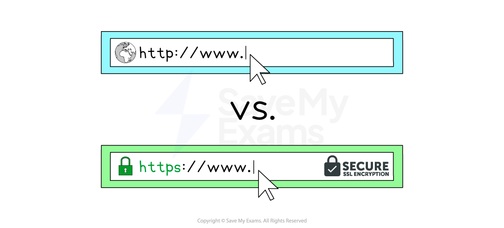

# Network Protocols

## HTTP & HTTPS

> **Spec point** — `spcpt_pDZ7J38NqCRp3C7G` · "3 Describe the purpose and operation of hypertext
transfer protocol (HTTP) and hypertext transfer
protocol secure (HTTPS)"

## HTTP & HTTPS

### What is HTTP & HTTPS?

> **Exam Hint**
> *Cambridge IGCSE 0478 expects you to explain the difference between HTTP and HTTPS, including the role of ****encryption**** in protecting sensitive data. This page covers only what you need to know to get the marks.*

- Hypertext Transfer Protocol (**HTTP**) allows communication between clients and servers for **website viewing**
- HTTP & HTTPS are **protocols**, a **set of rules** governing communication between devices on a network
- HTTP allows clients to **receive data** from the server (fetching a webpage) and **send data** to the server (submitting a form, uploading a file)
- **HTTPS **works in the same way as HTTP but with an **added layer of security**
- All data sent and received using HTTPS is **encrypted**
- HTTPS is used to **protect sensitive information **such as passwords, financial information and personal data

> **Exam Hint**
> *A common 2-mark question is:*
> 
> *“Describe one difference between HTTP and HTTPS.”*
> 
> *To get both marks, say:*
> 
> *“HTTPS encrypts the data being transmitted to keep it secure, unlike HTTP.”*
