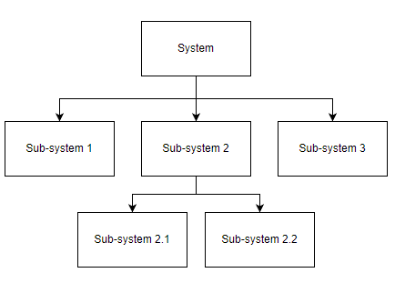
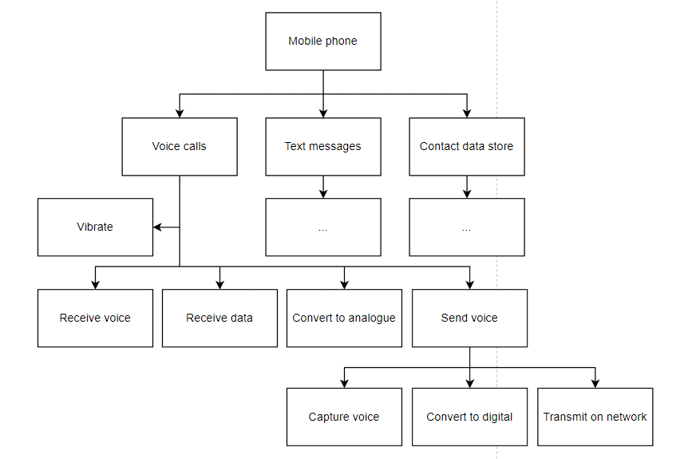
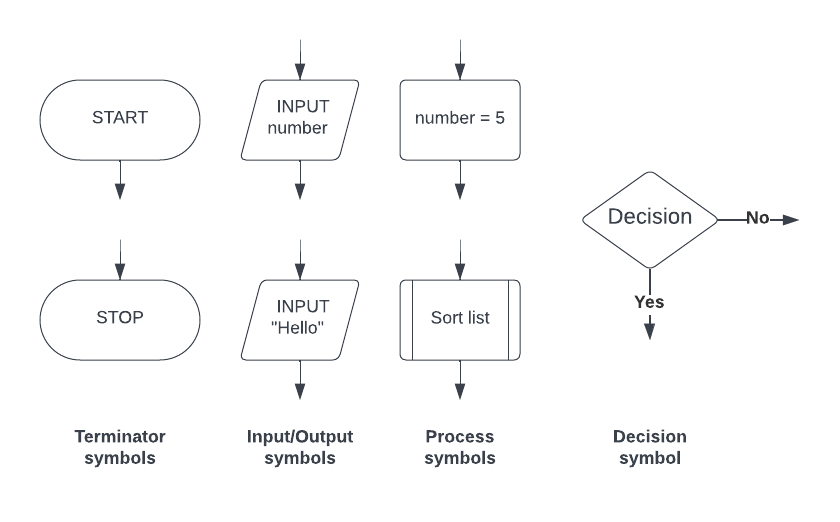

# Designing Algorithms

## What is an algorithm?

> **Exam Hint**
> *Cambridge IGCSE 0478 assesses your ability to ****understand****, ****write****, and ****interpret**** algorithms using ****pseudocode****, ****flowcharts****, and ****structured design****. This page gives examples in the format and style seen in Paper 2, focusing only on examinable methods.*

- An algorithm is** precise set of rules or instructions** to solve a specific problem or task
- There are three main ways to design an algorithm

  - **Structure diagrams**
  - **Flowchart**
  - **Pseudocode **

## Structure Diagrams

> **Spec point** — `spcpt_Mz7Hvgsg7KDrBTjT` · "c) Use different methods to design and
construct a solution to a problem"

## Structure Diagrams

#### What is a structure diagram?

- Structure diagrams **show hierarchical top-down design in a visual form**
- Each problem is divided into sub-problems and each sub-problem divided into further sub-problems
- At each level the problem is broken down into more detailed tasks that can be implemented using a single subroutine

- an example of a structure diagram for a mobile application  could be:

## Flowcharts

> **Spec point** — `spcpt_Pv7mbr5VHVpVjWzY` · "c) Use different methods to design and
construct a solution to a problem"

## Flowcharts

### What is a flowchart?

- Flowcharts are a **visual tool** that uses **shapes to represent different functions** to **describe an algorithm**
- Flowcharts show the data that is **input **and **output**, the **processes **that take place and any **decisions **or **repetition**
- Lines are used to show the **flow of control**

#### Example

| **Flowchart** |
|---|
|  |

- The casino would like the algorithm **refined **so that the user also** enters their first name** and this is used to **greet the user when they access the site**

| **Flowchart** |
|---|
|  |

## Pseudocode

> **Spec point** — `spcpt_ypRFKV9Mxf8yh3WY` · "c) Use different methods to design and
construct a solution to a problem"

## Pseudocode

### What is pseudocode?

- Pseudocode is a **text-based tool** that uses short **English words/statements** to **describe an algorithm**
- Pseudocode is **more structured** than writing sentences in English but is **very flexible**

#### Example

- A casino would like a program that asks users to **enter an age**, if they are 18 or over they can enter the site, if not then they are given a suitable message

| **Pseudocode** |
|---|
|   |

> **Exam Hint**
> *Pseudocode is ****not real code****—don’t use syntax like*` print()` *or* `input()` *with brackets. Stick to simple statements like:*
> 
> `INPUT Age`
> 
> `OUTPUT "Welcome"`
> 
> *Adding actual language syntax can lose you marks.*

- The casino would like the algorithm **refined **so that the user also** enters their first name** and this is used to greet the user when they access the site

| **Pseudocode** |
|---|
|   |

> **Exam Hint**
> *If the question asks you to write an algorithm, default to ****pseudocode****. Use ****flowcharts**** only when asked or when visual logic helps. Examiners reward clarity, not decoration.*
