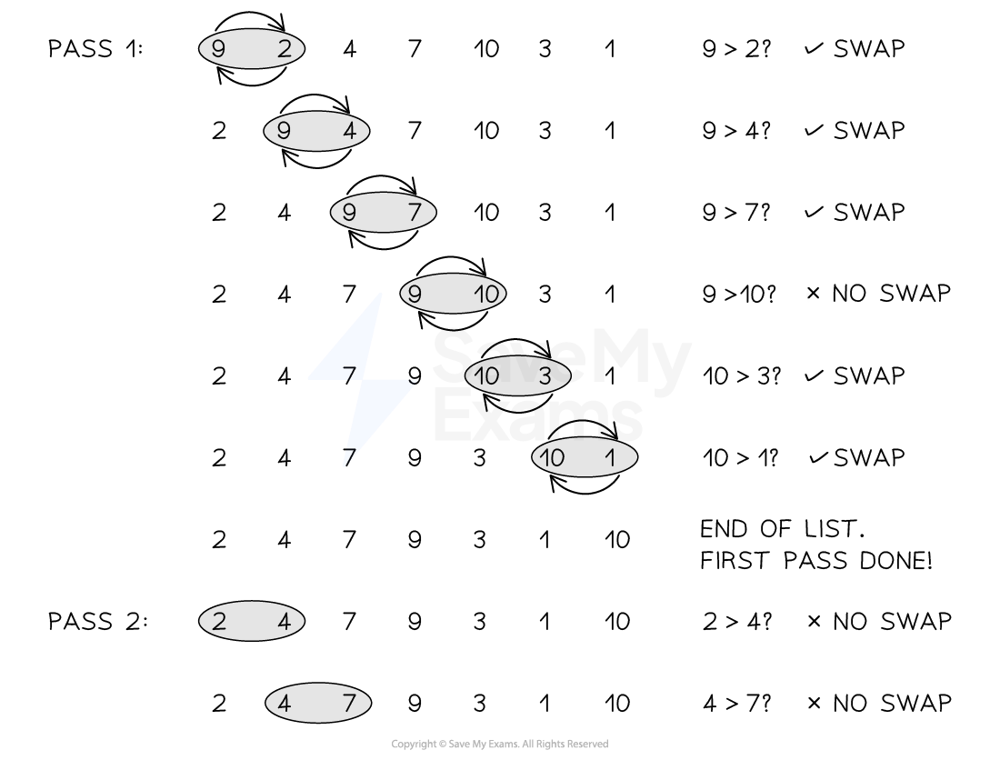

# Linear Search & Bubble Sort

## Linear Search

> **Spec point** — `spcpt_QCk9tMyQr3Hncd6J` · 4 Understand standard methods of solution 

## Linear Search

### What is a searching algorithm?

- Searching algorithms are **precise step-by-step instructions** that a computer can follow to **efficiently locate specific data** in massive datasets

### What is a linear search?

- A linear search **starts with the first value** in a dataset and** checks every value one at a time** until all values have been checked
- A linear search can be performed **even if the values are not in order**

### How do you perform a linear search?

| **Step** | **Instruction** |
|---|---|
| **1** | Check the first value |
| **2** | **IF **it is the value you are looking for  - STOP! |
| **3** | **ELSE **move to the next value and check |
| **4** | **REPEAT UNTIL **you have checked all values and not found the value you are looking for |

> **Exam Hint**
> You will not be asked to perform a linear search on a dataset in the exam, you will be expected to understand how to do it and know the advantages and disadvantages of performing it

| A linear search in Pseudocode |
|---|
|   |

| A linear search in Python code |
|---|
|   |

## Bubble Sort

> **Spec point** — `spcpt_cMDFWfmYfmSXjgBR` · 5 Understand standard methods of solution

## Bubble Sort

### What is a sorting algorithm?

- Sorting algorithms are **precise step-by-step instructions** that a computer can follow to **efficiently sort data** in massive datasets

### What is a bubble sort?

- A bubble sort is a simple sorting algorithm that starts at the beginning of a dataset and **checks values **in **'pairs'** and **swaps them **if they are** not in the correct order**
- One full run of comparisons from beginning to end is called a '**pass**', a bubble sort may require multiple '**passes**' to sort the dataset
- The algorithm is finished when there are **no more swaps to make**

### How do you perform a bubble sort?

| **Step** | **Instruction** |
|---|---|
| **1** | Compare the first two values in the dataset |
| **2** | **IF **they are in the wrong order...  - Swap them |
| **3** | Compare the next two values |
| **4** | **REPEAT **step 2 & 3 until you reach the end of the dataset (**pass 1**) |
| **5** | **IF **you have made any swaps...  - **REPEAT **from the start (pass 2,3,4...) |
| **6** | **ELSE **you have not made any swaps...  - STOP! the list is in the correct order |

#### Example

- Perform a bubble sort on the following dataset

| **5** | **2** | **4** | **1** | **6** | **3** |
|---|---|---|---|---|---|

| **Step** | **Instruction** |
|---|---|
| **1** | Compare the first two values in the dataset  \| **5** \| **2** \| **4** \| **1** \| **6** \| **3** \| \|---\|---\|---\|---\|---\|---\| |
| **2** | **IF **they are in the wrong order...  - Swap them  \| **2** \| **5** \| **4** \| **1** \| **6** \| **3** \| \|---\|---\|---\|---\|---\|---\| |
| **3** | Compare the next two values  \| **2** \| **5** \| **4** \| **1** \| **6** \| **3** \| \|---\|---\|---\|---\|---\|---\| |
| **4** | **REPEAT **step 2 & 3 until you reach the end of the dataset  - 5 & 4 SWAP!  \| **2** \| **4** \| **5** \| **1** \| **6** \| **3** \| \|---\|---\|---\|---\|---\|---\|  - 5 & 1 SWAP!  \| **2** \| **4** \| **1** \| **5** \| **6** \| **3** \| \|---\|---\|---\|---\|---\|---\|  - 5 & 6 NO SWAP!  \| **2** \| **4** \| **1** \| **5** \| **6** \| **3** \| \|---\|---\|---\|---\|---\|---\|  - 6 & 3 SWAP!  \| **2** \| **4** \| **1** \| **5** \| **3** \| **6** \| \|---\|---\|---\|---\|---\|---\|  - End of pass 1 |
| **5** | **IF **you have made any swaps...  - **REPEAT **from the start - End of pass 2 (swaps made)  \| **2** \| **1** \| **4** \| **3** \| **5** \| **6** \| \|---\|---\|---\|---\|---\|---\|  - End of pass 3 (swaps made)  \| **1** \| **2** \| **3** \| **4** \| **5** \| **6** \| \|---\|---\|---\|---\|---\|---\|  - End of pass 4 (no swaps)  \| **1** \| **2** \| **3** \| **4** \| **5** \| **6** \| \|---\|---\|---\|---\|---\|---\| |
| **6** | **ELSE **you have not made any swaps...  - STOP! the list is in the correct order |

> **Exam Hint**
> In the exam you do not have to show every swap that takes place in a bubble sort. You can show the outcome of a bubble sort at the end of each pass. If you have the outcome of each pass correct then a bubble sort has been implemented correctly and all marks will be given!

| A bubble sort in Pseudocode |
|---|
|   |

| A bubble sort in Python code |
|---|
|   |

> **Worked Example**
> A program uses a file to store a list of words.
> 
> A sample of this data is shown
> 
> | Milk | Eggs | Bananas | Cheese | Potatoes | Grapes |
> |---|---|---|---|---|---|
> 
> Show the stages of a bubble sort when applied to data shown  **[2]**
> 
> **How to answer this question**
> 
> - We need to sort the values in to **alphabetical order **from A-Z
> - You **CAN **use the first letter of each word to simplify the process
> 
> **Answer**
> 
> - E, B, C, M, G, P (pass 1)
> - B, C, E, G, M, P (pass 2)
