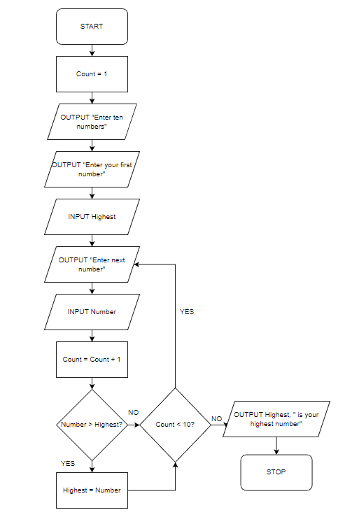

# Trace Tables

## Trace Tables

> **Spec point** — `spcpt_y9hvyjgdN6XfftMK` · "7 Complete a trace table to document a dry-run of
an algorithm"

## Trace Tables

### What is a trace table?

- A trace table is **used to test algorithms and programs for logic errors** that appear when an algorithm or program executes
- Trace tables can be used with **flowcharts, pseudocode **or **program code**
- A trace table can be used to:

  - **Discover the purpose of an algorithm **by showing output data and intermediary steps
  - **Record the state of the algorithm **at each step or iteration
- Each** stage of the algorithm is executed step by step**.
- Inputs, outputs, variables and processes can be **checked for the correct value **when the stage is completed

#### Trace table walkthrough

- Below is a flowchart to determine the **highest number of ten user-entered numbers**
- The algorithm prompts the user to enter the first number which automatically becomes the highest number entered
- The user is then prompted to enter nine more numbers.

  - If a new number is higher than an older number then it is replaced
- Once all ten numbers are entered, the algorithm outputs which number was the highest
- Example test data to be used is: **4, 3, 7, 1, 8, 3, 6, 9, 12, 10**

| **Trace table: Highest number** |   |   |   |
|---|---|---|---|
| **Count** | **Highest** | **Number** | **Output** |
| 1 |   |   | Enter ten numbers |
|   | 4 |   | Enter your first number |
| 2 |   | 3 | Enter your next number |
| 3 | 7 | 7 |   |
| 4 |   | 1 |   |
| 5 | 8 | 8 |   |
| 6 |   | 3 |   |
| 7 |   | 6 |   |
| 8 | 9 | 9 |   |
| 9 | 12 | 12 |   |
| 10 |   | 10 | 12 is your highest number |

> **Worked Example**
> The flowchart represents an algorithm. The algorithm will terminate if –1 is entered.
> 
> 
> 
> Complete the trace table for the input data: 50, 75, 99, 28, 82, 150, –1, 672, 80
> 
> **[4]**
> 
> | Value | Diff1 | Diff2 | Output |
> |---|---|---|---|
> |   |   |   |   |
> |   |   |   |   |
> 
> **Answer**
> 
> **Final answer:** **[1] for each correct column**
> 
> | Value | Diff1 | Diff2 | Output |
> |---|---|---|---|
> | 50 | 50 | 0 | Accept: Extreme |
> | 75 | 25 | 25 | Accept: Normal |
> | 99 | 1 | 49 | Accept: Normal |
> | 28 |   |   | Reject: Abnormal |
> | 82 | 18 | 32 | Accept: Normal |
> | 150 |   |   | Reject: Abnormal |
> | -1 |   |   |   |
