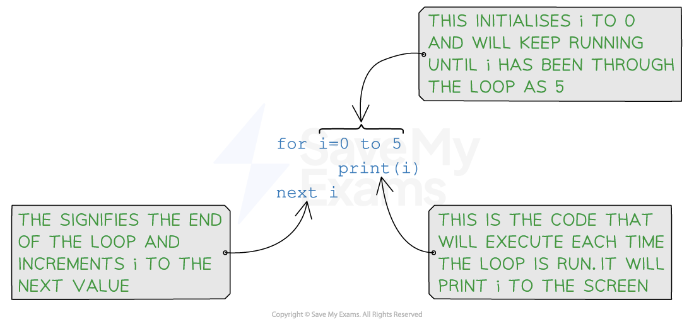
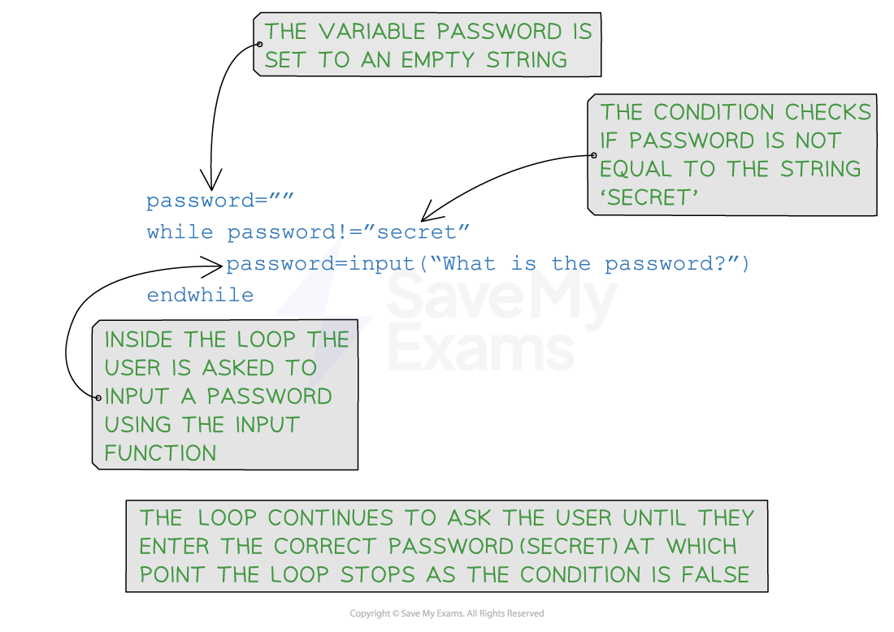

# Iteration

## What is iteration?

- Iteration is **repeating a line or a block of code **using a loop
- Iteration can be:

  - **Count controlled**
  - **Condition controlled**
  - **Nested**

## Count Controlled Loops

> **Spec point** — `spcpt_Pzfy6FxvnkNtGc87` · "c) Understand and use the concept of iteration
5 Understand and use nested statements"

## Count Controlled Loops

### What is a count controlled loop?

- A count controlled loop is when the code is repeated **a fixed number of times** (e.g. using a for loop)
- A count controlled loop can be written as: **FOR <identifier> ← <value1> TO <value2>** **    <statements>** **NEXT <identifier>**
- Identifiers must be an **integer data type**
- It uses a counter variable that is ***incremented*** or ***decremented*** after each iteration
- This can be written as: **FOR <identifier> ← <value1> TO <value2> STEP <increment>** **     <statements>** **NEXT <identifier>**
- A detailed look at a Python **FOR** statement:

#### Examples

| Iteration | Pseudocode | Python |
|---|---|---|
| Count controlled |   |   |
| **This will print the word "Hello" 10 times** |   |   |
|   |   |   |
| **This will print the even numbers from 2 to 10 inclusive** |   |   |
|   |   |   |
| **This will print the numbers from 10 to 0 inclusive** |   |   |

## Condition Controlled Loops

> **Spec point** — `spcpt_8vnmkB6kpk8T39Fv` · "c) Understand and use the concept of iteration
5 Understand and use nested statements"

## Condition Controlled Loops

### What is a condition controlled loop?

- A condition controlled loop is when the code is repeated **until a condition is met**
- There are two types of condition controlled loops:

  - **Post-condition (REPEAT)**
  - **Pre-condition (WHILE)**

#### Post-condition loops (REPEAT)

- A post-condition loop** is executed at least once**
- The condition must be an **expression **that evaluates to a **Boolean **(True/False)
- The condition is tested** after the statements are executed** and only stops once the condition is evaluated to True
- It can be written as: **REPEAT**
**    <statement>**
**UNTIL <condition>**

| Iteration | Pseudocode | Python |
|---|---|---|
| Post-condition |   | > *# NOT USED IN PYTHON* |
|   | > *# NOT USED IN PYTHON* |   |

#### Pre-condition loops (WHILE)

- The condition must be an **expression **that evaluates to a **Boolean **(True/False)
- The condition is tested and statements are **only executed if the condition evaluates to True**
- After statements have been executed the condition is **tested again**
- The loop ends when the condition **evaluates to False**
- It can be written as: **WHILE <condition> DO**
**    <statements>**
**ENDWHILE**
- A detailed look at a Python **WHILE** statement:

| Iteration | Pseudocode | Python |
|---|---|---|
| Pre-condition |   |   |
|   |   |   |

## Nested Iteration

> **Spec point** — `spcpt_m6m2FP8S8V8wKktK` · "c) Understand and use the concept of iteration
5 Understand and use nested statements"

## Nested Iteration

### What is nested iteration?

- Nested iteration is **a loop within a loop**, e.g. a FOR inside of another FOR
- Nested means to be '**stored inside the other**'

#### Example

| **Pseudocode** |
|---|
|   |

| **Python** |
|---|
|   |
