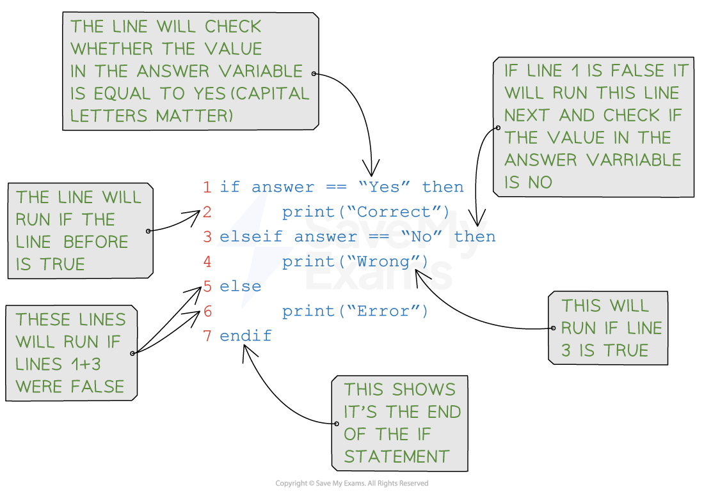

# Selection

## What is Selection?

- Selection is when the **flow of a program is changed, **depending on a** set of conditions**
- The outcome of this condition will then determine **which lines or block of code is run next**
- Selection is used for **validation**, **calculation** and making sense of a **user's choices**
- There are two ways to write selection statements:

  - **if**... **then**... **else**...
  - **case**...

## If Statements

> **Spec point** — `spcpt_FjbbKcgMnfMzFZ9x` · "(b) Understand and use the concept of selection
5 Understand and use nested statements"

## If Statements

### What is an If statement?

- As If statements allow you to execute a set of instructions if a condition is true
- They have the following syntax: **IF <condition>**
**    THEN**
**        <statement>**
**ENDIF**
- A detailed look at a Python IF statement:

#### Example

| **Concept** | **Pseudocode** | **Python** |
|---|---|---|
| IF-THEN-ELSE |   |   |

## Nested Selection

> **Spec point** — `spcpt_N3NGgT44vjrwh28J` · "(b) Understand and use the concept of selection
5 Understand and use nested statements"

## Nested Selection

### What is nested selection?

- Nested selection is **a selection statement within a selection statement**, e.g. an If inside of another If
- Nested means to be '**stored inside the other**'

#### Example

| **Pseudocode** |
|---|
|   |

| **Python** |
|---|
|   |

## Case Statements

> **Spec point** — `spcpt_zR626RjhYn5znqyX` · "(b) Understand and use the concept of selection
5 Understand and use nested statements"

## Case Statements

#### What is a case statement?

- A  case statement **can mean less code** but it only useful when comparing **multiple values of the same variable**
- **If **statements are **more flexible** and are generally used more in languages such as Python
- The format of a CASE statement is: **CASE OF <identifier>**
**    <value 1> : <statement>**
**    <value 2>: <statement>**
**    ....**
**    OTHERWISE <statement>**
**ENDCASE**

| Concept | Pseudocode | Python |
|---|---|---|
| CASE |   |   |

> **Exam Hint**
> - Make sure to include all necessary components in the selection statement:
> 
>   - the condition,
>   - the statement(s) to execute when the condition is true
>   - any optional statements to execute when the condition is false
> - Use proper indentation to make the code easier to read and understand
> - Be careful with the syntax of the programming language being used, as it may differ slightly between languages
> - Make sure to test the selection statement with various input values to ensure that it works as expected

> **Worked Example**
> Write an algorithm using pseudocode that:
> 
> - Inputs 3 numbers
> - Outputs the largest of the three numbers
> 
> **[3]**
> 
> **Exemplar answer**
> 
> | **Pseudocode** |
> |---|
> |   |
> 
> | Python |
> |---|
> |   |
