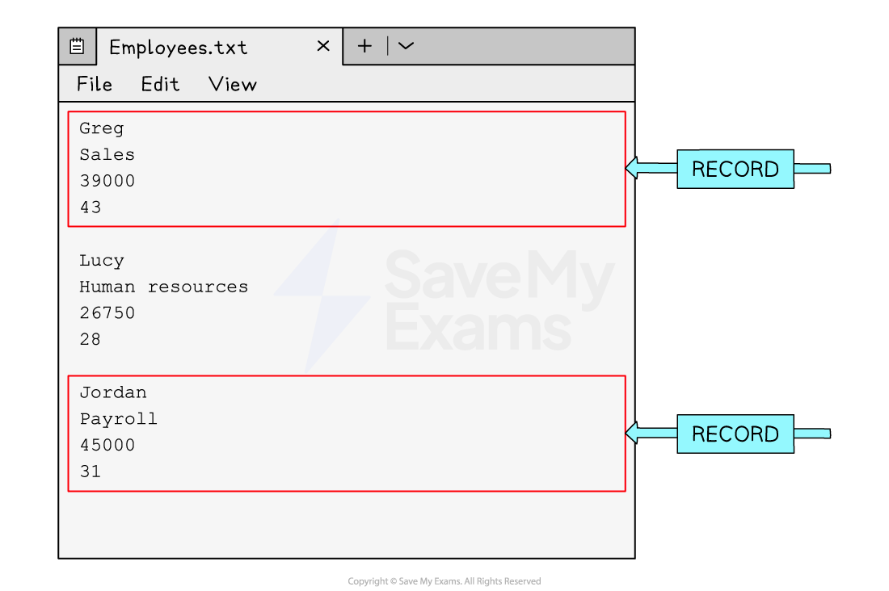

# Single Table Databases

### What is a database?

- A** Database **is an organised collection of data
- A database is made up of either **one or multiple tables** which are made up of **fields **and **records **to organise how it stores data
- It allows **easy storage, retrieval, and management** of information
- A database is useful when working with l**arge amounts of data**, databases are stored on **secondary storage**
- A database is often stored on remote servers so **multiple users** can access it at the same time, useful for online systems
- Data can be **sorted and searched efficiently**, making use of more advanced structures
- They are** more secure** than text files

## Fields & Records

> **Spec point** — `spcpt_3hpC7gNs8YZ6t7kd` · "1 Define a single-table database from given data
storage requirements"

## Fields & records

### What are fields & records?

- A field is** one piece** of information relating to one person, item or object
- A field is represented in a database by a **column**,
- A record is a **collection of fields** relating to one person, item or object
- A record is represented in a database by a **row**

### Text files

- A text file is useful when working with **small amounts of data**, text files are stored on s**econdary storage** and 'read' into a program when being used
- They are used to store information **when the application is closed**
- Each entry is stored on a new line or separated with a special identifier, for example, a comma (',')
- It can be difficult in text files to know where a record begins and ends

## Validation

> **Spec point** — `spcpt_pSBSvFNDkZT5RKdY` · "1 Define a single-table database from given data
storage requirements"

## Validation

- When a table is created, **validation rules** can be assigned to the different fields

  - A validation rule **controls what data** can be entered into that field
  - There are different types of validation checks used to limit what data can be entered into each field
  - The validation checks that are used are the same as those that appear in section 7: Algorithm Design & Problem-Solving

| **Type** | **Description** |
|---|---|
| **Length Check** | This type of validation checks the number of ***characters*** that have been entered into a field. For example, you might make phone numbers entered have to be eleven characters long |
| **Format Check** | This type of validation checks data entered meets an exact format. For example, a product code might have to be two letters followed by five numbers |
| **Range Check** | A range check will check the number entered is within a specific range. For example, the age of a dog would be between 0 - 40. Any other number would be disallowed |
| **Presence Check** | A presence check can be added to fields which cannot be left blank |
| **Type Check** | A type check will allow data with a specific data type to be entered into a field. For example, if text was entered into a field which is supposed to contain the date of birth of a person it would not be allowed |
| **Check Digits** | Check digit validation is a process used to verify the accuracy of numbers such as credit card numbers. A check digit is a single digit added to the end of the number, which is calculated based on a specific algorithm applied to the other digits in the number. When the data is re-entered the same algorithm can be applied, and if it produces a different result the code is incorrect |

> **Exam Hint**
> You will likely be presented with an example database table and identify either how many fields there are or how many records there are so make sure you remember a record is a row and a field is a column.

> **Worked Example**
> **A Database Table Containing Student Grades**
> 
> | **StudentID** | **FirstName** | **LastName** | **MarkSubmitted** | **Percentage** |
> |---|---|---|---|---|
> | 1483792 | Shanay | Giles | Y | 55 |
> | 1498378 | Poppy | Petit | N | 20 |
> | 1500121 | Diya | Dinesh | Y | 74 |
> | 1382972 | Joe | Swaile | Y | 68 |
> | 1598264 | Anton | Smith | Y | 34 |
> | 1548282 | Felicity | Hall | N | 47 |
> 
> Describe **two validation checks** that could be used to check data being inputted into the table above [**4**]
> 
> How to answer this question
> This
> 
> **Final answer:** **Answer**
> 
> StudentID could have a **length check** to ensure 7 characters are entered** [2]**
> 
> FirstName and LastName could have a **presence check** to make a record cannot be entered without entering the name of the student** [2]**
> 
> A **type check** of boolean could be applied to the Mark Submitted field so that only Y or N are entered** [2]**
> 
> A **range check** could be assigned to the Mark column to ensure only numbers between 0 and 100 are entered** [2]**

## Data types

> **Spec point** — `spcpt_7JRKzsBqqdfPqf5t` · 2 Suggest suitable basic data types 

## Data types

### What is a data type?

- A data type is the **type of data** that can be held **in a field** and is defined when designing a table
- Examples of common datatypes are:

  - **Integer **- whole number
  - **Real **- decimal number
  - **Text/alphanumeric **- text data
  - **Character **- single
  - **Date/Time **
  - **Boolean **- true or false values
- In the table ***cars*** below, the following datatypes would be used:

  - **car_id**: integer
  - **make**: text/alphanumeric
  - **model**: text/alphanumeric
  - **colour**: text/alphanumeric
  - **price**: real

***cars***

| **car_id** | **make** | **model** | **colour** | **price** |
|---|---|---|---|---|
| 1 | Peugeot | 2008 | Red | 24950 |
| 2 | Mazda | MX5 | Blue | 17995 |
| 3 | Citroen | DS4 | Black | 21450 |
| 4 | Ford | Puma | White | 19500 |
