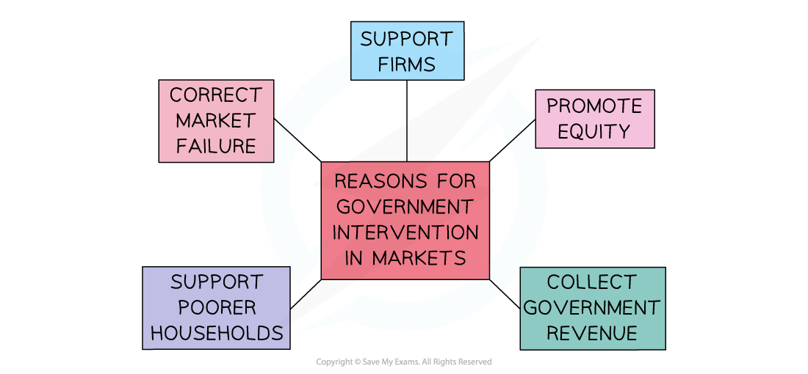

# Characteristics of a Mixed Economic System

## Characteristics of a Mixed Economic System

> **Spec point** — `spcpt_FXgTkWhXK5VJkYGM` · Definition of the mixed economic system

## Characteristics of a Mixed Economic System

- Any economic system needs to decide how to answer the **three fundamental economic questions **(see: [2.2.1 The (Free) Market System](https://www.savemyexams.com/igcse/economics/cie/20/revision-notes/2-the-allocation-of-resources/2-11-mixed-economic-system/2-11-1-characteristics-of-a-mixed-economic-system/))

  - **What to produce?** More weapons for the military or more schools to educate the children?
  - **Who to produce for?** Only those who can afford to pay for it? Or for everyone in society?
  - **How to produce it?** Should more labour be used or should the economy focus on using technology instead?
- A **mixed economic system** is a blend of a market and planned economy

  - Individuals, firms and the government **own factors of production** and distribute goods/services
  - In reality, almost every country in the world operates as a **mixed economic system**
  - Some countries have more **government intervention** than others e.g. China has more intervention than the USA
  - The higher the level of **government intervention**, the more the economy will lean towards operating like a ***planned economy***

- **Governments intervention** is necessary for several reasons

*A diagram showing several reasons for government intervention in mixed economic systems  *

- **To correct market failure:** in many markets there is a **less than optimal allocation** of resources from society's point of view

  - In maximising their self-interest, firms and individuals **will not self-correct** this misallocation of resources and there is a role for the government
  - Governments often achieve this by **influencing** the level of **production or consumption  **
- **Earn government revenue**: governments need money to provide **essential services, public and merit goods**

  - Revenue is raised through intervention such as taxation, ***privatisation***, sale of licenses (e.g. 5G licenses), and the sale of goods/services
- **Promote equity:** to reduce the opportunity gap between the rich and poor
- **Support firms:** in a global economy, governments choose to **support key industries** so as to help them remain competitive
- **Support poorer households:** poverty has multiple impacts on both the individual and the economy

  - Intervention seeks to **redistribute income** (tax the rich and give to the poor) so as to reduce the impact of poverty

- As we have seen in [2.10.3 Government Intervention to Address Market Failure](https://www.savemyexams.com/igcse/economics/cie/20/revision-notes/2-the-allocation-of-resources/2-10-market-failure/2-10-3-government-intervention-to-address-market-failure/), four of the most commonly used methods to intervene in markets are **indirect taxation**, **subsidies**, **maximum prices**, and **minimum prices  **
- Additional methods of intervention include regulation, ***nationalisation***, ***privatisation***, and the State provision of public goods
