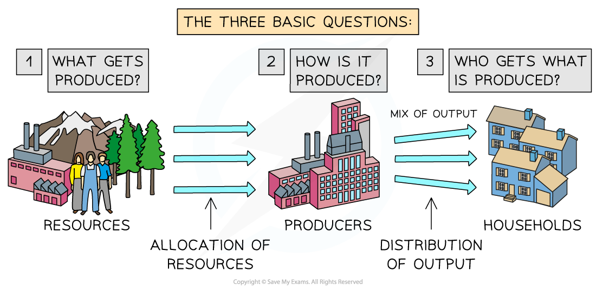

# The (Free) Market System

## Different Economic Systems

> **Spec point** — `spcpt_W2bDp2cDrcNKSqKT` · Establishing that the economic problem creates three key questions about determining resource allocation – what to produce, how, and for whom.

## Different Economic Systems

- In order to solve the basic economic problem of **scarcity**, economic systems emerge or are created by different economic agents within the economy

  - These agents include **consumers, producers, the government, and special interest groups** (e.g. environmental pressure groups or trade unions)
  - Any economic system aims to allocate the **scarce factors of production**
- The three main economic systems are a **(free) market system**, ***mixed economy***, and ***planned economy***

### What determines the economic system of a country?

*How the three questions are answered determines the economic system of a country*

- Economic decisions need to be made to answer **three important questions**

1. **What to produce?** 
As resources are limited in supply, decisions carry an opportunity cost. Which goods/services should be produced? e.g. better rail services or more public hospitals?
2. **How to produce it? **
Would it be better for the economy to have labour-intensive production so that more people are employed, or should goods/services be produced using machinery?
3. **For whom are the goods and services to be produced? **
Should goods/services only be made available to those who can afford them, or should they be freely available to all?

**How These Questions Are Answered Determines the Economic System**

| **Type of System** | **What to Produce?** | ** How to Produce?** | **For Whom?** |
|---|---|---|---|
| **Market system** | - Demand and supply ***(the price mechanism)*** | - Most efficient, profitable way possible | - Those who can afford it |
| **Mixed system** | - Demand, supply and the Government | - Some efficiency but also a focus on welfare/well-being | - Those who can afford it, plus some provision to those who cannot afford it |
| **Planned system** | - The Government | - Ensure everyone has a job | - Everyone |

## How a Market System Works

> **Spec point** — `spcpt_yqNr8ZVZP4qrfPKd` · How a market system works; including buyers, sellers, allocation of scarce  resources, .
How the price mechanism provides answers to these key allocation questions.

## How a Market System Works

- A market system works to allocate scarce resources efficiently, purely through the forces of demand and supply **(the price mechanism)**

  - There is no **government intervention** in a pure market system (no taxes or government spending)
  - In reality, there is no economy which is a pure market system** **
- In a **market system**, prices for goods and services are determined by the **interaction of demand and supply**

  - A **market **is any place that brings **buyers** and **sellers** together
  - Markets can be **physical** (e.g. McDonald's) or **virtual** (e.g. eBay)** **
- **The price mechanism is the interaction of demand and supply in a free market**

  - This interaction **determines prices,** which are the means by which **scarce resources are allocated** between competing wants/needs
- The price mechanism fulfils **several functions** in an economy:

  - Prices allocate (ration) scarce resources
  
    - When resources become** scarcer** the price will **rise** further. Only those who can afford to pay for them will receive them
    - If there is a **surplus,** then **prices fall** and more consumers can afford them
  - Prices** **provide information to producers and consumers where resources are required (in markets where prices increase) and where they are not (in markets where prices fall)
  - When prices for a good/service rise, it **incentivises producers** to reallocate resources from a less profitable market to this market in order to **maximise their profits**
  
    - Falling prices **incentivise reallocation** of resources to new markets

## Market Equilibrium and Disequilibrium

> **Spec point** — `spcpt_WkP9hkTns4nRYYRJ` · Market equilibrium, and market disequilibrium

## Market Equilibrium and Disequilibrium

- Equilibrium in a market occurs when **demand = supply**
- At this point, the price is called the **market clearing price**

  - This is the **price** at which sellers are clearing their stock **at an acceptable rate**

*A graph showing a market in equilibrium with a market clearing price at P and quantity at Q*

- Any price **above or below** P creates **disequilibrium **in this market

  - Disequilibrium occurs whenever there is **excess demand** or **supply** in a market
