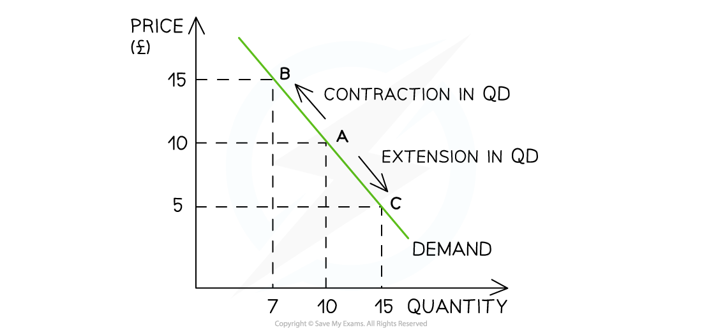

# Demand, Price & Quantity

## Introduction to Demand

> **Spec point** — `spcpt_FtjwQKmpHqn6F65m` · Definition, drawing and interpretation of appropriate
diagrams.
The link between individual and market demand in terms of aggregation.

## Introduction to Demand

- **Demand** **is the amount of a good/service that a consumer is willing and able to purchase at a given price in a given time period**

  - If a consumer is willing to purchase a good, but cannot afford to, it is not **effective demand**
- A **demand curve** is a graphical representation of the **price** **and** **quantity demanded (QD)** by consumers

  - If data were plotted, it would be an **actual curve.  **Economists, however, use straight lines so as to make analysis easier

### Individual and market demand

- **Market demand** is the combination of all the **individual demand** for a good/service

  - It is calculated by adding up the individual demand at each price level

**The Monthly Market Demand for Newspapers in a Small Village**

| **Customer 1** | **Customer 2** | **Customer 3** | **Customer 4** | **Market Demand** |
|---|---|---|---|---|
| 30 | 15 | 4 | 4 | **53** |

- **Individual and market demand** can also be represented graphically 

*Market demand for children's swimwear in July is the combination of boys and girls demand*

#### Diagram analysis

- A shop sells both boys and girls swimwear
- In July, at a price of \$10, the demand for boys swimwear is 500 units and girls is 400 units
- At a price of \$10, the shops **market demand** during July is 900 units

## Movements Along a Demand Curve

> **Spec point** — `spcpt_Gv3wQKWJ9DZm77Cd` · A demand curve to be drawn and used to illustrate movements along a demand curve with appropriate terminology, for example extensions and contractions in demand.

## Movements Along a Demand Curve

- If **price** is the only factor that changes (***ceteris paribus***), there will be a change in the quantity demanded **(QD)**

  - This change is shown by a **movement along the demand curve**

*A demand curve showing a contraction in quantity demanded (QD) as prices increase and an extension in quantity demanded (QD) as prices decrease*

### Diagram analysis

- An **increase** in price from £10 to £15 leads to a movement **up** the demand curve from point A to B

  - Due to the **increase** in price, the QD has** fallen** from 10 to 7 units
  - This movement is called a **contraction** in QD
- A **decrease **in price from £10 to £5 leads to a movement **down** the demand curve from point A to point C

  - Due to the **decrease** in price, the QD has **increased** from 10 to 15 units
  - This movement is called an **extension** in QD
- The **law of demand **captures this fundamental relationship between price and QD

  - It states that **there is an inverse relationship between price and QD**
  
    - When the price rises the QD falls
    - When prices fall the QD rises
