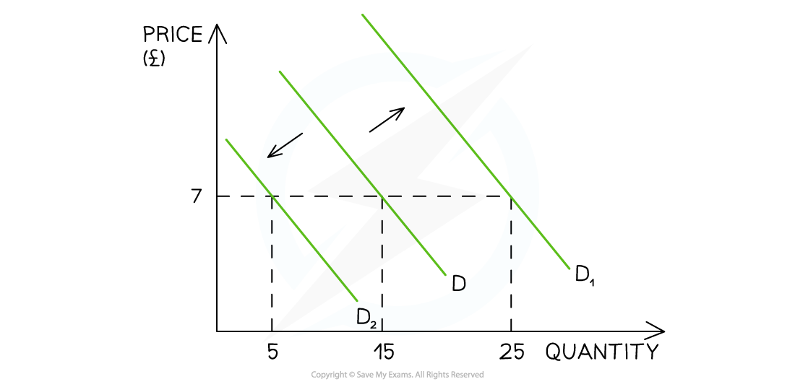

# Conditions of Demand

## Shifts of the Demand Curve

> **Spec point** — `spcpt_4bpTWFwBsDc8WBtb` · A demand curve to be drawn and used to illustrate movements along a demand curve with appropriate terminology, for example extensions and contractions in demand.

## Shifts of the Demand Curve

- There are numerous factors that will **change the demand **for a good/service, **irrespective of the price level**

  - Collectively, these factors are called the **conditions of demand**
- Changes to each of the conditions of demand, **shift the entire demand curve** (as opposed to a movement along the demand curve)

*A graph that shows how changes to any of the conditions of demand shifts the entire demand curve left or right, irrespective of the price level*

- For example, if a firm **increases** their **Instagram advertising**, there will be an** increase in demand** as more consumers become aware of the product

  - This is a **shift in demand **from D to D1
  
    - The price remains unchanged at £7 but the **demand has increased** from 15 to 25 units

**How Each of the Conditions of Demand Shifts the Entire Demand Curve**

| A Change in Real Income |   |
|---|---|
| - ***Real Income*** determines how many goods/services can be enjoyed by consumers - There is a **direct** relationship between income and demand for **goods and services** | - **Income increases**    - D Increases        - Shifts right     - (D→D1) - **Income decreases**    - D Decreases        - Shifts left     - (D→D2) |
| **A Change in Tastes and Fashion** |   |
| - If goods and services become more fashionable, then demand for them increases - There is a **direct relationship** between changes in taste/fashion and demand | - **Good becomes more fashionable**    - D Increases        - Shifts right     - (D→D1) - **Good becomes less fashionable**    - D Decreases        - Shifts left     - (D→D2) |
| **Improved Advertising and Branding** |   |
| - If more money is spent on **advertising **or **branding**, then demand for goods and services will increase as more consumers become aware of the product - There is a **direct** relationship between **branding or advertising** **and demand** | - **Advertising increases**    - D Increases        - Shifts Right     - (D→D1) - **Advertising decreases**    - D Decreases        - Shifts left     - (D→D2) |
| **Changes in the Prices of Substitute Goods** |   |
| - Changes in the price of ***substitute goods*** will influence the demand for a product/service - There is a **direct relationship** between the **price of good A** **and** **demand for good B** - For example, the price of a Sony 60" TV increases so the **demand** for LG 60" TV increases | - **Price of Good A increases**    - D for Good B increases        - Shifts Right     - (D→D1) - **Price of Good A decreases**    - D for Good B decreases        - Shifts left     - (D→D2) |
| **Changes in the Prices of Complementary goods** |   |
| - Changes in the price of ***complementary goods*** will influence the demand for a product/service - There is an **inverse relationship** between the **price of good A** **and demand for good B** - E.g. The price of printer ink increases so the **demand** for ink printers decreases | - **Price of Good A increases**    - D for Good B decreases        - Shifts left     - (D→D2) - **Price of Good A decreases**    - D for Good B increases        - Shifts right     - (D→D1) |
| **Changes in Population Size or Distribution** |   |
| - If the **population size** of a country changes over time, then the **demand** for goods/services will also change - There is a **direct relationship** between the changes in population size and demand - Demand will also change if there is a change to the **age distribution** in a country, as different ages **demand different goods and services **E.g. An ageing population will buy more hearing aids | - **Population Increases**    - D Increases   Shifts Right   (D→D1) - **Population Decreases**    - D Decreases   Shifts Left   (D→D2) |

> **Exam Hint**
> The difference between a **movement along the demand curve** and a **shift in demand** is essential to understand. You will be repeatedly examined on this and it is important that you use the **correct language** to show that you understand the difference between **a change in quantity demanded** and a **change in demand.**
> 
> When **price changes** (ceteris paribus), there is a movement along the demand curve resulting in a change to **quantity demanded**. When a **condition of demand changes,** there is a shift of the entire demand curve resulting in a **change to demand.**
