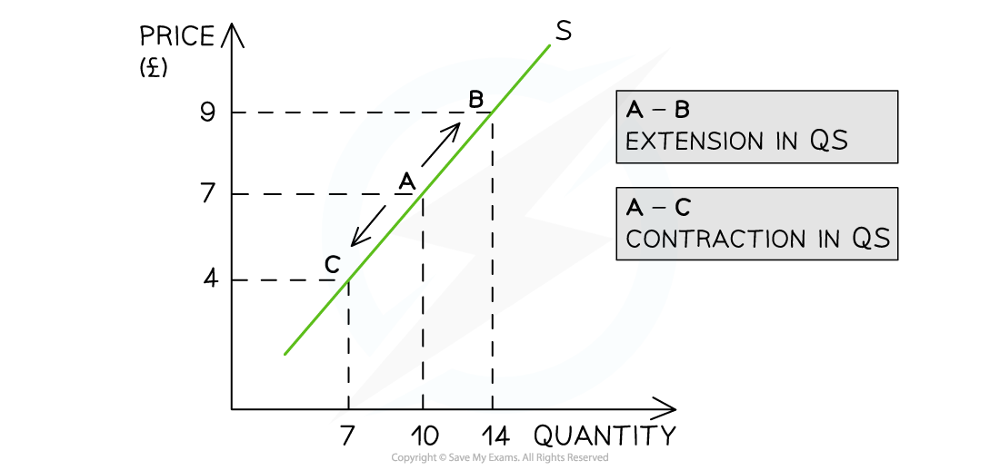

# Supply, Price & Quantity

## Introduction to Supply

> **Spec point** — `spcpt_W2VqjcTDjpfP4pSF` · Definition, drawing and interpretation of appropriate diagrams.
The link between individual and market supply in terms of aggregation

## Introduction to Supply

- **Supply** **is the amount of a good/service that a producer is willing and able to supply at a given price in a given time period**
- A **supply curve** is a graphical representation of the **price** and **quantity supplied** by producers

  - If data were plotted, it would be an actual curve. Economists, however, use straight lines so as to make analysis easier
- The supply curve is **sloping upward **as there is a **positive relationship** between the price and quantity supplied

  - Rational **profit maximising producers** would want to supply more as prices increase in order to **maximise** their profits

### Individual and market supply

- **Market supply** is the combination of all the **individual supply** for a good/service

  - It is calculated by adding up the individual supply at each price level

**The Monthly Market Supply of Bread From 4 Bakeries in a Small Town**

| **Bakery 1** | **Bakery 2** | **Bakery 3** | **Bakery 4** | **Market Supply** |
|---|---|---|---|---|
| 300 | 600 | 180 | 320 | **1400 loaves** |

- **Individual and market supply** can also be represented graphically 

*Market supply for smart phones in December is predominantly the combination of iPhone and Samsung supply*

#### Diagram analysis

- In New York City, the market supply for smart phones in December is predominantly the combination of iPhone and Samsung supply
- **At a price of \$1000,** the supply of iPhones is 300 units and the supply of Samsung phones is 320 units
- At a price of \$1,000, the **market supply **of smart phones in New York City during December is 620 units

## Movements Along a Supply Curve

> **Spec point** — `spcpt_kNSpHbrHGdzp6TXp` · A supply curve to be drawn and used to illustrate movements along a supply curve with appropriate terminology, for example extensions and contractions in supply.

## Movements Along a Supply Curve

- If **price** is the only factor that changes (***ceteris paribus***), there will be a change in the **quantity supplied (QS)**

  - This change is shown by a **movement along the supply curve**

*A supply curve showing an extension in quantity supplied (QS) as prices increase and a contraction in quantity supplied (QS) as prices decrease*

### Diagram analysis

- An **increase** in price from £7 to £9 leads to a **movement** **up** the supply curve from point A to B

  - Due to the **increase** in price, the quantity supplied has** increased** from 10 to 14 units
  - This movement is called an **extension in QS **
- A **decrease **in price from £7 to £4 leads to a **movement down** the supply curve from point A to C

  - Due to the **decrease** in price, the quantity supplied has **decreased** from 10 to 7 units
  - This movement is called a **contraction in QS**
