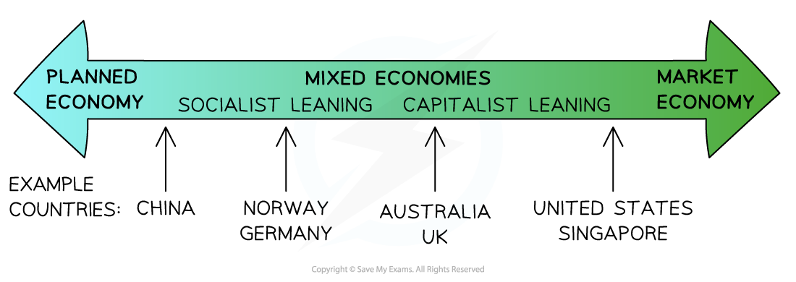

# The (Free) Market System

## Definition and Characteristics

> **Spec point** — `spcpt_sGmH2zQZv9mkpNyG` · Definition of market economic system. Including examples of how it works in a variety of different countries.

## Definition and Characteristics

- A **market economy **is an economy that has **no government intervention** in the allocation of resources and distribution of goods/services

  - This is also called a **free market economy**
  - There is no purely free market economy in the world but some countries have **less government intervention** than others
- An economy can be considered to be a market, ***mixed*** or ***planned*** economy

  - The type of economy is determined by how the **three economic questions** are answered (see: [2.2.1 The (Free) Market System](https://www.savemyexams.com/igcse/economics/cie/20/revision-notes/2-the-allocation-of-resources/2-2-the-role-of-markets-in-allocating-resources/2-2-1-the-free-market-system/)).
  - This ultimately determines the **amount of government intervention** in an economy

*The spectrum of economic systems and where certain economies fall based on the degree of government intervention*

- North Korea is a planned economy
- The United States, Japan and Singapore are mixed economies but have less government intervention than Norway, Germany or China **Characteristics of a Market System**

| **Characteristic** | **Explanation** |
|---|---|
| **Property Ownership** | - Individuals have the right to **purchase the factors of production** |
| **Freedom of Choice** | - **Individuals** are free to start their own business - **Firms** are free to decide what they are going to produce, how, and for whom - **Workers** are free to decide who they are going to work for - **Consumers **decided what goods/services best meet their wants/needs |
| **Self Interest** | - Entrepreneurs maximise **profits** - Workers maximise **wages** - Consumers maximise their well-being/satisfaction |
| **Limited Government Intervention** | - A pure market economy has no government intervention - Most free market economies have a **low level of intervention,** usually in the form of taxation, provision of defence, healthcare and education |
| **Price Mechanism** | - Changes in prices **allocate scarce resources** - Rising prices indicate a **shortage** of resources and falling prices indicate a **surplus** of resources |

## Advantages and Disadvantages of a Market System

> **Spec point** — `spcpt_ZTmcBF5XDSdjRGms`

## Advantages and Disadvantages of a Market System

- Each **economic system** has numerous advantages and disadvantages

**The Advantages and Disadvantages of Market Economies**

| **Advantages** | **Disadvantages** |
|---|---|
| - Profit incentive **motivates** people **to work** or develop entrepreneurial ideas - **Greater variety** of goods/services - Competition leads to **better quality** of goods/services - Competition leads to **lower prices** of goods/services - Competition encourages **innovation** and product development - Profits, income and wealth are unlimited resulting in **better standards of living** - More **efficient** use of scarce resources | - **Wealth** gets concentrated in the hands of the few as they are able to keep **buying up** the scarce factors of production - This **increases inequality** such that the gap between the rich and the poor continues to grow - Sometimes **product quality falls** as firms lower quality standards in order to **increase profits** - Workers get **exploited** - **Resource depletion** and **environmental degradation** are often ignored - **Monopolies** develop as firms **increase market power **through mergers and acquisitions - This leads to **exploitation** of consumers and supply chains |

> **Exam Hint**
> **Multiple choice questions** often explore your understanding of the different characteristics of market and mixed economic systems.
> 
> When answering **structured questions** that ask you to **discuss/explain** the difference between two systems, ensure that the disadvantages of one system are **not always just the opposite points** to the advantages of the other system. Develop some unique points for each system.
