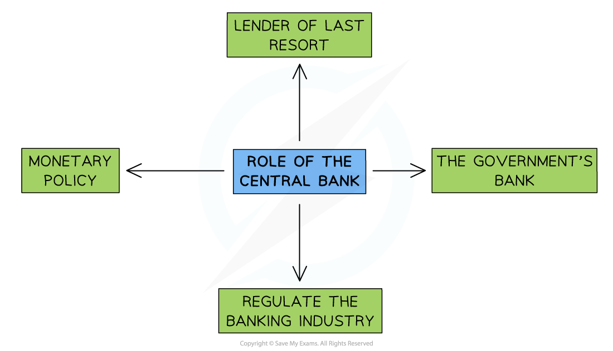

# Central & Commercial Banks

## The Functions of Central Banks

> **Spec point** — `spcpt_3q6c2bHRXRPvk9zF` · The role and importance of central banks and commercial banks for government, producers and consumers.

## The Functions of Central Banks

- Central Banks play a vital role in **maintaining stability **in the financial system. Additionally, the **policy tools** at their disposal help to meet **Government economic objectives** and create economic growth

*Central Banks play four important roles in the economy*

1. **Implementation of** ***monetary policy: *** This is more fully explained in  [Sub-topic 4.4.1](https://www.savemyexams.com/igcse/economics/cie/20/revision-notes/4-government-and-the-macroeconomy/4-4-monetary-policy/4-4-1-monetary-policy-measures/)
2. **Banker to the government: **The Government sets the ***annual budget*** but it is the Central Bank that manages the **tax receipts and payments.** In 2022 there were 5.7 million public sector workers in the UK who had to be paid by the Central Bank each month
3. **Banker to the banks – lender of last resort: **Commercial banks are able to borrow from the Central Bank when they run into short-term ***liquidity*** issues. Without this help, they might go **bankrupt** leading to instability in the financial system - and a potential loss of savings for many households
4. **Regulation of the banking industry: **the high level of ***asymmetric information*** in financial markets requires that commercial banks are **regulated** in order to protect consumers

## The Functions of Commercial Banks

> **Spec point** — `spcpt_QSqgdkRphMhbBV8n` · The role and importance of central banks and commercial banks for government, producers and consumers.

## The Functions of Commercial Banks

- **Financial markets** are any place or system that provides buyers and sellers the means to exchange goods/services and trade **financial instruments**

  - Financial instruments include loans, bonds, equities, and international currencies
- **Commercial Banks** play a central role in financial markets

1. **They facilitate saving:** storing money for future use is essential for households and firms. It also provides a pool of money that financial institutions can lend i.e. one person's savings is another person's borrowing
2. **They lend to businesses and individuals:** access to credit is a key requirement for economic growth and development. Being able to borrow money speeds up **consumption **by households and **investment** by firms. It also allows households or firms to** **purchase** *****assets*** and pay them off over an extended period of time e.g. mortgages on home purchases
3. **They facilitate the exchange of goods and services: **each purchase of goods/services requires the **movement of money** between at least two parties. Commercial Banks provide multiple ways for this exchange to happen including phone apps (e.g. Google Pay), debit cards, credit cards and bank transfers
4. **They provide forward markets in currencies and commodities:** forward markets are also called ***futures markets***. They provide some **price stability** in commodity markets and enable investors to make a profit by **speculating** on future prices
5. **They provide a market for equities:** equities are shares in public companies that are listed on stock exchanges around the world. Commercial Banks facilitate both **long term investment and** ***speculation*** by providing platforms which connect buyers and sellers
