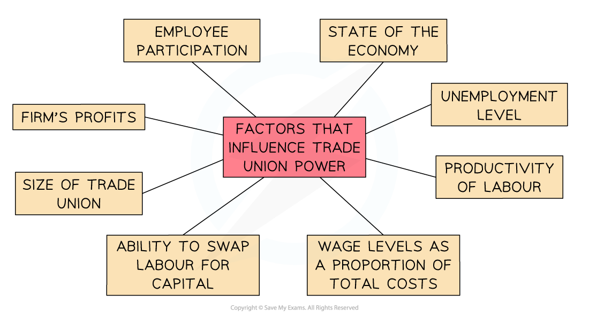

# The Role of Trade Unions

## The Work of Trade Unions

> **Spec point** — `spcpt_F42pjqh5nphcvyr3` · Including engaging in collective bargaining on wages, working hours and working conditions; protecting employment; and influencing government policy. 

## The Work of Trade Unions

- Workers pay a **monthly fee** to join a trade union

  - The fee is called a **subscription**
  - Their membership ends when they stop paying this fee
- **Benefits** of union membership include

  - ***Collective bargaining***
  - Job-specific training
  - **Legal representation** in disputes
  - Discounts on a wide range of goods/services
- When **collective bargaining** fails and discussions break down, trade unions have several methods of **forcing employers/governments to continue engaging** with them

  - These methods are collectively referred to as **industrial action** and include
  
    - ***Strikes***
    - ***Overtime bans***
    - ***Work to rule***
    - ***Go-slows***

**The Focus of Trade Union Efforts**

| **1. Collective bargaining on wages, working conditions and contractual terms** |   |
|---|---|
| - Negotiates for **acceptable wage levels** - often well above the minimum wage | - Negotiates for increased wages when **comparative industries** receive pay increases |
| - Negotiates for **inflation-linked** pay rises | - Negotiates for **higher wages** when firms are making **higher profits** |
| - Negotiates **standard weekly working hours** and any overtime payments | - Negotiates for improvements to **working conditions** and equipment |

| **2. Protecting the employment of their workers** |   |
|---|---|
| - Negotiates for the **retention and redeployment** of workers when machinery (capital) replaces labour | - Negotiates **resettlement packages **when firms relocate from one region to another and ***redundancy*** terms for those unable to relocate |
| - Negotiates to **minimise job losses** when machinery (capital) replaces labour | - Negotiates on a **fair termination process** when firms are struggling in an economic downturn |

| **3. Influencing government policy** |   |
|---|---|
| - Negotiates with government on the creation/maintenance of **minimum wage levels** | - Aims to influence policy through member action such as ***strikes*** |
| - Negotiates to **minimise job losses** when machinery (capital) replaces labour | - Negotiates on a **fair termination process** when firms are struggling in an economic downturn |

## Factors Influencing the Strength of Trade Unions

> **Spec point** — `spcpt_tMQ5kQ4YGGwppcz8` · Factors Influencing the Strength of Trade Unions

## Factors Influencing the Strength of Trade Unions

- The **higher** the percentage of workers from a firm that belong to a trade union, the **greater the collective bargaining power** of that union with the employer
- The higher the percentage of workers **from an economy** that belong to trade unions, the greater the collective bargaining power of the unions **with the government**
- There are numerous other factors which influence the **collective bargaining power** of specific unions at different periods of time

*Factors which influence the collective bargaining power of trade unions*

1. **The unemployment level** - the higher the unemployment level the weaker the bargaining power as firms can more easily replace existing workers
2. **Wage levels as proportion of total costs** - the lower the percentage of total costs that a firms's wages represent, the higher the bargaining power
3. **Swapping labour for capital** - the nearer the replacement cost of capital for labour to meeting the increased costs demanded by the union, the weaker the bargaining power
4. **The level of profits **- higher profits strengthen the unions demands for higher wages
5. **State of the economy **- less bargaining power in a recession and more when the economy is booming
6. **Overall size of the trade union** - the larger the union the stronger their bargaining power
7. **The productivity of labour** - if the workers are extremely productive, generating high levels of output from low levels of input, they are more valuable to the firm and the union has stronger bargaining power
