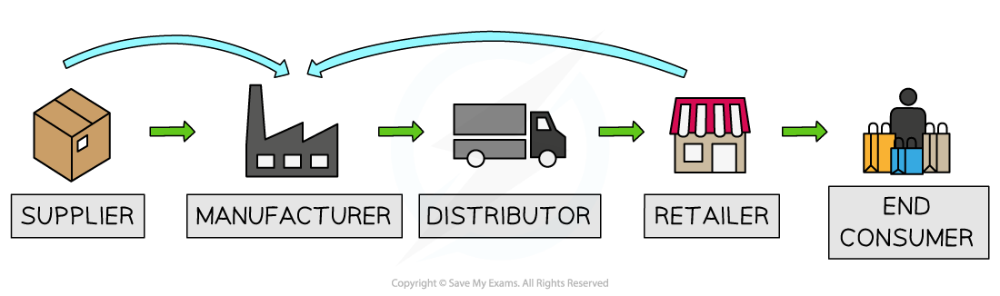

# The Growth of Firms

## Internal and External Growth

> **Spec point** — `spcpt_rjpyqWNGKWBW8K6J` · Internal growth, for example increased market share.
External growth, for example mergers.

## Internal and External Growth

- The growth of firms can be ***organic*** (internal) or ***inorganic*** (external)
- **Organic growth** is usually generated by

  - Gaining greater ***market share***
  - ***Product diversification***
  - Opening a new store
  - International expansion
  - Investing in** new technology**/production machinery
- **Inorganic growth** usually takes place when firms merge in one of three ways

  - ***Vertical integration*** (forward or backwards)
  - ***Horizontal integration***
  - ***Conglomerate integration***

*A diagram that illustrates how a firm can grow through forward or backward vertical integration*

- **Forward** **vertical integration** involves a ***merger*** or ***takeover*** with a firm further forward in the supply chain

  - E.g. A dairy farmer merges with an ice-cream manufacturer
- **Backward vertical integration** involves a merger/takeover with a firm further backward in the supply chain

  - E.g. An ice-cream retailer takes over an ice-cream manufacturer

## Types of Mergers

> **Spec point** — `spcpt_JPrt8dKzZS5SbggF` · Examples, advantages and disadvantages of different types of mergers: horizontal, vertical, and conglomerate.

## Types of Mergers

- Firms will often **grow organically** to the point where they are in a financial position to** integrate** with others

  - Integration speeds up growth but also creates new challenges

**An Explanation of the Advantages and Disadvantages of Each Type of Growth**

| **Type of Growth** | **Advantages** | **Disadvantages** |
|---|---|---|
| **Organic** | - The **pace of growth** is manageable - **Less risky **as growth is financed by profits and there is expertise in the industry - Avoids ***diseconomies of scale*** - The management know and understand every part of the business | - The pace of growth can be slow and frustrating - Not necessarily able to benefit from ***economies of scale*** - Access to **finance** may be limited |
| **Vertical Integration** (Inorganic growth) | - Reduces the **cost of production** as middle man profits are eliminated - Lower costs make the firm more **competitive** - Greater control over the supply chain **reduces risk **as access to raw materials is more certain - **Quality** of raw materials can be controlled - Forward integration adds **additional profit** as the profits from the next stage of production are assimilated - Forward integration can increase **brand visibility** | - **Diseconomies of scale** occur as costs increase e.g. unnecessary duplication of management roles - There can be a ***culture clash*** between the two firms that have merged - Possibly **little expertise** in running the new firm results in **inefficiencies** - The price paid for the new firm may take a long time to recoup |
| **Horizontal Integration** (Inorganic growth) | - Rapid increase of **market share** - Reductions in the cost per unit due to ***economies of scale*** - Reduces competition - Existing knowledge of the industry means the merger is more likely to be successful - Firm may gain new** knowledge or expertise** | - **Diseconomies of scale** may occur as costs increase e.g. unnecessary duplication of management roles - There can be a ***culture clash*** between the two firms that have merged |
| **Conglomerate Integration** (Inorganic growth) | - Reduces overall **risk** of business failure - Increased size and connections in new industries opens up **new opportunities for growth** - Parts of the new business may be **sold for profit** as they are duplicated in other parts of the conglomerate | - Possible **lack of expertise** in new products/industries - **Diseconomies of scale** can quickly develop - Usually results in job losses - **Worker dissatisfaction** due to unhappiness at the takeover can reduce **productivity** |

> **Exam Hint**
> Paper 1 MCQ frequently tests your ability to differentiate between forward vertical and backward vertical integration. This is all about a supply chain for a good/service. If a firm takes over another at an earlier stage in the supply chain - it is vertical backward integration.
