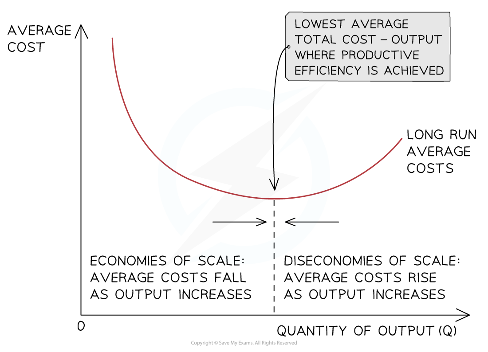

# Economies & Diseconomies of Scale

## An Introduction to Economies and Diseconomies of Scale

> **Spec point** — `spcpt_ccGgv9fTXjFndf4x` · How internal and external economies and
diseconomies of scale can affect a firm/industry as
the scale of production changes.

## An Introduction to Economies and Diseconomies of Scale

- As a firm grows, it is able to increases its **scale of output **generating efficiencies that lower its **average costs (AC)** of production

  - These efficiencies are called ***economies of scale***
  - Economies of scale help large firms to **lower their costs of production** beyond what small firms are able to achieve
- As a firm continues increasing its **scale of output**, it will reach a point where its **average costs (AC)** will start to **increase**

  - The reasons for the increase in the average costs are called ***diseconomies of scale***
- **Internal economies of scale** occur as a result of the growth in the scale of production **within** the firm

* Economies of scale occur when average costs decrease with increasing output and diseconomies of scale occur when average costs increase with increasing output*

### Diagram analysis

- With relatively low levels of output, the firms average costs are high
- As the firm increases its output, it begins to benefit from **economies of scale** which lower the average cost per unit
- At some level of output, a firm will **not be able to reduce costs** any further - this point is called **productive efficiency**
- Beyond this level of output, the average cost will begin to rise as a result of **diseconomies of scale**

## Types of Internal Economies and Diseconomies

> **Spec point** — `spcpt_ZnxzvmSZp3X6mCPD` · How internal and external economies and diseconomies of scale can affect a firm/industry as the scale of production changes.

## Types of Internal Economies and Diseconomies

**Types of Internal Economies and Diseconomies of Scale**

| **Internal Economies of Scale** | **Diseconomies of Scale** |
|---|---|
| - ***Financial Economies*** - ***Managerial Economies*** - ***Marketing Economies*** - ***Purchasing Economies*** - ***Technical Economies*** - ***Risk-bearing Economies*** | - ***Management Diseconomies*** - ***Communication Diseconomies*** - ***Geographical Diseconomies*** - ***Cultural Diseconomies*** |

## External Economies of Scale

> **Spec point** — `spcpt_GFrDqgv6m2kBDJJG` · How internal and external economies and diseconomies of scale can affect a firm/industry as the scale of production changes.

## External Economies of Scale

- **External economies of scale **occur when there is an increase in the size of the industry in which the firm operates

  - The firm is able to benefit from lower **average costs (AC)** generated by factors **outside of the firm**

**Sources of External Economies of Scale**

| **Source** | **Explanation** |
|---|---|
| **Geographic Cluster** | - As an industry grows, **ancillary firms** move closer to major manufacturers to cut costs and generate more business - This **lowers the AC** e.g. car manufacturers in Sunderland rely on the service of over 2,500 ancillary firms |
| **Transport Links** | - **Improved transport links** develop around growing industries in order to help get people to work and to improve the transport logistics - This **lowers the AC **e.g. Bangalore is know as India's Silicon Valley and transportation projects have been successful in transforming the movement of people and goods |
| **Skilled Labour** | - An increase in skilled labour can **lower the cost of skilled labour**, thereby **lowering the AC** - The larger the geographic cluster, the larger the pool of skilled labour |
| **Favourable Legislation** ** ** | - This often generates significant reductions in AC as **governments support certain industries** in order to **achieve their wider objectives ** |
