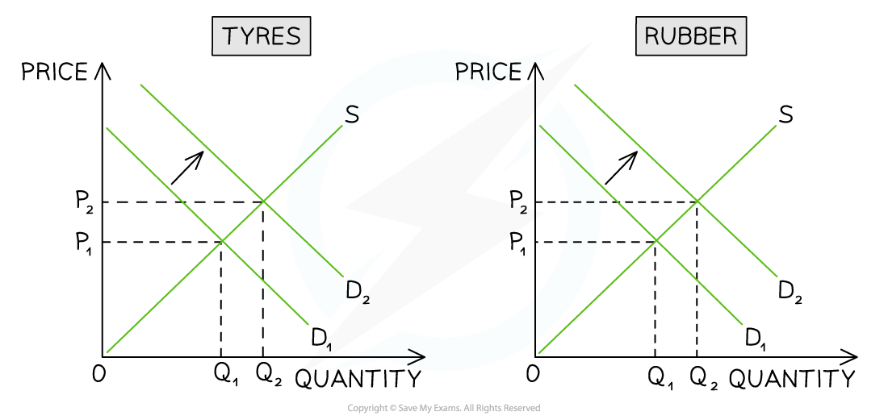

# Demand for the Factors of Production

## Influences on the Demand for Factors of Production

> **Spec point** — `spcpt_jBbdgQrpbbPY5Xyb` · Influences to include demand for the product, the price of different factors of production, their availability and their productivity.

## Influences on the Demand for Factors of Production

- The demand **by firms** for ***factors of production (FoP)*** is influenced by three factors

1. The demand for goods/services
2. The price of different factors of production
3. The availability and productivity of the factors

### 1. The demand for goods/services

- The demand for the** factors of production** is a **derived demand**. If a tyre manufacturer benefits from increased demand for their tyres, they will require **more rubber** to meet the demand

  - They may also require **more labour**
  - Depending on the level of increased demand, possibly **more capital **(machinery)  to manufacture the tyres

*The demand for rubber is derived demand from the demand for tyres*

- In the *tyre market*, the **increased demand **for tyres is represented by a **shift in the demand curve** from D1 to D2 
- Rubber is a **natural resource (land)** and there is now increased demand from the firm for rubber in order to meet higher levels of tyre production
- The diagram on the right represents the *rubber market* where **demand for it increases from D****1**** to D****2**

### 2. The price for different factors of production

- The price of **alternative factors of production** are constantly monitored by firms in order to ensure that they are maximising ***profits***

  - The price of **alternative (substitute)** raw materials will be considered e.g. using fish leather instead of cow leather to manufacture jackets
  - The price of installing **new and efficient machinery (capital)** will be monitored against the cost of hiring more **workers (labour)**

### 3. The availability and productivity of the factors

- The availability of the factors of production can change rapidly in ***factor markets***

  - Covid 19 caused many **supply issues **which reduced the availability of **labour and many raw materials**
  - Many firms responded by searching for **substitute factors of production** so that they could continue producing goods/services
  - In some cases this meant **switching demand** from cheaper **foreign imports** to more expensive **locally produced** raw materials
- If the ***productivity*** of a factor is high (or increasing), then the demand for that factor will also increase

  - If a new Government training scheme improves the **productivity of car mechanics,** car repair garages will seek to **employ more workers **as each worker is able to achieve more resulting in **higher profits**

> **Exam Hint**
> Firms are able to increase their profits in two main ways.
> 
> Firstly, they can raise the selling price so that the gap between the selling price and their costs of production increases (the effectiveness of this depends on the price elasticity of demand).
> 
> Secondly, they can** decrease the cost of their factors of production** and maintain the current selling price.
> 
> Following the second option can have significant impacts on the product manufactured by the firm e.g. switching to a cheaper natural resource may decrease product quality or decreasing the wages paid to workers may reduce motivation leading to poor productivity.
