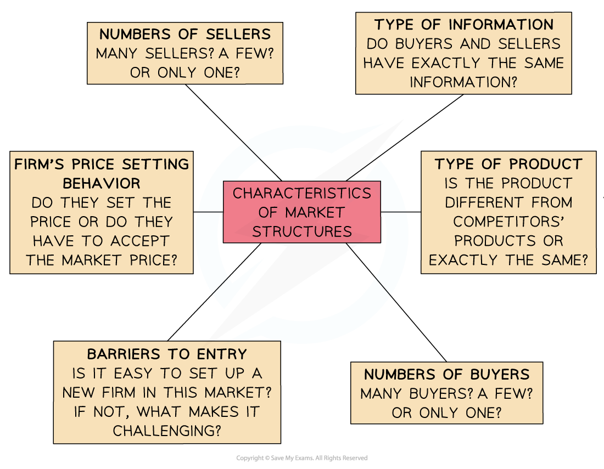

# Competitive Markets

## An Introduction To Competitive and Monopoly Markets

> **Spec point** — `spcpt_NG3rWxwqtzc4cM9r` · The effect of having a high number of firms on price, quality, choice, profit. Note: the theory of perfect and imperfect competition and diagrams are not required.

## An Introduction To Competitive and Monopoly Markets

- Each firm operates in a **specific market**
- The conditions in different markets can **vary significantly** and are determined by the ***market structure*** in which the firm operates
- There are a range of market structures, however **your syllabus** only requires you to know the characteristics of two - **competitive markets and monopolies**
- Competitive markets are those with an extremely **high degree of competition**
- A monopoly is a market structure in which one firm dominates the market and has **significant market power**

*The six characteristics which determine the type of market structure a firm operates in - competitive or monopoly*

- The **answers to the questions** above determine the type of **market structure** in which a firm is operating in

  - If a firm is selling a unique product (e.g. handmade car) it is likely operating in a monopoly market and setting high prices

## Characteristics of Competitive Markets

> **Spec point** — `spcpt_xgnbWCB7GGJYPhRv` · The effect of having a high number of firms on price, quality, choice, profit. Note: the theory of perfect and imperfect competition and diagrams are not required.

## Characteristics of Competitive Markets

- The characteristics of a competitive market are as follows

1. **There are many buyers and sellers:** due to the number of market participants sellers are ***price takers***
2. **There are no** ***barriers to entry*** **and exit from the industry: **firms can start-up or leave the industry with relative ease which increases the level of competition
3. **Buyers and sellers possess perfect knowledge of prices: **this assumption presupposes perfect information e.g. if one seller lowers their price then all buyers will know about it
4. **The products are *****homogenous***: this means firms are unable to build brand loyalty as **perfect substitutes exist** and any price changes will result in losing customers

**Advantages and Disadvantages of Competitive Markets**

| **Advantages** | **Disadvantages** |
|---|---|
| - **Lower prices:** competition causes firms to lower prices for consumers in an attempt to gain market share - **Better quality:** firms innovate and continuously seek to improve their quality of their goods/services in order to become recognised in a crowded market - **More choice:** more sellers equals more choice for consumers | - **Worse quality:** in a bid to lower prices, product quality may actually deteriorate over time - **Too much choice:** consumers may be overwhelmed and not explore the full range of market offerings, instead sticking to what they know - **Worker welfare:** the greater the competition the greater the need to cut costs, often resulting in low wages and poor working environments |
