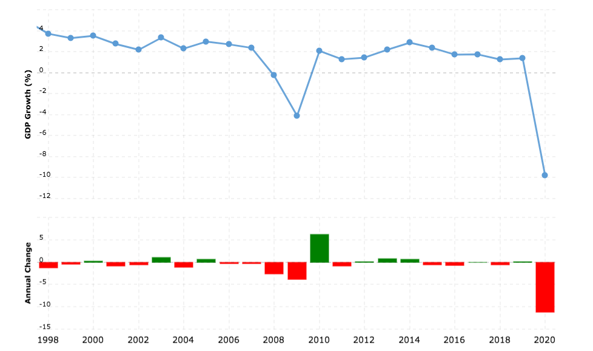
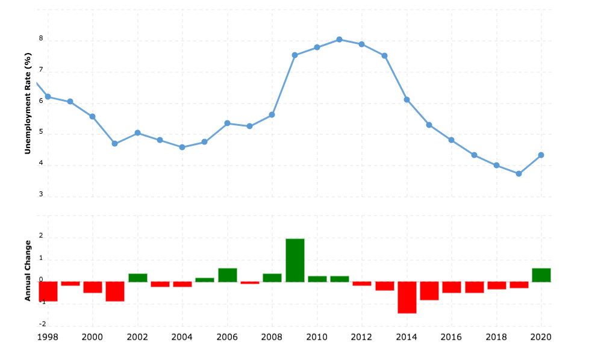
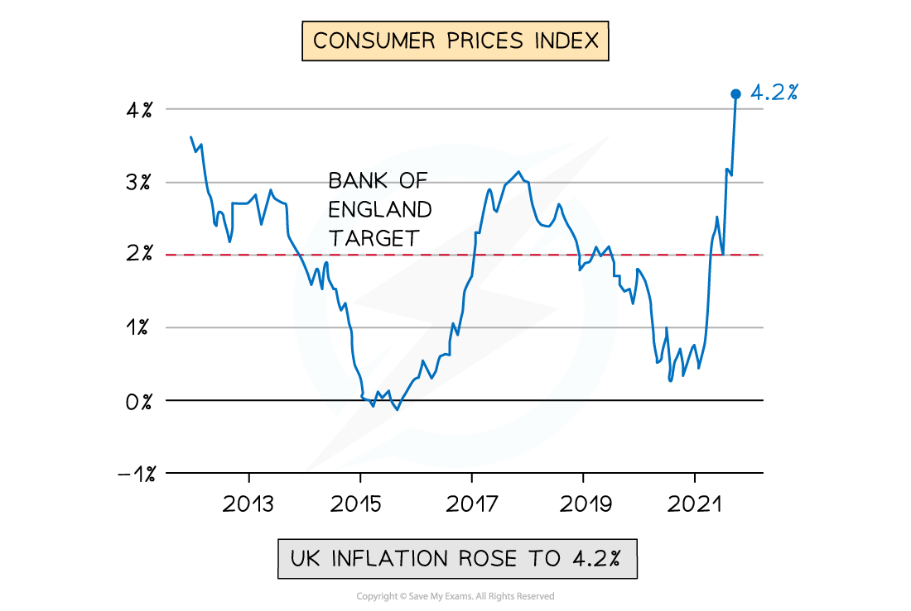
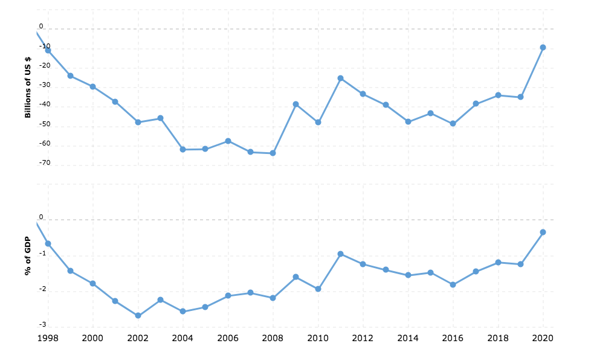

# The Five Macroeconomic Aims

## Economic Growth

> **Spec point** — `spcpt_YgQdC63Fvc3Tqh8D` · Economic growth, full employment/low unemployment, stable prices/low inflation, balance of payments stability, redistribution of income. Reasons behind the choice of aims and the criteria that governments set for each aim.

## Economic Growth

- ***Economic growth*** is a central macroeconomic aim of most governments
- Many developed nations have an annual target **growth rate of 2-3%**

  - This is considered to be **sustainable growth**
  - Growth at this rate is **less likely** to cause excessive ***demand pull inflation***
- **Politicians** often use it as a metric of the effectiveness of their **policies** and leadership
- Economic growth has **positive impacts** on confidence, consumption, investment, employment, incomes, living standards and government budgets

*A diagram showing the economic growth rate of the UK since 1998 Source: Macrotrends*

**A Table Highlighting Some of the Economic Growth Trends in the UK Since 1998**

| **1998-2007** | **2008-2015** | **2016-2019** | **2020 - ** |
|---|---|---|---|
| - **Steady growth** fluctuating between 2-4% | - **Global financial crisis** followed by rapid bounce back due to **government intervention** - and then steady growth | - Gradual ***disinflation*** possibly due to future expectations regarding the impact of the **Brexit **vote | - **Supply chain issues due to Brexit. ** - Decreased **consumption** due to the impact of Covid 19. - These created a **deep** ***recession***** **(short-lived due to government intervention) |

## Low Unemployment

> **Spec point** — `spcpt_kWmkQzj2DSCNQjB6` · Economic growth, full employment/low unemployment, stable prices/low inflation, balance of payments stability, redistribution of income. Reasons behind the choice of aims and the criteria that governments set for each aim.

## Low Unemployment

- Someone is considered to be unemployed if they do not have a job and are **actively seeking** for one
- The **target unemployment rate** often depends on the size of the economy e.g. India finds a rate of 6.5% good whereas Singapore aims for it to be under 2%
- The closer an economy is to the **full employment level **of labour, the better (more efficiently) it is using its human resources
- Within the broader** unemployment rate**, there is an **increased emphasis** on the unemployment rate within different **sections of the population**

  - E.g. **Youth unemployment**, ethnic/racial unemployment by group
  
    - In 2021, black unemployment in the USA was 8.7% and white unemployment was 4.7%

*A diagram showing the unemployment rate in the UK from 1998 - 2020 Source: Macrotrends*

- Unemployment tends to be **inversely proportional to real GDP** growth

  - When ***real GDP*** increases, unemployment falls
  - When real GDP decreases, unemployment rises
- Unemployment in the UK remained **relatively high for the six years** following the **global financial crisis** of 2007

## Low and Stable Rate of Inflation

> **Spec point** — `spcpt_bSy3hbRp7wHxXnt9` · Economic growth, full employment/low unemployment, stable prices/low inflation, balance of payments stability, redistribution of income. Reasons behind the choice of aims and the criteria that governments set for each aim.

## Low and Stable Rate of Inflation

- Most economies have a **target** ***inflation*** rate of 2% using the ***Consumer Price Index (CPI)***
- A low rate of inflation is desirable as it is a **symptom of economic growth**
- The different causes of inflation (***cost push*** or ***demand pull***) require different policy responses from the Government

  - ***Demand-side policies*** ease demand pull inflation
  - ***Supply-side policies*** ease cost push inflation

*A diagram illustrating the inflation rate in the UK from 2012 to 2021 using the CPI*

- In the UK, a **continual deviation** from the target of 2% would **not be considered as stable**

  - An inflation rate in April 2022 of 4-5% was considered to be unstable, eroding household ***purchasing power***
- A **low and stable rate of inflation** is important as it

  - Allows firms to **confidently plan** for future investment
  - Offers **price stability** to consumers

## Balance of Payments Stability on the Current Account

> **Spec point** — `spcpt_SMKZtXfvJNzpwFcK` · Economic growth, full employment/low unemployment, stable prices/low inflation, balance of payments stability, redistribution of income. Reasons behind the choice of aims and the criteria that governments set for each aim.

## Balance of Payments Stability on the Current Account

- The **Balance of Payments (BoP)** for a country is a record of all the financial transactions that occur between it and the rest of the world

  - The current account focuses mainly on the financial transactions related to **exports and imports** of goods/services
- Governments aim for **Balance of Payments equilibrium on the Current Account**

  - If **exports > imports** it will create a **current account surplus**
  - If **imports > exports**, it will create a **current account deficit**
  
    - Each one of these conditions has advantages/disadvantages associated with it
    - However, a current account deficit is more problematic in the long-run
- The **UK** has traditionally run a **small deficit**

  - As a **% of GDP** the UK current account deficit is insignificant so has not been problematic

*A diagram showing the UK Trade Deficit from 1998 to 2020. The bottom graph illustrates the trade deficit as a % of GDP and the top one illustrates the absolute value expressed in US$ Source: Macrotrends*

- In the diagram above the** trade deficit has been falling steadily** since 2016

  - During this time period the **value of exports** was increasing slightly faster than the **value of imports**

## The Redistribution of Income

> **Spec point** — `spcpt_5m4X7GK2kgmNcdM7` · Economic growth, full employment/low unemployment, stable prices/low inflation, balance of payments stability, redistribution of income. Reasons behind the choice of aims and the criteria that governments set for each aim.

## The Redistribution of Income

- The redistribution of income aims to reduce ***income inequality*** in an economy

  - High levels of income inequality **create social unrest** and can ultimately lead to revolutions
  - **Perfect income equality** is not desirable as it removes the** incentive to work** and study
- Governments aim to **redistribute income** by taxing the wealthy and providing welfare payments to the poor
- **Unchecked capitalism** has a natural outcome of **high income inequality**

  - The wealthy are able to keep buying **factors of production**
  - The **concentration of ownership** becomes more and more narrow with fewer individuals owning the bulk of the world's wealth
- There is a need for governments to **intervene** to maintain acceptable levels of income inequality
- ***Absolute poverty*** is usually worse in developing countries. However, in a developed economy such as Germany, a 1% increase in income inequality can push a lot more households into ***relative poverty***
