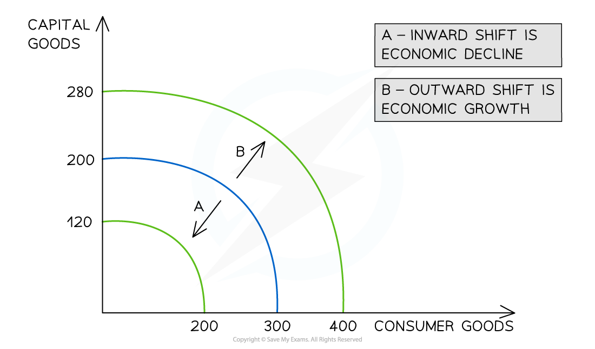

# Causes & Consequences of Growth

## Causes of Economic Growth

> **Spec point** — `spcpt_BB9vb8njBwsdYRxs` · How changes in total demand may increase the utilisation of resources and GDP – resulting in a movement from inside toward the PPC. How economic growth shifts the economy’s PPC to the right and is caused by changes in investment, technology, and the quantity and quality of the factors of production.

## Causes of Economic Growth

### 1. Growth caused by a change in total demand

- **Actual economic growth** occurs when there is an increase in the **quantity of goods/services** produced in an economy in a given period of time

  - This is often measured by the **percentage change** in **real gross domestic product (GDP)**
  - If any component of real GDP increases (consumption, investment, government spending, ***net exports***), there will be an increase in **total demand**
  **   ** 
  
  *Any movement from Point E towards the PPC boundary represents actual economic growth and is caused by an increase in output (rGDP)*

#### Diagram explanation

- Previously unused ***factors of production*** are now being employed
- This is demonstrated by a shift from inside the ***production possibilities curve (PPC)*** such as Point E, towards the boundary of the PPC
- At any given point in time, the **actual economic growth** may be less than the **potential growth** available to the economy

### 2. Growth caused by a change in the quantity/quality of factors of production

- **Potential growth** is the increase in the **productive potential of an economy**
- This occurs when there is an increase in the** quantity or quality** of the factors of production available in an economy

  - One example of how the **quality** of a factor of production can be **improved** is through the impact of **training and education on labour**. An educated workforce is a **more productive workforc**e and the **production possibilities increase**
  - One example of how the **quantity** of a factor of production can be **increased** is through a change in migration policies. If an economy allows **more foreign workers** to work productively in the economy, then the **production possibilities increase**
- Investing in new **capital machinery** increases the quality of ***capital***
- Investing in **new technology** results in an improvement to productivity

*Outward shifts of a PPC show economic growth caused by changes to the quantity/quality of the FOP*

#### Diagram explanation

- **Economic growth** occurs when there is an increase in the **productive potential of an economy**

  - This is demonstrated by an **outward shift** of the entire curve represented by A
  - **More consumer goods** and **more capital goods** can now be produced using all of the **available resources**

## The Consequences of Economic Growth

> **Spec point** — `spcpt_qB6MKM4CynHnMDvh` · The costs and benefits of economic growth in the context of different economies.

## The Consequences of Economic Growth

- **Economic growth** is considered to be the main contributor to an improvement in the **standards of living**
- Due to the **negative aspects** of economic growth, there is much controversy about maintaining it as a central **macroeconomic aim**

  - Instead, arguments for a focus on **societal well-being** are gaining traction

**A Table Summarising the Benefits and Costs of Economic Growth**

| **Benefits of Economic Growth** | **Costs of Economic Growth** |
|---|---|
| - **Increased incomes** lead to better standards of living | - Rising total demand causes ***demand pull inflation*** and the **purchasing power** of people on fixed incomes may fall |
| - Decreased levels of ***absolute poverty*** | - **Lack of equity** in the distribution of income - the rich may get richer and the poor poorer |
| - Improvement in the quality/quantity of **environmentally friendly technologies** | - Environmental damage caused by ***negative externalities of production*** and consumption increases |
| - **Higher sales revenue** for firms and greater profits | - **Increased inflation** can harm export sales |
| - **Increased investment** by firms increases the potential output of the economy | - The level of imports usually increases negatively impacting **the current account** |
| - **Reduced expenditure **by governments on benefits | - Increased income usually leads to **greater consumption of demerit goods** |
| - Higher government **tax revenue** due to rising incomes and surging **corporate profits** | - Greater output often requires **more time from workers** and can decrease leisure time and **well-being** |
| - **Increased employment** resolves some of the negative social impacts of unemployment | - **Resources** are depleted more rapidly |

> **Exam Hint**
> Remember this distinction as MCQ often checks for this understanding:
> 
> Growth caused by a change in total demand is represented by a movement from within the existing PPC towards its boundary.
> 
> Growth caused by a change in the quantity/quality of the factors of production (supply-side growth) moves the entire PPC curve outwards.
