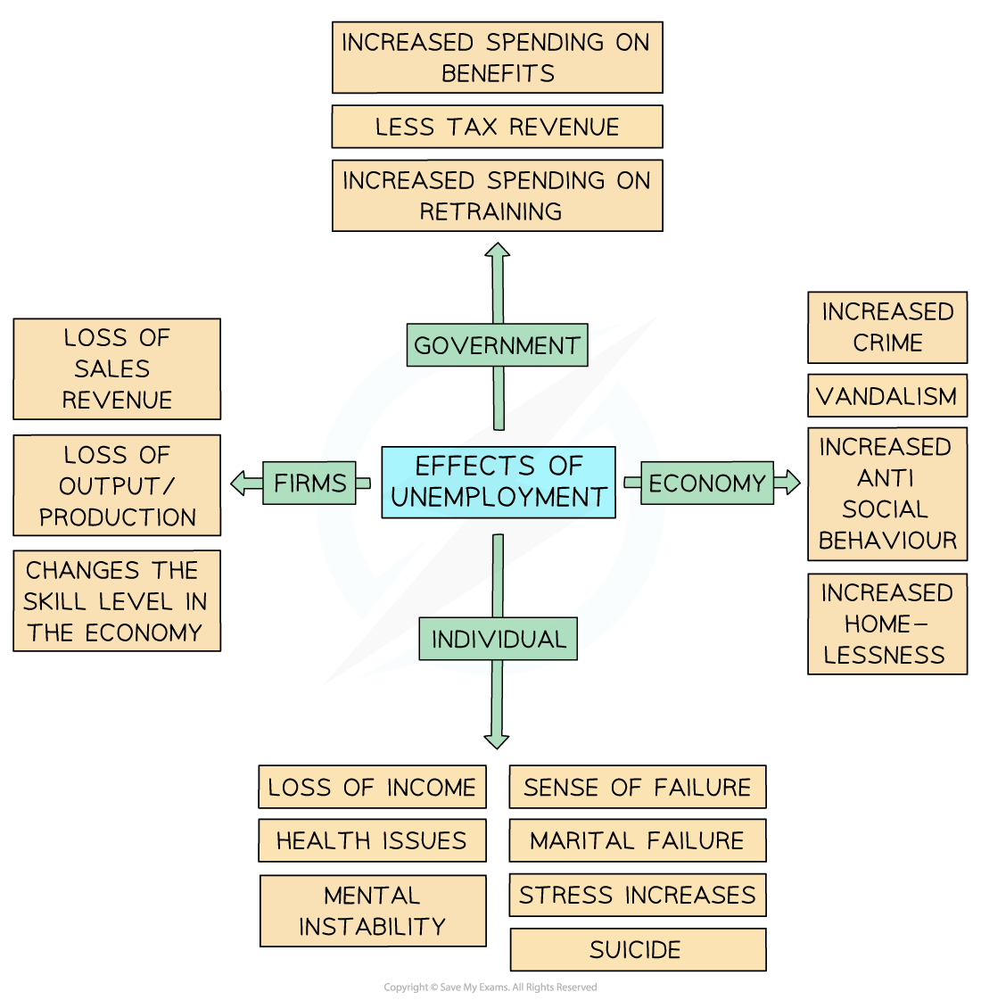

# Consequences of Unemployment

## Consequences of Unemployment

> **Spec point** — `spcpt_T33QPZzQmQCb9K8v` · The consequences of unemployment for the individual, firms and the economy as a whole.

## Consequences of Unemployment

- The effects of unemployment, especially **long-term unemployment, **are extremely damaging

  - There are impacts on the individual, the economy, the government, and firms

*Long term unemployment affects individuals, the economy, government, and firms*

- Government's receive **less tax revenue** & have **higher expenditure** in the form of welfare payments
- Individuals suffer significant emotional, relational & financial consequences
- Firms may find it harder to **find workers to employ** (as they have moved on) once the economy starts to recover
- The economy contracts as there is a higher level of **inefficient use of available resources**
