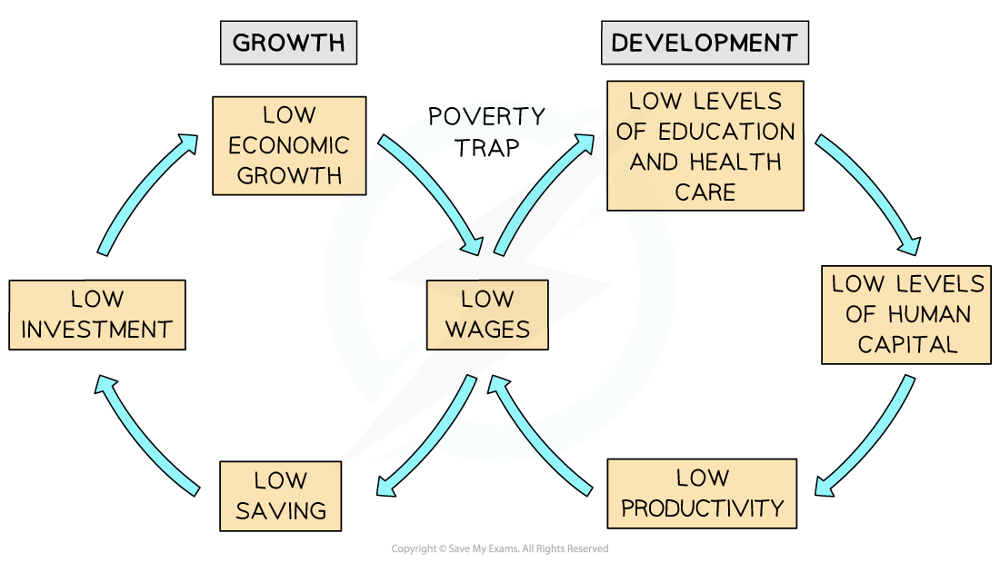

# Causes of Poverty

## Absolute and Relative Poverty

> **Spec point** — `spcpt_6y2w4Zd5sVnwjKJ3` · The difference between the two terms.

## Absolute and Relative Poverty

- **Poverty** is a situation where a person **lacks the financial resources to **sustain a basic standard of living
- Economists distinguish between **absolute and relative poverty  **
- **Absolute poverty** is a situation where individuals cannot afford to acquire the **basic necessities** for a healthy and safe existence

  - These necessities include shelter, water, nutrition, clothing and healthcare
  - In 2022, the **World Bank** defined absolute poverty as anyone who was living on less than **\$1.90 a day**
  - Absolute poverty is more prevalent in **developing countries** than developed ones
- **Relative poverty** is a situation where household income is a certain percentage less than the **median household income** in the economy

  - Poverty in a household is considered relative to **income levels** in other households
  - E.g. The UK defines relative poverty as households that are living with less than 60% of the **median household income**
  
    - In May 2022, the median UK monthly household income was £2072/month
    - This meant that the **relative poverty line** was any household earning less than £1243,20/month
- **Relative poverty** is the main form of poverty that occurs in **developed** countries

## Causes of Poverty

> **Spec point** — `spcpt_smdjywH48H5H9nG8`

## Causes of Poverty

- There are many **causes of poverty. **However, poor countries have several **common characteristics** which can be summarised in a **poverty cycle diagram**

*Poverty is caused by a lack of both economic growth and human development*

- **Low wages** represent the intersection of economic growth and human development and are the major cause of poverty

  - Low wages are usually the result of **unemployment**, ***informal employment***, a lack of skills, or a ***primary sector*** based economy
- **Education and healthcare **cost money and with lower wage levels these are not accessible, resulting in poor ***human capital***

  - People find it harder to stay well or to **recover from illness** resulting in **lower productivity** and **shorter life expectancy**
- **Low productivity** results in low wages and the cycle continues
- **Populations** with a large number of **dependents **(old people and children) for each working household tend to experience **higher levels of poverty**
