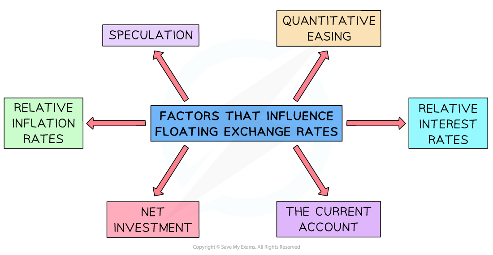
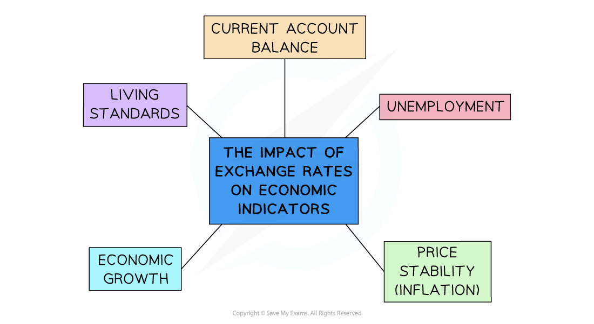

# Exchange Rate Fluctuations

## Causes of Exchange Rate Fluctuations

> **Spec point** — `spcpt_2CGKWVJJXPpsDns9`

## Causes of Exchange Rate Fluctuations

- Numerous factors influence floating exchange rates, resulting in an ***appreciation*** or ***depreciation***** **of a currency

*Factors influencing floating exchange rates*

1. **Relative** ***interest*** **rates:** influence the flow of ***hot money*** between countries. If the UK increases its interest rate, then demand for £'s by foreign investors increases and the £ appreciates. If the UK decreases its interest rate, then the supply of £'s increases as investors sell their £'s in favour of other currencies and the £ depreciates
2. **Relative** ***inflation***** rates: **as inflation in the UK rises** relative** to other countries, its exports become more expensive so there is **less demand** for UK products by foreigners, which means there is less demand for £s and so the **£ depreciates**
3. **Net investment: **foreign direct investment (FDI) into the UK creates a **demand for the £** which leads to the **£ appreciating**. FDI by UK firms abroad creates a supply of £'s which leads to the £ depreciating
4. **The current account: **UK exports have to be paid for in £'s. UK imports have to be paid for in local currencies, which requires £'s to be supplied to the forex market. Due to this, an **increasing *****net exports*** will result in an appreciation of the £ and falling **net exports** will result in a depreciation of the £** **
5. **Changes in tastes/preferences: **As global demand for **quinoa** increased as it b**ecame fashionable**, Bolivia's exports of quinoa increased dramatically which put **upward pressure on their currency**. Foreigners demanded the Boliviano in order to pay for the quinoa
6. **Speculation: **the vast majority of currency trades are speculative. Speculation occurs when **traders buy a currency** in the expectation that it will be worth more in the short to medium term, at which point they will sell it to **realise a profit**
7. ***Quantitative easing:*** involves increasing the money supply and much of the new supply is used to buy back gilts. Many of these gilts are **owned by foreigners** who then exchange the £s received for their own currency. The increase in the supply of £'s **depreciates the £ **
8. **MNCs: **An increase in the number of MNCs globally will result in **more money flows** between countries, each of which influences exchange rates

## Consequences of Foreign Exchange Rate Fluctuations

> **Spec point** — `spcpt_jbSyv8hNBsdVM97p` · The effects of foreign exchange rate fluctuations on export and import prices and spending on imports and exports via the PED.

## Consequences of Foreign Exchange Rate Fluctuations

- Changes to exchange rates may have far-reaching impacts on an economy

*The impact of changes to exchange rates on an economy*

| **Economic Indicator** | **Explanation** |
|---|---|
| **The Current Account** | - From a UK perspective, **the depreciation** of the £ causes **exports** to be cheaper for foreigners to buy and** imports** to the UK are more expensive - The** extent** to which a currency depreciation improves the **current account balance** depends on the **price elasticity of demand for exports and imports**    - This follows the **revenue rule** which states that in order to increase revenue, firms should **lower prices** for products that are price elastic in demand   - If the **price elasticity of demand for UK exports is elastic, **then a depreciation of the currency will result in a larger than proportional increase in demand for UK exports, which will rapidly improve any **current account deficit** |
| **Economic growth** | - Net exports are a component of ***total (aggregate) demand***    - A depreciation that results in an **increase in net exports** will lead to economic growth |
| **Inflation** | - ***Cost push inflation*** can be caused by a **depreciating currency** as the price of **imported raw materials** increases with a weaker currency - Net exports are a component of ***total (aggregate) demand***    - A **depreciation** that results in an **increase in net exports** will lead to an increase in total demand   - This may lead to an increase in ***demand pull inflation*** - An **appreciation** of the currency will have the opposite effect |
| **Unemployment** | - If **depreciation** leads to an increase in exports, **unemployment is likely to fall** as more workers are required to produce the additional products demanded - An **appreciation** of the currency will have the opposite effect |
| **Living standards** | - The impact of a **depreciation** on **living standards **can be muted    - As imports are more expensive, households face **higher prices and less choice,** which detracts from living standards   - Rising exports can decrease unemployment and **increase wages/income **which** **means an improved standard of living for some households - The impact of an **appreciation** on living standards will be the opposite |
| **Foreign direct investment (FDI)** | - Depreciation of a currency makes it **cheaper for foreign firms** to invest in the country which can increase investment and real GDP - An appreciation has the opposite effect |
