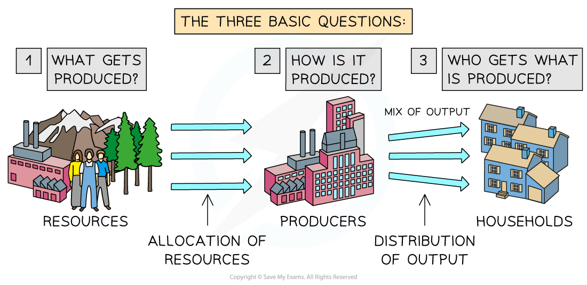

# Resource Allocation Decisions

## Economic systems

> **Spec point** — `spcpt_T77Y2G6rXS5BsPDF` · Economic systems

## Economic systems

- **An economic system is the way a country or society organises the production, distribution and consumption of goods and services to solve the problem of scarcity**
- In order to solve the basic economic problem of **scarcity**, economic systems emerge or are created by different **economic agents** within the economy

  - These agents include **consumers, producers, the government **and **special interest groups** (e.g. environmental *pressure groups*)
  - Any economic system aims to allocate the **scarce ***factors of production*

### Three types of economic systems

#### 1. Market economy (capitalist/free market system)

- Decisions are made by **individuals **and **private firms**
- It is based on ***supply ***and ***demand***
- There is little to no government intervention

#### 2. Planned economy (command economy)

- The **government** makes all key decisions about what, how and for whom to produce
- Resources are owned and controlled by the state

#### 3. Mixed economy

- Combines features of both market and planned economies
- The ***private sector*** and **government** share decision-making
- Most modern economies are mixed economies

> **Exam Hint**
> The above knowledge sits in a different place in your syllabus. However, it has been included here as it provides a nice link in the understanding between scarcity, economic systems and the three basic economic questions – they are inextricably linked

## The three basic economic questions

> **Spec point** — `spcpt_hbzPcpQwbfmhhSCB` · "• what to produce
• how to produce
• who to produce for"

## The three basic economic questions

- Each economic system has to ask and answer three basic questions

  - Each** system **answers them differently

*How the three questions are answered determines the economic system of a country*

- Economic decisions need to be made to answer **three important questions**

1. **What to produce?**

  - As resources are limited in supply, decisions carry an opportunity cost
  
    - For example, should a government invest limited public funds in better rail services or more public hospitals?
2. **How to produce it?**

  - Would it be better for the economy to have *labour-intensive* production so that more people are employed, or should goods and services be produced using machinery?
3. **For whom are the goods and services to be produced?**

  - Should goods and services only be made available to those who can afford them, or should they be freely available to all?

#### How does each system answer these questions?

| **Type of system** | **What to produce?** | ** How to produce?** | **For whom?** |
|---|---|---|---|
| **Market system** | - Demand and supply ***(the price mechanism)*** | - Most efficient, profitable way possible | - Those who can afford it |
| **Mixed system** | - Demand, supply and the government | - Some efficiency but also a focus on welfare/well-being | - Those who can afford it, plus some provision to those who cannot afford it |
| **Planned system** | - The government | - Ensure everyone has a job | - Everyone |
