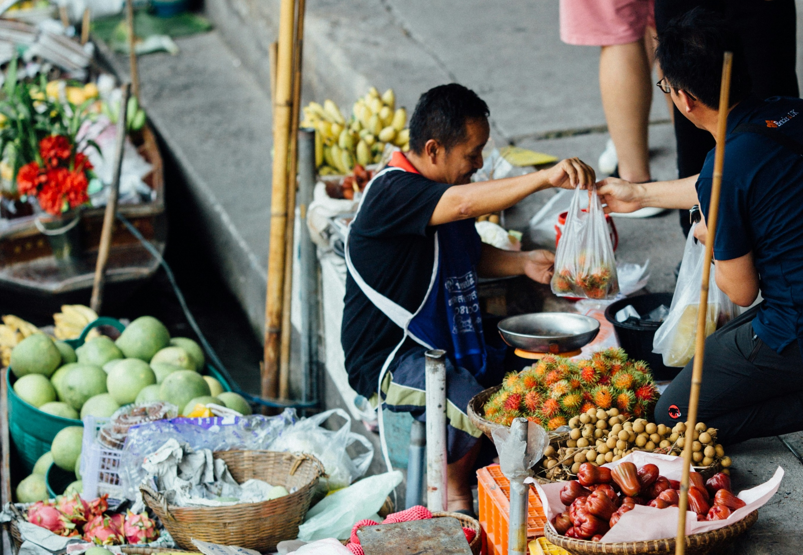

# How Markets Work

## Definition of a market

> **Spec point** — `spcpt_hg2vRkbQwQmBCHwZ` · Definition of a market

## Definition of a market

- **A market is any place or process that brings buyers and sellers together to exchange goods and services**

  - This exchange can happen in a **physical location** (such as a food market in Jakarta) or through a **virtual platform** (such as Alibaba or Amazon)

*Jakarta food market*

> **Exam Hint**
> In economics, a market does **not** always refer to a building or shop – it includes any system where buyers and sellers can meet

## Examples of markets

> **Spec point** — `spcpt_h5c2zWdTS46mdQCd` · Examples of markets

## Examples of markets

- A **product market** is one where buyers and sellers meet exchange a physical good
- A **factor market** is one where buyers and sellers meet to exchange *factors of production*

| **Type of market** | **Description** | **Example** |
|---|---|---|
| **Physical retail market** | - Buyers and sellers meet face-to-face | - A street market in Bangkok selling fruit and clothing |
| **Online market** | - Buyers and sellers interact via the internet | - Shopee – an e-commerce platform used widely in Southeast Asia |
| **Commodity market** | - Raw materials such as oil, gold or wheat are traded | - The Dubai Mercantile Exchange for crude oil |
| **Labour market** | - Workers offer labour, and employers demand it | - The tech recruitment market in Bengaluru, India |
| **Foreign exchange market** | - *Currencies *are bought and sold | - *Forex *trading platforms accessed by banks worldwide |
| **Stock market** | - *Shares *of companies are bought and sold | - The Tokyo Stock Exchange |

## Roles of buyers and sellers

> **Spec point** — `spcpt_6R26tmWdGKHDNb8f` · The roles of buyers and sellers

## Roles of buyers and sellers

- In any market, both buyers and sellers play essential roles

  - In an efficient market, sellers respond to what buyers want, and buyers choose between competing sellers
  - This interaction helps **determine prices and quantities**

*The buyer demands and the seller supplies*

### Buyers

- Also known as **consumers** or **demanders**
- Their **choices and preferences** determine **demand** for goods and services
- They help to set prices by *signalling* how much they are willing to pay

  - For example: A buyer in Mexico City searching for the best price on mobile phones influences how firms set prices to compete

### Sellers

- Also known as **producers** or **suppliers**
- They aim to **supply** goods or services in order to make a **profit**
- They decide **what to produce**, **how much** and at **what price** based on costs and expected demand

  - For example: A coconut farmer in the Philippines choosing whether to sell to local markets or export to Singapore

> **Exam Hint**
> When answering short questions on markets, be sure to explain **both sides** of a market. Buyers create demand. Sellers provide supply. The interaction between the two leads to price and output decisions
