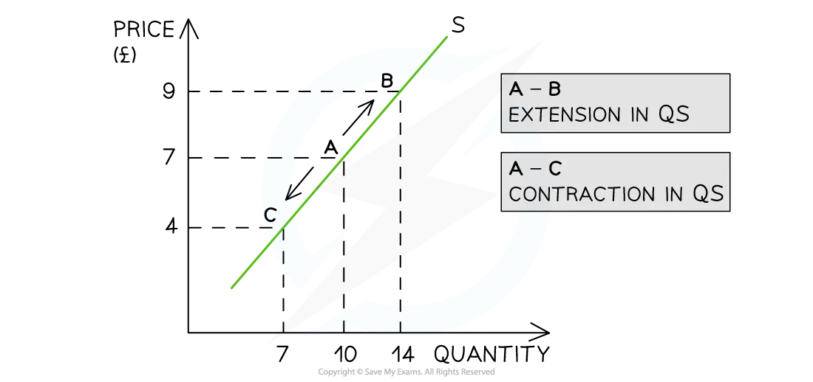

# Movements Along & Shifts of the Supply Curve

## Movements along a supply curve

> **Spec point** — `spcpt_ShV6zKnqHZkvpPGp` · Movements along a supply curve; Causes of extensions and contractions in supply

## Movements along a supply curve

- If **price** is the only factor that changes (***ceteris paribus***), there will be a change in the **quantity supplied (QS)**

  - This change is shown by a **movement along the supply curve**

### Diagram analysis

- An **increase** in price from £7 to £9 leads to a **movement** **up** the supply curve from point A to B

  - Due to the **increase** in price, the quantity supplied has** increased** from 10 to 14 units
  - This movement is called an **extension in quantity supplied**
- A **decrease **in price from £7 to £4 leads to a **movement down** the supply curve from point A to C

  - Due to the **decrease** in price, the quantity supplied has **decreased** from 10 to 7 units
  - This movement is called a **contraction in quantity supplied**

## Shifts of the supply curve

> **Spec point** — `spcpt_GHM6Yr7vSBsr4fxv` · Shifts of the supply curve

## Shifts of the supply curve

- There are several factors that will **change the supply** of a good or service, **irrespective of the price level**
- Collectively, these factors are called the** conditions of supply **and include:

  - Changes to the costs of production
  - Changes to *indirect taxes* and *subsidies*
  - Changes to technology
  - Changes to the number of firms
  - Weather events
  - Future price expectations
  - Goods in *joint *and *competitive supply*
- Changes to any of the conditions of supply **shift the entire supply curve** (as opposed to a movement along the supply curve)

*A graph that shows how changes to any of the conditions of supply shifts the entire supply curve left or right, irrespective of the price level*

- For example, if a firm's cost of production increases due to the increase in price of a key resource, then there will be a** decrease in supply** as the firm can now only afford to produce fewer products

  - This is a **shift in supply **from S to S1. The price remains unchanged at £7 but the **supply has decreased** from 10 to 2 units

## Causes of changes to the conditions of supply

> **Spec point** — `spcpt_dFJDTsYGjPxtKMNS` · Causes of changes to the conditions of supply

## Causes of changes to the conditions of supply

### 1. Changes to the costs of production

- If the price of **raw materials** or other **costs of production** change, firms respond by changing supply.

*Changes to the conditions of supply shift the entire supply curve*

- **If costs of production increase**

  - Supply decreases and shifts left (S→S1)
  - For example, rising aluminium prices increase bicycle production costs in Malaysia, causing supply to fall
- **If costs of production decrease**

  - Supply increases and shifts right (S→S2)

### 2. Changes to indirect taxes

- Any change to **indirect taxes** changes the **cost of production **for a firm and impacts supply

*Changes to the conditions of supply shift the entire supply curve*

- **If indirect taxes increase**

  - Supply decreases and shifts left (S→S1)
  - For example, a higher sugar tax in Thailand raises costs for soft drink producers, reducing supply
- **If indirect taxes decrease**

  - Supply increases and shifts right (S→S2)

### 3. Changes to subsidies

- Changes to ***producer subsidies*** directly impact the **cost of production** for the firm

*Changes to the conditions of supply shift the entire supply curve*

- **If subsidies increase**

  - Supply increases and shifts right (S→S2)
- **If subsidies decrease**

  - Supply decreases and shifts left (S→S1)
  - For example, the removal of farming subsidies in Argentina reduces agricultural output

#### 4. Changes to the state of technology

- New technology increases ***productivity*** and **lowers costs** of production
- **Ageing technology** can have the opposite effect

*Changes to the conditions of supply shift the entire supply curve*

- **If technology improves**

  - Supply increases and shifts right (S→S2)
  - For example, new irrigation systems in Morocco help farmers produce more crops with less water
- **If technology worsens**

  - Supply decreases and shifts left (S→S1)

### 5. Change in the number of firms in the industry

- The **entry and exit** of firms into the market has a direct impact on the supply
- If ten new firms start selling building materials in Hanoi, the supply of building material will **increase**

*Changes to the conditions of supply shift the entire supply curve*

- **If the number of firms increases**

  - Supply increases and shifts right (S→S2)
- **If the number of firms decreases**

  - Supply decreases and shifts left (S→S1)
  - For example, several electronics factories close in South Africa due to constant power outages, reducing supply

### 6. Weather events

- Droughts or flooding can cause a **supply shock** in agricultural markets
- A drought will cause **supply to decrease**
- Unexpectedly good growing conditions can cause supply to increase

*Changes to the conditions of supply shift the entire supply curve*

- **If the weather is good**

  - Supply increases and shifts right (S→S2)
  - For example, ideal monsoon rains boost rice production in India
- **If the weather is bad**

  - Supply decreases and shifts left (S→S1)
  - For example, severe drought in Kenya reduces the coffee harvest, lowering supply

### 7. Future price expectations

- Producers base their supply decisions not only on current prices, but also on what they expect prices to be in the future
- Changes in expectations cause a **shift of the supply curve**

*Changes to the conditions of supply shift the entire supply curve*

#### If prices are expected to rise in the future

- Producers will prefer to sell later at the higher expected price
- This means they:

  - Hold back stock now
  - Reduce current supply
  - Shift the supply curve **left**
- **Result:** Supply decreases (S → S₁)
- Example: Farmers store grain if they expect higher prices next month

#### If prices are expected to fall in the future

- Producers will prefer to sell now before prices drop
- This means they:

  - Release more stock onto the market
  - Increase current supply
  - Shift the supply curve **right**
- **Result:** Supply increases (S → S₂)
- Example: Oil producers increase current exports if they expect global prices to fall

#### Summary Table

| Expectation about future price | Effect on current supply | Direction of shift |
|---|---|---|
| Prices expected to rise | Supply decreases | Left |
| Prices expected to fall | Supply increases | Right |

> **Exam Hint**
> Several of the **conditions of supply** change the costs of production. However, be sure to explain each condition as a standalone point before linking it to the **cost of production** (for example, a change in indirect taxation).
> 
> A common error by students is to explain that a **subsidy** (for example, a £3,000 subsidy for each electric vehicle produced) shifts the demand curve for electric vehicles to the right. This is incorrect. The subsidy will shift the **supply curve** to the right. Then, due to the lower price, there will be a **movement along the demand curve** (extension of quantity demanded) to create a new market equilibrium.
