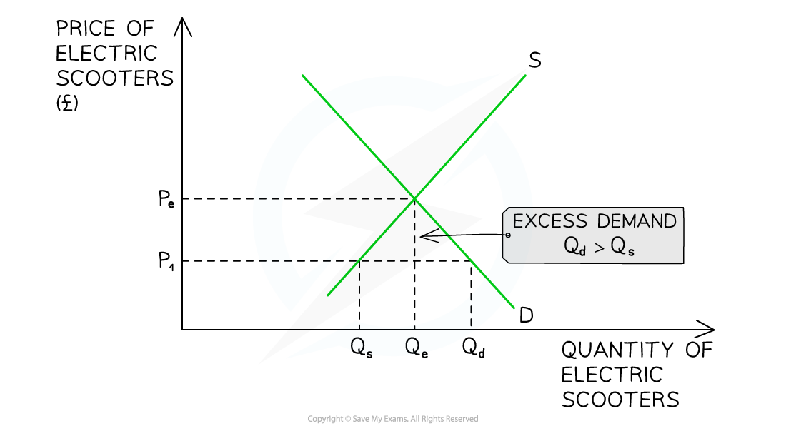

# Market Equilibrium and Disequilibrium

## Market equilibrium

> **Spec point** — `spcpt_kvr9Cv5wf2V5qcXR` · Definition of market equilibrium; Drawing and interpreting equilibrium using demand and supply curves

## Market equilibrium

- In a ***market system***, prices for goods or services are determined by the **interaction of demand and supply**

  - A **market **is any place that brings **buyers** **and** **sellers** together
- Buyers and sellers meet to **trade** at an **agreed price**

  - Buyers agree the price **by purchasing** the good or service
  - If they do not agree on the price, then they **do not purchase** the good or service and are exercising their ***consumer sovereignty***
- Based on this interaction with buyers, **sellers** will gradually **adjust their prices** until there is an **equilibrium price** and **quantity** that works for both parties

  - At the equilibrium price, **sellers** will be satisfied with the **rate and quantity** of sales
  - At the equilibrium price, **buyers are satisfied **that the product provides benefits worth paying for

### Graphing equilibrium

- Equilibrium in a market occurs when **demand = supply**
- At this point the price is called the **market clearing price**

  - This is the **price** at which sellers are clearing (selling) their stock **at an acceptable rate**

*Equilibrium occurs at the intersection of demand and supply*

- Any price **above or below** P creates **disequilibrium **in this market

  - Disequilibrium occurs whenever there is **excess demand** or **excess** **supply** in a market

## Market disequilibrium

> **Spec point** — `spcpt_5MBW9nfPdcS4jRgM` · Drawing and interpreting disequilibrium using demand and supply curves; shortages (demand exceeding supply) and surpluses (supply exceeding demand

## Market disequilibrium

### Disequilibrium: excess demand

- **Excess demand** occurs when the demand **is greater** than the supply

  - It can occur when **prices are too low** or when **demand is so high** that supply cannot keep up with it

*Excess demand in the market for electric scooters*

#### Diagram analysis

- At a price of P1, the **quantity demanded** of electric scooters (Qd) is **greater** than the **quantity supplied** (Qs)
- There is excess demand (a **shortage)** in the market equivalent to **Q****s****Q****d**** **

#### Market response

- This market is in **disequilibrium**

  - Sellers are frustrated that products are selling so quickly at a **price** that is obviously **too low**
  - Some buyers are frustrated as they will **not be able to purchase** the product
- Sellers realise they can **increase prices** and generate more ***revenue*** and ***profits***
- Sellers gradually **raise prices**

  - This causes a **contraction in quantity demanded **as some buyers **no longer desire** the good or service at a higher price
  - This causes an **extension in quantity supplied,** as other sellers are more **incentivised to supply** at higher prices
- In time, the market will have **cleared the excess demand** and arrive at a position of **equilibrium (P****e****Q****e****)**

  - Different markets take different lengths of **time to resolve disequilibrium**
  
    - For example, retail clothing can do so in a few days. Whereas the housing market may take several months, or even years

### Disequilibrium: excess supply

- **Excess supply** occurs when the supply **is greater** than the demand

  - It can occur when **prices are too high** or when **demand falls unexpectedly**
  - For example, during the later stages of the covid pandemic the market for face masks was in **disequilibrium**

*A graph that depicts the condition of excess supply in the market for Covid-19 face masks during the later stages of the pandemic*

#### Diagram analysis

- At a price of P1, the **quantity supplied **of face masks (Qs) is **greater** than the **quantity demanded** (Qd)
- There is excess supply (a surplus) in the market equivalent to **Q****d****Q****s**

#### Market response

- This market is in **disequilibrium**

  - Sellers are frustrated that the masks are **not selling** and that the **price** is obviously **too high**
  - Some buyers are frustrated, as they **want to purchase** the masks but are not willing to **pay the high price**
- Sellers will gradually lower** prices** in order to generate more **revenue**

  - This causes a **contraction in quantity supplied ** as some sellers **no longer desire** to supply masks
  - This causes an **extension in quantity demanded,** as buyers are **more willing **to purchase masks at** lower prices**
- In time, the market will have **cleared the excess supply** and arrive at a position of **equilibrium (P****e****Q****e****)**

## Equilibrium in demand and supply schedules

> **Spec point** — `spcpt_Kq8TVKDPxBVT92Gc` · Interpreting disequilibrium using demand and supply schedules; Interpreting equilibrium using demand and supply schedules

## Equilibrium in demand and supply schedules

- **A demand and supply schedule shows the quantity demanded and the quantity supplied of a product at different price levels**

  - Demand and supply schedules can be used to identify **equilibrium and disequilibrium**

#### Demand and supply schedule per week for YEEZY Boost 700 Wave Runner trainers

| **Price (\$)** | **Quantity demanded (QD)** | **Quantity supplied (QS)** | **Excess demand or supply** |
|---|---|---|---|
| 300 | 1200 | 500 | Excess demand = 700 |
| 400 | 1000 | 650 | Excess demand = 350 |
| 500 | 800 | 800 | **Equilibrium** |
| 600 | 600 | 950 | Excess supply = 350 |
| 700 | 400 | 1100 | Excess supply = 700 |

### Table analysis

- At a price of \$500, the market is in **equilibrium**

  - The QD = QS (800 units)
- At a price of \$300 and \$400, there is **excess demand,** as the product is more affordable for consumers

  - Producers supply less at lower prices as they make l**ess profit per unit**
  - Producers are **incentivised** to supply more when prices are higher
- At a price of \$600 and \$700, there is **excess supply,** as the high price has eliminated some buyers from the market

  - Producers would love to sell at this high price but in order to clear their stock, they have to lower the price and move towards the **equilibrium**
