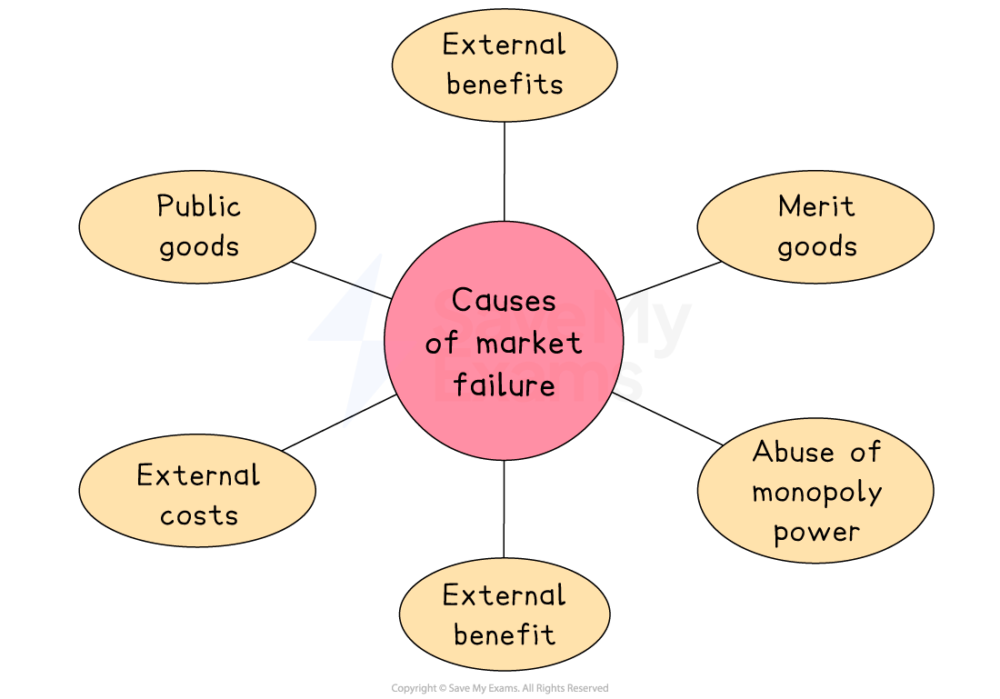

# Causes & Consequences of Market Failure

## Causes of market failure

> **Spec point** — `spcpt_tmMdXDgxkPXjYXFx` · "causes relating to public goods, merit goods, demerit goods, external costs and external benefits, abuse of monopoly power; ""implications of misallocation of resources in relation to:
– the over-consumption of demerit goods and goods with external costs
– the under-consumption of merit goods and goods with external benefits 
– the non-provision of public goods 
– restricted supply causing higher prices under a monopoly
Note: demand and supply diagrams relating to market failure are not required.
"""

## Causes of market failure

- **Market Failure** occurs when free market activity results in a **less than optimum allocation of resources** from the point of view of society

#### Causes of market failure

### Demerit goods

- These are goods that are **over-consumed** because individuals **underestimate how harmful they are** to themselves

  - The focus is on the **individual’s misjudgement** of private harm
  - These goods are often addictive
  
    - For example, gambling, alcohol, drugs, sugary foods and drinks

| Consequences |
|---|
| - Overuse leads to **increased pressure on public healthcare** and social services - **Rising social costs** from crime, addiction, or long-term illness - **Lost economic productivity** due to poor health or *absenteeism* |

### Merit goods

- These are goods that are **beneficial to society** but consumers **under-consume** them as they do not fully recognise the **private benefits**

  - **Consumers **make poor decisions due to **lack of information** or **short-term thinking**
  
    - For example. vaccinations, education, electric cars

| Consequences |
|---|
| - Lower public health or educational outcomes - Slower *economic growth* due to underinvestment in human capital - Widening inequality — especially for low-income households |

### Public goods

- Public goods are beneficial to society but would be **underprovided by a free market**
- Public goods are goods that are:

  - **Non-excludable**: you can't stop someone from using them
  - **Non-rivalrous**: one person’s use doesn’t reduce availability for others
- Due to the above two factors, there is** little opportunity** for sellers **to make profits** from providing these goods and services

  - Examples include national defence, parks, libraries and lighthouses

| Consequences |
|---|
| - Little – or no – provision in a free market - Reduced safety, *infrastructure*, or national welfare - Public goods become dependent on taxation and government budgets |

### Abuse of monopoly power

- The development of ***monopoly*** markets is a natural outcome of a **market system**
- Firms seek to **eliminate competition** by buying out competitors and increasing their ownership of **factors of production**
- With less competition, firms can raise prices, reduce the choice available to consumers, or **limit the supply**

| Consequences |
|---|
| - Consumers pay more and get less value for money - Some consumers are unable to benefit from the good or service - Fewer choices (less competition) and lower-quality goods or services - Resources are not used in the most efficient way for society |

### External costs and benefits

- Externalities occur when there is an **external cost or external benefit on a third party** not involved in the economic transaction

  - The *price mechanism* in a free market ignores these externalities
- If these external costs/benefits were acknowledged, then the **price and output in the market would be different**

| Consequences |
|---|
| - **Overproduction** of goods with external costs (e.g. factory waste) - **Underproduction** of goods with external benefits (e.g. vaccinations) - **Misallocation of resources**, reducing *social welfare* |

## Summarising some key differences

> **Spec point** — `spcpt_s7J2fWQ5GsdkFjz3` · "implications of misallocation of resources in relation to:
– the over-consumption of demerit goods and goods with external costs
– the under-consumption of merit goods and goods with external benefits 
– the non-provision of public goods 
– restricted supply causing higher prices under a monopoly
Note: demand and supply diagrams relating to market failure are not required.
"

## Summarising some key differences

### The difference between merit goods and external benefits

- Many **merit goods also create external benefits**, so they are common causes of **market failure**. But they are not identical:

|   | **Merit goods** | **External benefits (positive externalities)** |
|---|---|---|
| **Definition** | - Goods **under-consumed** because individuals **undervalue** their benefits | - Benefits that are **received by third parties** not involved in the transaction |
| **Cause of market failure** | - People make poor decisions due to **lack of information** or **short-term thinking** | - The full benefit of a good is **not reflected in the market price** |
| **Key issue** | - Under-consumption due to **misjudged private benefit** | - Under-production or under-consumption due to **unpriced social benefit** |
| **May include** | - Education, vaccinations, healthy food | - Public transport, planting trees, community art |
| **Do they always overlap?** | - Not always — not all merit goods have external benefits | - Not always — not all external benefits come from merit goods |

### The difference between demerit goods and external costs

- Many **demerit goods also create external costs**, so they are common causes of **market failure**. But they are not identical:

|   | **Demerit goods** | **External costs**  **(negative externalities)** |
|---|---|---|
| Focus | - Private harm underestimated by consumer | - Harm to third parties (society) |
| **Cause of market failure** | - Poor decision-making by individuals | - Costs not reflected in the market price |
| May include | - Cigarettes, alcohol, sugary drinks | - Pollution from factories, traffic congestion, noise |
| **Do they always overlap?** | - Not always | - Not always |
