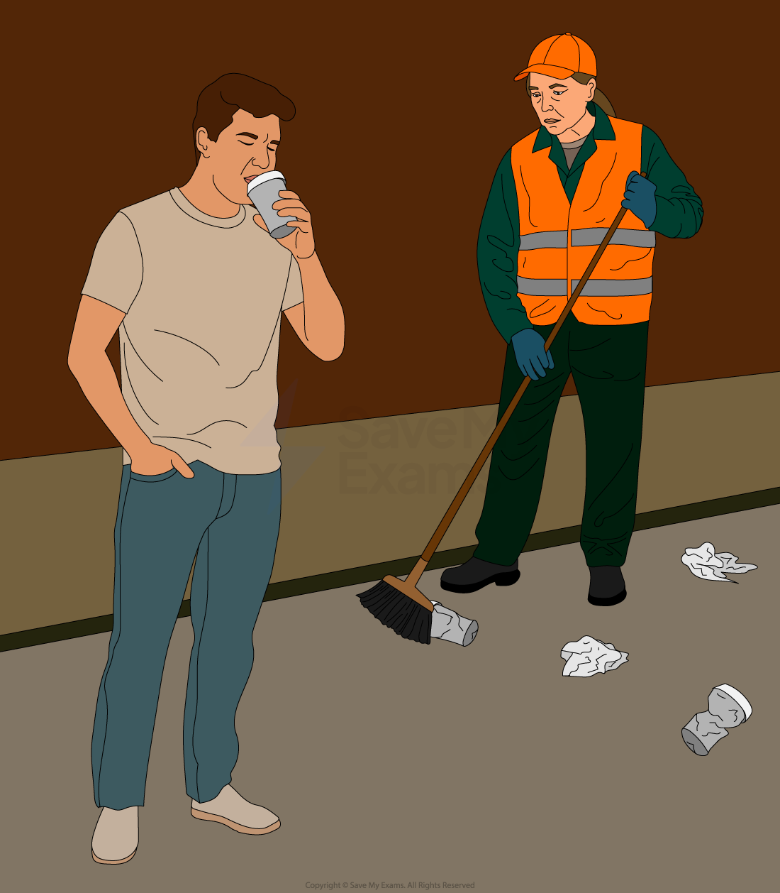
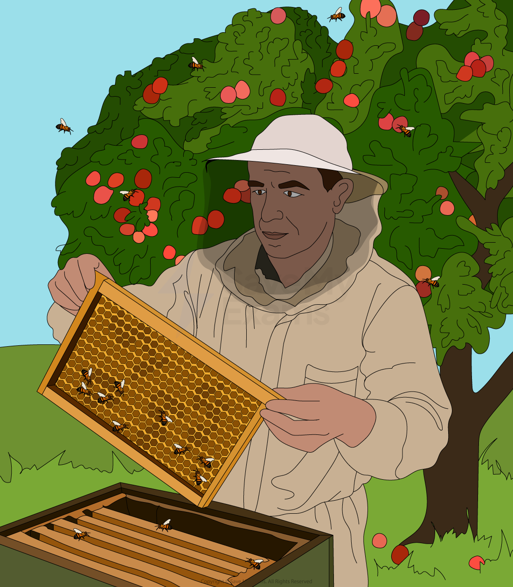

# Market Failure Terminology

## Defining market failure

> **Spec point** — `spcpt_X33B3RPdJr2dHpxX` · Defintiion of market failure

## Defining market failure

- **Market failure occurs when the free market fails to allocate resources efficiently, resulting in a loss of social welfare**

  - It can lead to **too much** or **too little** of a good or service being produced or consumed from **society’s point of view**
  - For example, pollution caused by factories is not reflected in market prices — this is a market failure
- **Free markets** often work very well
- However, these **free market can fail** when there is a **less than optimum** allocation of resources from the** point of view of society**

  - Sometimes there is an** over-provision **of goods or services which are harmful ***(demerit goods)*** and therefore an **over-allocation** of the resources (factors of production) used to make these goods/services, e.g., cigarettes
  - Sometimes there is an** under-provision **of the goods or services which are beneficial (***public goods*** and ***merit goods***) and therefore an **under-allocation** of the resources (factors of production) used to make these goods and services, e.g., schools.
  - Sometimes the market causes a **lack of equity** (inequality) – the rich get richer and the poor get relatively poorer
  - Sometimes**, environmental damage **occurs during the production or consumption of a good or service
- In each of these cases, from society’s point of view there is a lack of **efficiency in the allocation of resources**

## External costs and benefits

> **Spec point** — `spcpt_7rFjG7zF6krWTfBD` · public goods, merit goods, demerit goods, private benefits, external benefits, social benefits, private costs, external costs, social costs, monopoly

## External costs and benefits

- **Externalities **occur when there is an external impact **on a third party** not involved in the economic transaction between the **buyer and seller**

  - These impacts can be **positive (benefits) or negative (costs)** and are often referred to as **spillover effects**
  - These impacts can be on the **production side** of the market (producer supply) or on the **consumption side** of the market (consumer demand)

## Costs

#### Social cost = private cost + external cost

*The social cost equals private cost + external cost*

- **Private costs**

  - These are what the producer, consumer or government **actually pay** to produce or consume a good or service
  
    - For example, a consumer pays \$9 for a McDonald's meal
- **External costs **

  - These are the damages not factored into the market transaction
  
    - For example, the consumer throws their McDonald's packaging onto the street and the Government has to hire cleaners to collect the litter
- **Social costs**

  - These includes both the private cost and the external cost to society
  
    - It is a better reflection of the true cost of an economic transaction

### Benefits

#### Social benefit = private benefit + external benefit

*The external benefits of beekeeping*

- **Private benefits**

  - These are what the producer, consumer or government **actually gain** from producing or consuming a good or service
  
    - For example, a bee farmer gains the **private benefit** of the income from selling their honey
- **External benefits **

  - An **external benefit (positive externality)** is the benefit not factored into the market transaction
  
    - For example, the bees from the bee farm pollinate the nearby apple orchards

- **Social benefits**

  - These include both the private benefit and the external benefit to society
  
    - It is a better reflection of the true benefit of an economic transaction

> **Exam Hint**
> Market failure results in the **overconsumption of demerit goods** and goods with external costs and the **underconsumption of merit goods** and goods with external benefits. Your understanding of this concept is frequently tested in MCQ
