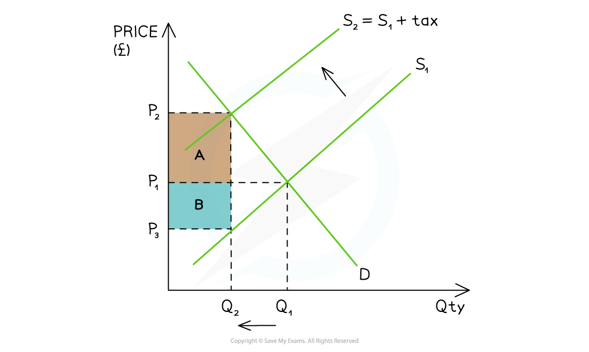

# Solutions to Market Failure: Indirect Taxation & Subsidies

## Indirect taxation

> **Spec point** — `spcpt_jrz7VcGppWGSdTh3` · Indirect taxation: definition, drawing and interpretation of diagrams, advantages and disadvantages

## Indirect taxation

- An **indirect tax **is paid on the consumption of goods or services

  - It is only paid if consumers make a **purchase**
  - It is usually levied by the government on ***demerit goods*** to reduce the quantity demanded (QD) and/or to raise **government revenue**
  - **Government revenue** is used to fund **government provision of goods and services** esuch as education
- Indirect taxes are levied by the government on **producers. **This** **is why the supply curve shifts
- **Producers and consumers **each pay a share (***incidence***) of the tax

*The impact of an indirect tax is split between the consumer (A) and the producer (B)*

### Diagram analysis

- The government places a **specific tax** on a **demerit good**

  - The supply curve shifts left from S1 → S2 by the amount of the tax
- The **price the consumer pays has increased** from P1 before the tax, to P2 after the tax
- The **price the producer receives has decreased** from P1 before the tax to P3 after the tax
- The **government receives tax revenue** = (P2 - P3) x Q2

  - The **consumer incidence** (share) of the tax is equal to **area A: (P****2 ****- P****1****) x Q****2**
  - The **producer incidence** (share) of the tax is equal to **area B: (P****1 ****- P****3****) x Q****2**
- The **QD** in this market has **decreased** from Q1 → Q2

  - If the **decrease in QD** is significant enough, it may force producers to **lay off some workers**

#### Evaluating the use of indirect taxes to correct market failure

| **Advantages** | **Disadvantages** |
|---|---|
| - **Reduces** the quantity demanded of demerit goods - **Raises revenue** for government programs | - The **effectiveness of the tax** in reducing the use of demerit goods depends on the price elasticity of demand (PED)    - Many consumers who purchase products that are price inelastic in demand will **continue to do so** - It may help **create illegal markets** as consumers seek to avoid paying the taxes - Producers may be forced to **lay off some workers** as output falls due to the higher prices |

> **Exam Hint**
> When analysing the impact of taxes on a market, it is worth highlighting the **elasticity of the product,** as it influences who pays more of the tax (producer or consumer).
> 
> The more **price inelastic** the product, the greater the proportion of the tax that is passed on to consumers by producers, as the quantity demanded will fall less proportionately than the price increase.
> 
> The more **price elastic **the product, the smaller the proportion of the tax that is passed on to consumers by producers, as the quantity demanded will fall more proportionately than the price increase.

## Producer subsidies

> **Spec point** — `spcpt_JVMRgBd6QYRdpJFT`

## Producer subsidies

- A **producer subsidy** is a** per unit** amount of money given to a firm by the government in order to:

  - **increase production**
  - **increase the provision** of a ***merit good***
- The way a subsidy is shared between producers and consumers is determined by the **price elasticity of demand (PED)** of the product

  - Producers **keep some** of the subsidy and **pass the rest on** to the consumers in the form of lower prices

*A diagram which demonstrates the cost of a subsidy to the government (A+B) and the share received by the consumer (A) & producer (B)*

### Diagram analysis

- The original **equilibrium** is at **P****1****Q****1**
- The **subsidy** shifts the supply curve from **S → S + subsidy**:

  - This **increases the QD **in the market from **Q****1 ****→ Q****2**
  - The **new** market **equilibrium** is P2Q2
  - This is a **lower price **and **higher QD** in the market

- Producers receive **P****2** from the consumer **PLUS** the subsidy per unit from the government

  - Producer revenue is therefore **P****3 ****x Q****2**
  - **The producer share **of the subsidy is marked B in the diagram
- The subsidy **decreases the price** that consumers pay from **P****1 ****→ P****2**

  - **The consumer share** of the subsidy is marked A in the diagram
- The **total cost** to the government of the subsidy is **(P****3 ****- P****2****) x Q****2**** **represented by **area A+B**

#### Evaluating the use of producer subsidies to correct market failure

| **Advantages** | **Disadvantages** |
|---|---|
| - Can be **targeted** to help specific industries - **Subsidies lower prices** and increases demand for merit goods - They helps to **change destructive consumer** behaviour over a longer period of time    - For example, subsidising electric cars makes them affordable and helps motorists to see them as an option for the masses - and not just the wealthy | - Subsidies distort the **allocation of resources** in markets    - They often result in excess supply when used in agricultural markets - There is an **opportunity cost** associated with the government expenditure – could the money have been better used elsewhere? - Subsidies are **prone to political pressure** and *lobbying* by powerful business interests    - For example, most oil companies receive subsidies from their respective governments (despite making \$billions in profits each year) |
