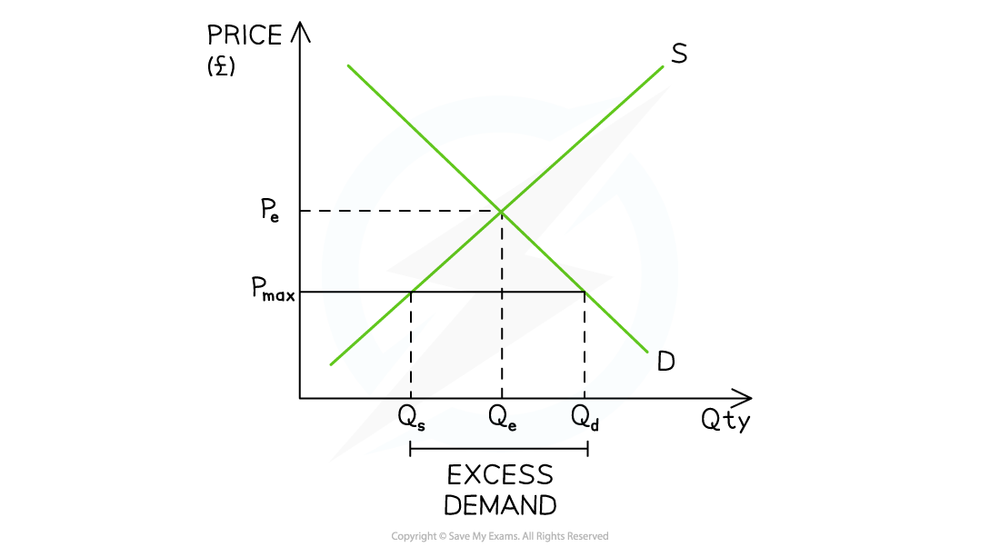
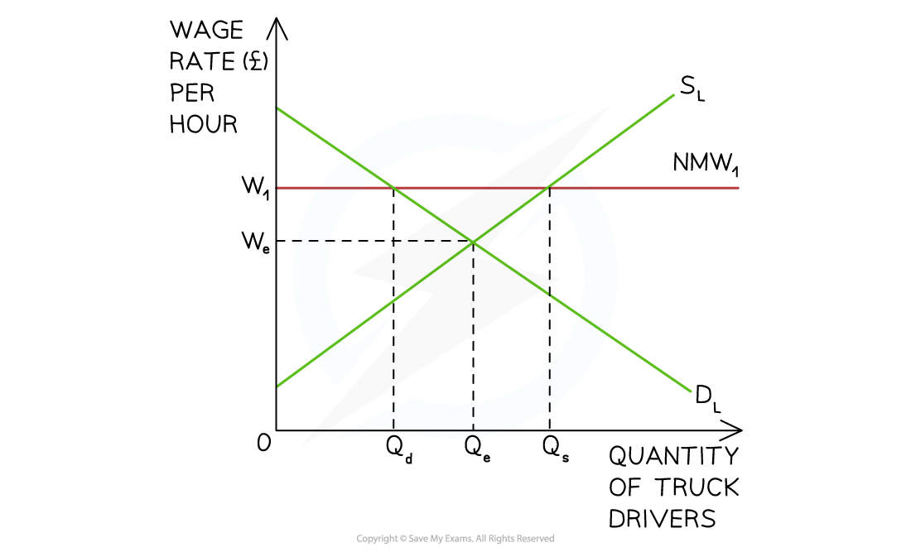

# Solutions to Market Failure: Maximum & Minimum Prices

## Intervention to address market failure

> **Spec point** — `spcpt_qKWrQf3jSDxkZKHQ` · Government intervention in markets to address market failure

## Intervention to address market failure

- Four of the most commonly used methods to address market failure in markets are

  - **maximum prices**
  - **minimum prices  **
  - **indirect taxation**
  - **subsidies**
- Additional methods of intervention include regulation, ***nationalisation***, ***privatisation***, and government (state) provision of public goods

## Maximum prices

> **Spec point** — `spcpt_tBnbb7VhqGF6MVrC` · Maximum Prices: definition, drawing and interpretation of diagrams, advantages and disadvantages

## Maximum prices

- A **maximum price **is set by the government **below** the existing **free market equilibrium price** and sellers cannot legally sell the good/service at a higher price
- Governments will often use **maximum prices** in order to help **consumers.**

  - Sometimes they are used for **long periods** of time e.g. housing rental markets.
  - Other times they are **short-term solutions** to unusual price increases e.g. petrol

*The maximum price (Pmax) sits below the free market price (Pe) and creates a condition of excess demand (shortage)*

### Diagram analysis

- The initial **market equilibrium** is at PeQe
- A **maximum price **is imposed at **P****max**

  - The lower price **reduces the incentive to supply** and there is a contraction in QS from Qe → Qs
  - The lower price i**ncreases the incentive to consume** and there is an extension in QD from Qe → Qd
  - This creates a condition of **excess demand equal to Q****s****Q****d**

#### Evaluating the use of  maximum prices

| Advantages | Disadvantages |
|---|---|
| - **Some consumers benefit** as they purchase at lower prices - Maximum prices can **stabilise markets in the short term **during periods of intense disruption e.g. Covid supplies at the start of the pandemic | - Some consumers are **unable to purchase** due to the shortage - The unmet demand usually encourages the creation of **illegal markets** (*black market* or *grey market*) as desperate buyers turn to illegal bidding - Maximum prices distort market forces and therefore can result in an **inefficient allocation of scarce resources** e.g. maximum prices in rentals in the property market create a shortage |

## Minimum prices

> **Spec point** — `spcpt_gVTY2csvGWxGC9kt` · Minimum prices: definition, drawing and interpretation of diagrams, advantages and disadvantages

## Minimum prices

- A **minimum price **is set by the government **above** the existing **free market equilibrium price** and sellers cannot legally sell the good or service** at a lower price **
- Governments will often use **minimum prices** in order to **help producers **or to** decrease consumption of a demerit good **such as alcohol

*The imposition of a minimum price (Pmin) above the free market price (Pe) creates a condition of excess supply (surplus)*

### Diagram analysis

- The initial **market equilibrium** is at PeQe
- A **minimum price **is imposed at **P****min**

  - The higher price **increases the incentive to supply** and there is an extension in QS from Qe → Qs
  - The higher price decreases** the incentive to consume** and there is a contraction in QD from Qe → Qd
  - This creates a condition of **excess supply Q****d****Q****s **

#### Evaluating the use of minimum prices in product markets

| **Advantages** | **Disadvantages** |
|---|---|
| - **In agricultural markets, **producers benefit as they receive a higher price (governments will often purchase **excess supply** and store it or export it) - When used in ***demerit markets*****, output falls** (Ggovernments will not purchase the **excess supply **of a demerit good)** ** - **Producers** usually **lower their output** in the market to match the QD at the minimum price and this helps to reduce the **external costs** | - It costs the government to purchase the excess supply and an ***opportunity cost*** is involved - Farmers may become **over-dependent **on the government's help - Producers lower output which may result in an **increase in unemployment** in the industry |

### Minimum prices in labour markets

- Minimum prices are also used in the **labour market to protect workers** from wage exploitation

  - These are called** national** **minimum wages **
- A **national minimum wage (NMW) **is a **legally imposed wage level** that employers must pay their workers

  - It is set **above** the market rate
  - The minimum wage per hour varies **based on age**
  ** **

#### Diagram analysis

- The **demand for labour (D****L****)** represents the demand for workers by firms
- The **supply of labour (S****L****)** represents the supply of labour by workers
- The **market equilibrium** wage and quantity for truck drivers in the UK is seen at **W****e****Q****e**
- The UK government imposes a **national minimum wage** (NMW) at **W****1**
- Incentivised by higher wages, the **supply of labour increases** from Qe to Qs
- Facing higher production costs, the **demand for labour** by firms **decreases **from Qe to Qd
- This means that **at a wage rate of W****1** there is** excess supply of labour** and the potential for** unemployment **equal to **Q****d****Q****s****  **

#### Evaluating the use of a minimum wage in labour markets

| **Advantages** | **Disadvantages** |
|---|---|
| - Guarantees a **minimum income** for the lowest-paid workers - Higher income levels help to **increase consumption** in the economy - May **incentivise** workers to be more productive | - Raises the **costs of production** for firms who may respond by **raising the price of goods and services** - If firms are unable to raise their prices, the introduction of a minimum wage may force them to lay off some workers **(increase unemployment)** |

> **Exam Hint**
> The material in this topic is frequently examined in the Paper 2 structured questions. You will be asked to **evaluate** the effectiveness of taxes, subsidies, maximum or minimum prices.
> 
> To do so:
> 
> 1. Consider the advantages and disadvantages of each method of intervention
> 
> 2. Explain that several methods of intervention are likely to be more effective than a single method e.g. smoking is **taxed and highly regulated **(age restrictions, packaging restrictions, display restrictions)
> 
> 3. Consider different market segments and their responsiveness e.g. wealthy consumers will less responsive (inelastic demand) to tax increases than poorer consumers (elastic demand)
