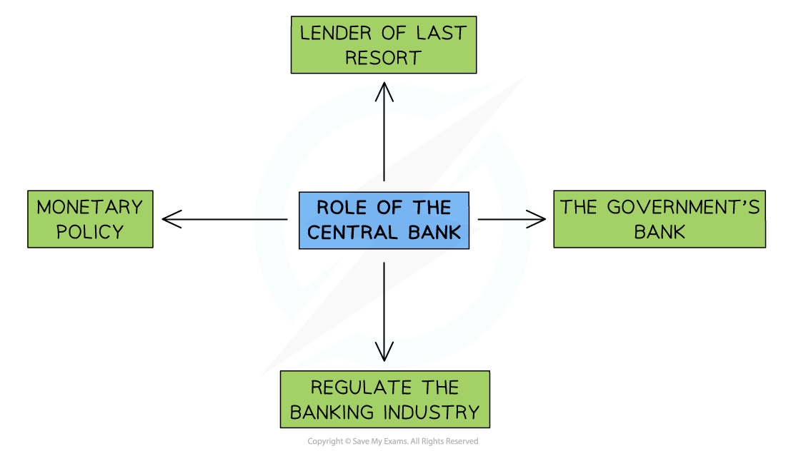

# Central & Commercial Banks

## The role and importance of central banks

> **Spec point** — `spcpt_NxqmRm9wjz2dbtpn` · The role and importance of central banks

## The role and importance of central banks

- **A central bank is the main financial institution of a country, responsible for managing the nation’s currency, money supply and interest rates**
- The Central Bank plays a vital role in **maintaining stability **in the financial system

  - The **policy tools** at their disposal help to meet **government economic objectives** and create *economic growth*

*Central Banks play four important roles in the economy*

### What do central banks do?

#### 1. Implement monetary policy

- Monetary policy is the adjustment of *interest rates* and the *money supply* so as to influence total demand and meet the inflation target

#### 2. Banker for the government

- The government sets the ***annual budget*** but it is the Central Bank that manages the **tax receipts and payments**

  - In 2022 there were 5.7 million public sector workers in the UK who had to be paid by the Central Bank each month

#### 3. Banker to the commercial banks – lender of last resort

- Commercial banks are able to borrow from the Central Bank when they run into short-term ***liquidity*** issues
- Without this help, they might go **bankrupt** leading to instability in the financial system - and a potential loss of savings for many households

#### 4. Regulation of the banking industry

- **Regulation** is when the **government sets rules or laws** to control the way consumers and producers behave in a market
- The high level of ***asymmetric information*** in financial markets requires that commercial banks are **regulated** in order to protect consumers

## The role and importance of commercial banks

> **Spec point** — `spcpt_f5QnG9YBdht442JW` · The role and importance of commercial banks

## The role and importance of commercial banks

- **Commercial banks are financial institutions that accept deposits from individuals and businesses, and provide loans and other financial services for profit**

### Roles of commercial banks

- **Accepting deposits**

  - Provide safe storage for customers’ money
  - Offer different types of accounts (*current*, savings, fixed deposit) with varying interest rates
- **Lending to customers**

  - Provide loans, *overdrafts*, and *mortgages* to individuals and businesses.
  - Generate profit mainly through interest charged on loans
- **Facilitating payments**

  - Offer payment services such as debit/credit cards, *cheque clearing*, and online banking
  - Enable domestic and international transfers (e.g. *SWIFT payments*)
- **Providing financial advice**

  - Advise customers on investments, savings and business finance
- **Foreign exchange services**

  - Exchange currencies for trade, travel or investment

### Importance of commercial banks

- **Encourage saving**

  - They provide a secure place for individuals and firms to save, helping to mobilise funds for investment
- **Support business growth**

  - Offer *credit facilities* for expansion, *working capital* and start‑up capital.
- **Economic stability**

  - Help circulate money in the economy by channelling savings into productive investments
- **Facilitate trade**

  - Provide trade finance, *letters of credit*, and foreign currency for importers and exporters
- **Convenience**

  - Offer easy access to financial services through branches, ATMs and online banking
