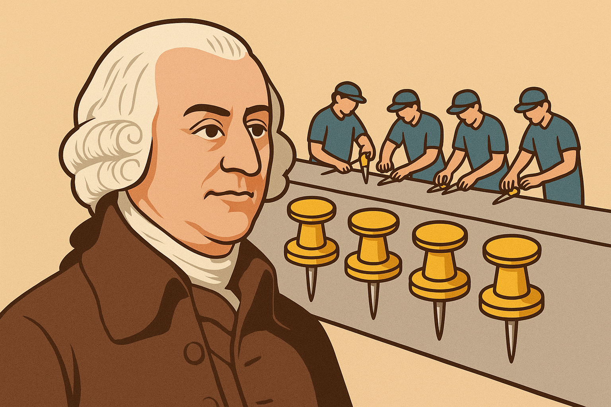

# Division of Labour & Worker Specialisation

## Specialisation and the division of labour

> **Spec point** — `spcpt_WpsGKqtSShdqZb54` · Specialisation and the division of labour

## Specialisation and the division of labour

- **The division of labour is when a task is broken up into several component tasks**

  - This allows workers to **specialise** by focusing on one (or a few) of the components that make up the production process and thereby gain significant skill in doing it
  
    - This results in higher **output per worker** and so increases productivity

*Adam smith observing work behaviour in a factory*

- Based on observations made during a visit to a pin factory, famous economist **Adam Smith** developed the ideas of **specialisation** and the **division of labour**

  - He noted that a single worker could not make more than 20 pins a day as it involved around 18 different processes, such as cutting the wire, sharpening the end, stamping the head etc.
  - However, if the labour was **divided up into different tasks** and workers **specialised in just that one task**, Adam Smith estimated that just 10 workers could produce 48,000 pins per day
- **Specialisation** occurs on several different levels

  - On an** individual** level
  - On a **business** level, for example, one firm may only specialise in manufacturing drill bits for concrete work
  - On a **regional** level, for example, Silicon Valley has specialised in the tech industry
  - On a **global **level, as countries seek to trade, for example Bangladesh specialises in textiles and exports them to the world

## Advantages and disadvantages of the division of labour

> **Spec point** — `spcpt_sGBpBgDdp5yF95rD` · Advantages and disadvantages of the division of labour

## Advantages and disadvantages of the division of labour

#### Evaluating the impact on workers, firms and the ecnomy

| **Stakeholder** | **Pros** | **Cons** |
|---|---|---|
| **Worker** | - Workers can acquire the **single skill** required relatively quickly - Workers gain **recognition and status** for performing their skill well | - The work can be **repetitive and boring** - There is limited opportunity to gain additional skills - If the firm replaces **labour with capital**, the worker may find it difficult to find employment elsewhere due to their **limited skill base** |
| **Firm** | - **Time spent training** new workers is relatively short - **Increased output** allows firms to generate more sales and profit - Higher labour productivity **lowers cost per unit** for firms, which makes their goods more competitive **internationally (exports)** | - Worker **productivity** can fall due to the boredom/ decreased motivation experienced - **Staff turnover** may be high as workers seek new, interesting opportunities elsewhere - International trade is beneficial for the firms that **can compete **globally. However, some firms will be **unable to compete** and will go out of business - **Entire industries** may close leading to ***structural unemployment*** |
| **Economy** | - Increased exports can result in **economic growth** for the nation - Economic growth usually leads to **higher income** and a better *standard of living* - Income gained from exports can be used to **purchase** other goods from around the world **(imports). **This increases the **variety of goods** available in a country | - Specialisation may create **over-dependency** on other countries' resources - This may **cause problems **if conflict arises (E.g. Europe's reliance on Russian natural gas during the Ukraine crisis) - Specialisation using a country's **own resources** will lead to *resource depletion* |
