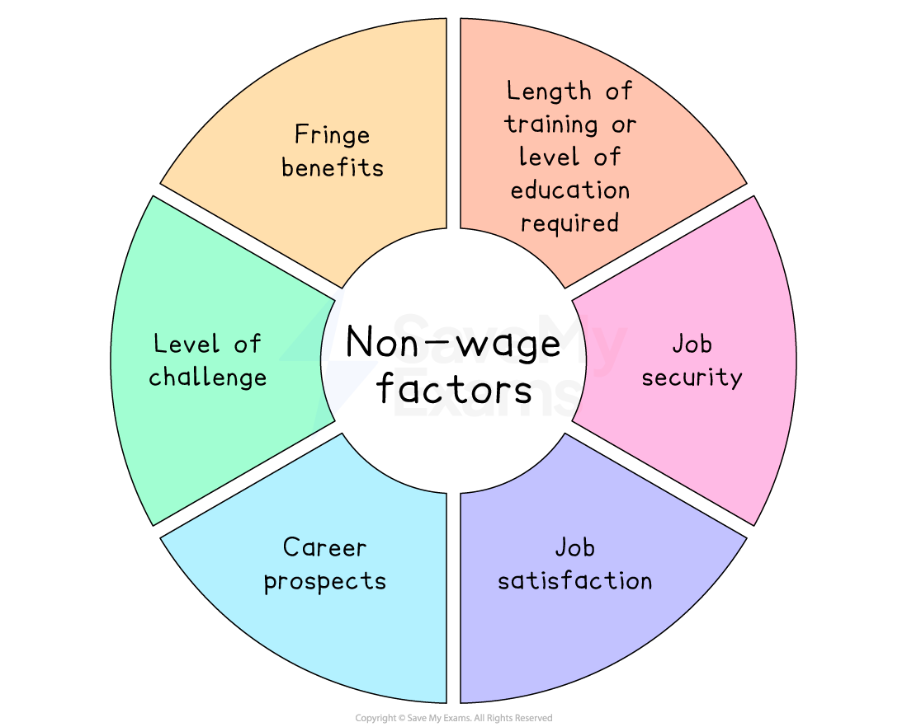

# Factors Affecting the Choice of Occupation

## Wage factors

> **Spec point** — `spcpt_fqk95tVx8RfXhPf9` · Wage factors

## Wage factors

- The **occupational choices** of workers are influenced by a range of **wage and non-wage factors, **which are often held in balance when making decisions about **where to work**
- Wage factors are **financial payments** that workers receive for their labour
- Non-wage factors incorporate a **range of influences** that are meaningful to a worker

#### Wage factors that influence occupational choices

| **Factor** | **Explanation** |
|---|---|
| **Wages** | - An agreed amount of **money per hour** - E.g., if a student works in a restaurant for 6 hours, 5 days a week and she gets paid \$10/hour, her **weekly wage** is \$300 (6x5x\$10) |
| **Salary** | - Employment contracts often state the agreed **annual salary** the employee will receive - This is then divided by 12 and **paid monthly **(in the USA it is divided by 24 and paid every 2 weeks) - The hours worked monthly may vary but the pay received is **always the same** |
| **Commission** | - Often used as payment to salespeople - It is typically a **percentage of the value of the transaction** involved, e.g., estate agents receive 3-7% of the selling price of any property they sell - This can **motivate employees** to maximise sales |
| **Bonus** | - Money paid in **addition to a salary** and is usually a single annual payment - Often paid when the company earns high levels of profits, or as a **reward **for exceptional worker performance |
| **Piece rate pay** | - A **fixed amount **paid to the employee for **each completed item** produced    - e.g., 25 Rupees paid to workers in India for each pair of socks they produce |
| **Performance-related pay (PRP)** | - Payment based on how well the **worker performs** - Workers doing exactly the **same job** may receive **different compensation** based on **different outcomes** they achieve |
| **Share options** | - Payment through the issuing of *shares *in the company the employee works for - This is usually in addition to a monthly salary - The **monetary value **of the shares provided to the employee can be calculated on any given day as: **number of shares x share price** |

## Non-wage factors

> **Spec point** — `spcpt_m5yBdpQ8G5f28Y5J` · Non-wage factors

## Non-wage factors

- Many different **non-wage factors** influence a worker's choice of occupation

*Non-wage factors that can influence the choice of occupation*

### Fringe benefits

- Benefits provided in addition to a normal salary, such as:

  - Childcare
  - Free lunches
  - Gym membership
  - Company car
- These can be a significant influence on a person’s choice of occupation

### Length of training or level of education required

- Longer training or study requirements may discourage people from entering the occupation
- Fewer workers are willing to invest the time and cost needed for lengthy qualifications.

  - For example, becoming a lawyer usually takes seven years of study and training

### Job security

- Stability of employment can be an important deciding factor
- Some industries offer *permanent contracts*; others have short‑term contracts (e.g. 1–4 years)
- Workers may avoid jobs in industries with high *redundancy *risk

### Job satisfaction (enjoyment of work)

- Enjoying work is a major contributor to overall job satisfaction
- Workers often change jobs or careers to improve enjoyment and fulfilment

### Career prospects

- Occupations with clear pathways for promotion and skill development are more attractive
- Opportunities for salary increases and advancement encourage workers to stay in or choose certain careers

### Level of challenge

- Some workers choose roles for the challenge and variety they offer

  - For example, firefighters often value the physical and mental challenges of their work

### Status

- Certain jobs carry high social recognition, which can be appealing.

  - For example, doctors, surgeons, and lawyers are often seen as prestigious professions
