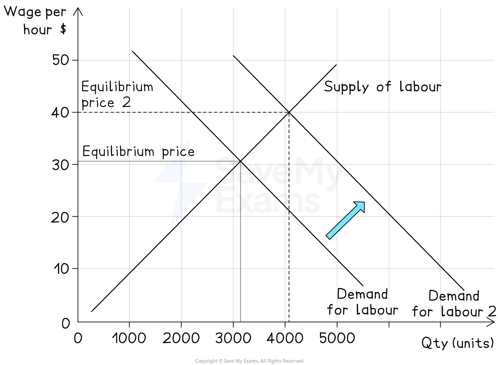
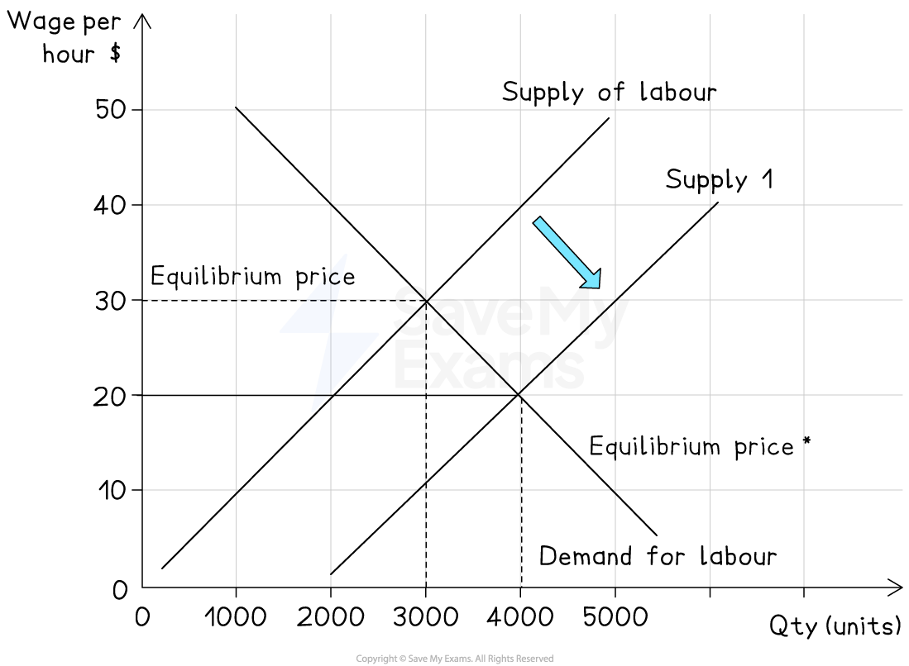
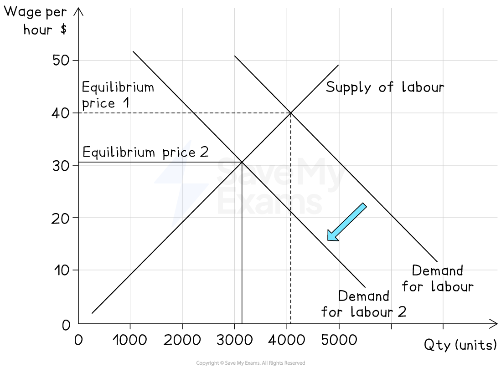
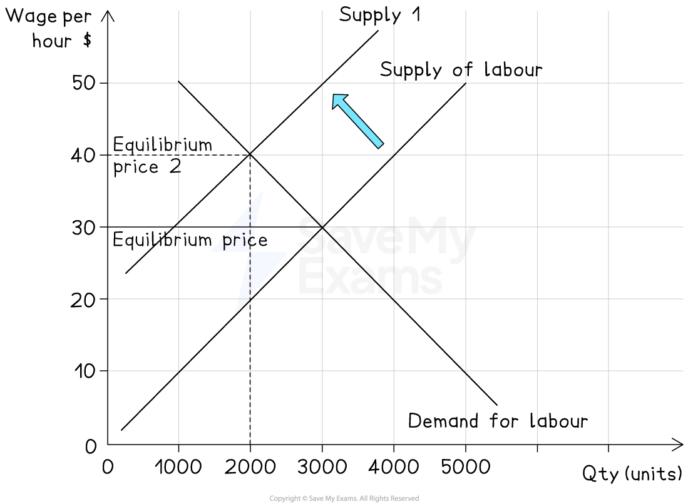
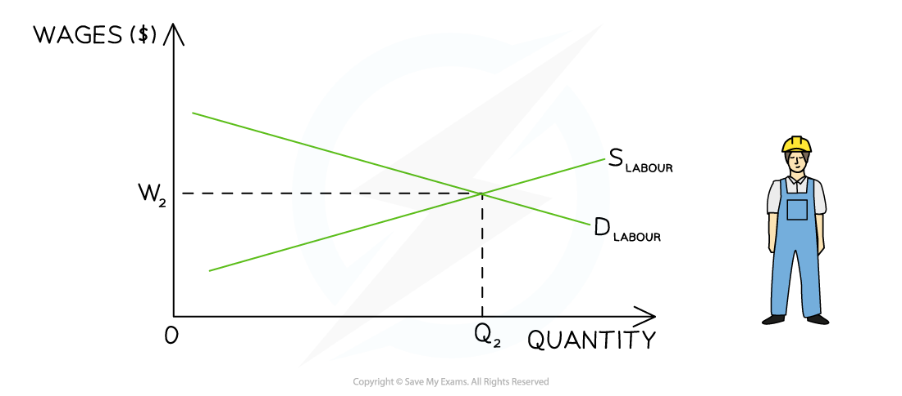

# Labour Market Diagrams

## Drawing and interpreting labour market diagrams

> **Spec point** — `spcpt_HV3JZSQwc6HtkhVn` · Drawing and interpreting labour market diagrams

## Drawing and interpreting labour market diagrams

- The **labour marke**t is a type of ***factor market***
- **Factor markets** follow exactly the same rules as** product markets**

  - They are affected by changes to price, demand and supply
  - They are affected by the **price elasticity of demand and supply**
- **Labour market equilibrium** occurs where the **demand for labour (D****L****)** is equal to the **supply of labour (S****L****)**

  - The DL is the demand **by firms** for workers
  
    - Firms **demand more** labour as the wage rate decreases, which results in a downward-sloping demand curve
  - The SL is the supply of labour **by workers**
  
    - Workers **supply more** labour as the wage rate increases, which results in an upward-sloping supply curve
- Individual firms are ***price takers*** in the labour market, as they have to accept the **wage rate **that workers are being paid in the industry

  - If they offer a** lower wage,** they will likely struggle to recruit workers
  - If they offer a **higher wage,** there will be a large number of workers applying to work there

*In the labour market for graphic designers, the equilibrium wage rate is W and the equilibrium quantity is Q. At this point the DL = SL*

### Diagram analysis

- The market for graphic designers is in **equilibrium where D****L**** = S****L **
- The **equilibrium wage** is W and the **quantity** of labour is Q
- There is ***no excess supply*** of labour
- There is ***no excess demand*** for labour

## Changes in demand and supply in the labour market

> **Spec point** — `spcpt_X8Kq4GfrVvb6V6bB` · Changes in demand and supply in the labour market

## Changes in demand and supply in the labour market

### 1. Increase in demand for labour

*An increase in the demand for labour increases the equilibrium wage rate*

- **Cause**

  - Economic growth, increased demand for goods and services, higher labour productivity
- **Effect on diagram**

  - Labour demand curve shifts **right** (*D1 → D2*)
- **Result**

  - Higher equilibrium wage rate (*W1 → W2*) and more labour employed (*Q1 → Q2*)

### 2. Increase in supply of labour

*An increase in the supply of labour decreases the equilibrium wage rate*

- **Cause**

  - *Immigration*, higher working‑age population, more flexible working patterns
- **Effect on diagram**

  - Labour supply curve shifts **right** (*S1 → S2*)
- **Result**

  - Lower equilibrium wage rate (*W1 → W2*) and more labour employed (*Q1 → Q2*)

### 3. Decrease in demand for labour

*A decrease in the demand for labour decreases the equilibrium wage rate*

- **Cause**

  - Recession, automation replacing workers, falling demand for goods
- **Effect on diagram**

  - Labour demand curve shifts **left** (*D1 → D2*)
- **Result**

  - Lower equilibrium wage rate (*W1 → W2*) and less labour employed (*Q1 → Q2*)

### 4. Decrease in supply of labour

*A decrease in the supply of labour increases the equilibrium wage rate*

- **Cause**

  - Ageing population, *emigration*, higher welfare benefits reducing incentives to work
- **Effect on diagram**

  - Labour supply curve shifts **left** (*S1 → S2*)
- **Result**

  - Higher equilibrium wage rate (*W1 → W2*) and less labour employed (*Q1 → Q2*)

## Analysing the PED and PES of labour

> **Spec point** — `spcpt_CMyjrRm696pKWSfn` · Analysing the PED and PES of labour

## Analysing the PED and PES of labour

### Price inelastic demand and supply

- Consider the** labour market** for NBA basketball players
- In 2022, ***LeBron James*** received a salary of \$45m

*The impact of inelastic demand and supply in the labour market*

#### Diagram analysis

- **D****L**** **is the demand for labour **from the basketball clubs**
- **S****L** is the supply of labour **by the basketball players**
- The **demand **for highly skilled players is very **price inelastic**

  - Clubs want the very best players, almost irrespective of what they **cost**
- The **supply** of highly skilled players is also very **price inelastic**

  - A significant increase in price will have little impact on the quantity of labour supplied in the market, as it takes years to develop ***LeBron James-type*** skills
- The **market equilibrium** is found at W1Q1 - a **high price** and relatively **low quantity**

### Price elastic demand and supply

- Consider the** labour market** for labourers on a building site

#### Diagram analysis

- **D****L**** **is the demand for labour **from the building company for labourers**
- **S****L** is the supply of labour **by people willing to work on a building site**
- The **demand **for workers is very **price elastic**

  - If wages dropped a little, then firms would respond quickly by **employing more workers**
- The **supply** of workers is also very **price elastic**

  - Due to it being an unskilled job, there would quickly be an increase in the **supply of labour** if wages were to increase
- The **market equilibrium** is found at W1Q1 - a **low price** and relatively **high quantity**
