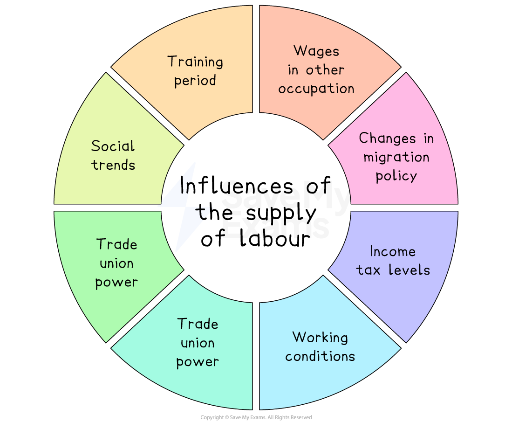

# Wage Determination

## Influences on the demand for labour

> **Spec point** — `spcpt_S5b7nVgdNB6dfzwf` · "drawing and interpretation of diagrams that illustrate the effects of:
– changes in demand and supply in the labour market"

## Influences on the demand for labour

- The **labour market** is composed of **sellers of labour** (households) and **buyers of labour** (firms)

  - **Workers supply **their labour and **firms demand** labour
- The demand for labour is a **derived demand**

  - This means that **it depends on the demand for goods and services**
  
    - If demand for goods and services increases, then the demand for labour will increase – and  vice versa

### Factors that influence the demand for labour

#### 1. The price of the product being produced

- If the **selling price** of the product** increases**, then the firm will be incentivised to supply more, and the firm's **demand for labour** will increase

#### 2. The demand for the final product

- As demand for labour is a **derived demand**, when an economy is booming, then **demand for most goods and services will be high **– and the demand for labour will be **high**
- Conversely, when an economy is in a ***recession*** demand for most goods and services will be lower - and the **demand for labour will be lower**

#### 3. The ability to substitute capital (machinery) for labour

- Firms will constantly evaluate if it will be possible and **more cost-effective** to switch production from using labour to capital (machinery)
- If it is more cost-effective, then **demand for labour will fall**

#### 4. The productivity of labour

- If the ***productivity*** of labour increases (possibly through training), this will lower **average costs, **and firms will likely demand more labour

## Influences on the supply of labour

> **Spec point** — `spcpt_Q2jsDTr2bHCdqhtv` · Influences on the supply of labour

## Influences on the supply of labour

- Households supply labour in a market economy
- There are **numerous factors** that influence the amount of labour supplied to a **particular industry**

*The supply of labour is influenced by many factors*

### Training period

- **Long training periods **(and their cost) act as a *barrier to entry* and** exclude many households** from offering labour in certain markets

### Wages in other occupations

- **Comparative wage rates** in substitute labour markets strongly influence the supply of labour

  - For example, it is getting harder to recruit economics teachers as businesses in the ***private sector*** offers **higher wages** for their skills

### Changes in migration policy

- Policies that increase the ***net migration rate *** increase the supply of labour to certain industries

  - For example, in 2022, 36% of Singapore's labour force were migrants

### Income tax levels

- Beyond a certain level, ***income taxes***** become a disincentive to households** offering their labour
- The assumption is that **as income tax increases, labour supply decreases** - and vice versa

### Working conditions

- The working conditions and non-wage benefits can act as strong incentive in certain industries

  - For example, tech companies are well known for their **laid-back work environment and wide range of benefits.** e.g. on-site childcare and restaurants

### Trade union power

- ***Trade unions*** can increase the supply of labour to certain industries as **workers consider the benefits** of belonging to the union,

  - For example, higher wages and a safer working environment

### Level of welfare benefit

- The **higher **the level of ***welfare benefits***, the **lower the incentive** for low-skilled labour to offer their labour – and vice versa

### Social trends

- Social trends include any **major changes within society** and can influence the supply of labour to certain industries

  - For example. working from home during Covid resulted in **significant changes to the labour market** and not all workers returned to work when economies opened up again

## Trade unions and their relative bargaining power

> **Spec point** — `spcpt_MrBRk35RfqxfbN2k` · Trade unions and their relative bargaining power

## Trade unions and their relative bargaining power

- **A trade union is an organisation formed by workers to protect and promote their common interests, particularly regarding pay, working conditions, and employment rights**
- Trade unions negotiate with employers on behalf of all of their members (**collective bargaining**) on wages, working hours, and benefits
- Their bargaining power can influence **wage levels above** what might be set by market forces alone

### Factors affecting a trade union’s bargaining power

- **Membership size (employee participation)**

  - Large, well-organised unions can exert more influence
- **Wage levels as proportion of total costs**

  - The lower the percentage of total costs that a firms's wages represent, the higher the bargaining power
- **Swapping labour for capital**

  - The nearer the replacement cost of capital for labour to meeting the increased costs demanded by the union, the weaker the bargaining power
- **Legal framework**

  - Labour laws may support or restrict union activities (e.g., right to *strike*, limits on *picketing*)
- **Firm's profits**

  - Firms making higher profits may be more able (and willing) to agree to wage increases
- **State of the economy**

  - In a strong economy with low unemployment, unions have more leverage; in a *recession*, less
- **Skill level of members**

  - Unions that represent highly skilled, specialised workers tend to have more bargaining power because their labour is harder to replace.
