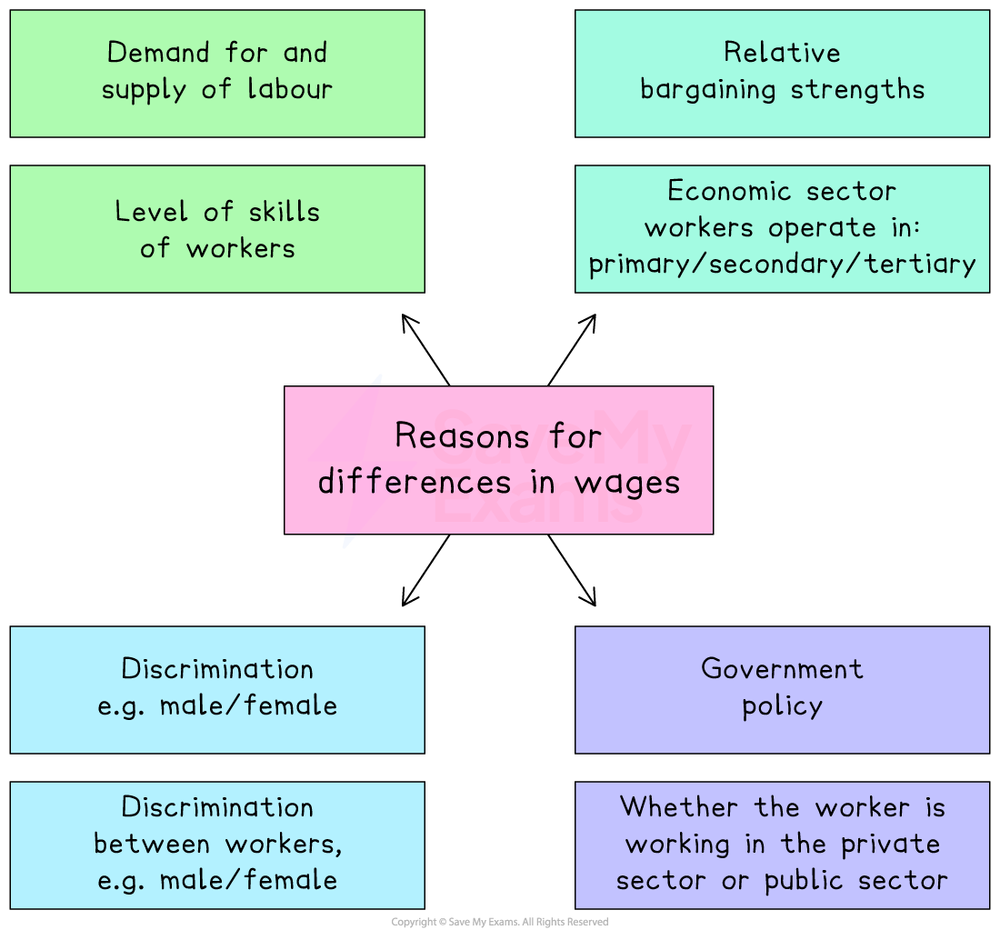

# Wage Differentials

## What causes differences in wage levels?

> **Spec point** — `spcpt_2bys3bJVPM5d9wcP` · "– demand for and supply of labour
– relative bargaining strengths
– discrimination, e.g. male/female
– government policy"

## What causes differences in wage levels?

- Wage levels vary significantly across occupations, industries, and even between workers doing similar jobs
- These differences arise from a combination of *market forces*, institutional factors, and social influences

*The causes of wage differentials are varied*

- In competitive labour markets, wages are largely determined by the interaction between the **demand for labour** and the **supply of labour**
- However, other factors such as **bargaining power**, **government policy**, and ***discrimination**** *can also play a decisive role
- The impact of these influences often depends on the worker’s **skill level**, the **sector** in which they operate (primary, secondary, or tertiary), and whether they work in the **private** or **public** sector

## Explaining wage differentials

> **Spec point** — `spcpt_Rn4fCNNwCBtncYPm` · "how these reasons influence the wages of workers, depending on:
– level of skills of workers
– economic sector workers operate in: primary/secondary/tertiary
– discrimination between workers, e.g. male/female
– whether the worker is working in the private sector or public sector"

## Explaining wage differentials

### 1. High demand + low supply → higher wages

*Inelastic demand and supply for labour*

- For example, specialist surgeons or talented basketball players have scarce skills, pushing wages up

### 2. Wage differentials between skilled and unskilled workers

- Many economies have a **high supply of unskilled labour**

  - This means that employers can **push wages down,** as there is always someone willing to work for less (take-it-or-leave-it approach to wages)
- To become skilled takes time and money, which means that there is a more** limited supply** of specific skill sets

  - In recognition of these factors, wages for skilled workers are higher

### 3. Wage differentials in the primary, secondary and tertiary sectors

- ***Primary sector*** workers are usually paid low wages due to the unskilled nature of the job and the fact that raw materials often generate the lowest profits in the production chain
- ***Secondary sector*** workers ***add value*** to the raw materials, and these products sell for higher profits. Therefore wages tend to be higher than primary sector wages
- ***Tertiary sector*** workers are paid the highest. Their jobs often require highly valued skills that take years to acquire and the products they sell or services they provide can be complex and expensive, e.g., artificial intelligence coders

### 4. Wage differentials between private and public sector workers

- **Public sector **organisations are **owned and controlled by the government*** *
- **Private secto**r organisations are **owned and controlled by private individuals and firms**

#### Differences  between private and public sector pay

| **Private sector workers** | **Public sector workers** |
|---|---|
| - Salaries can be **extremely high**, especially if the value of goods or services offered is high and the workers are productive - Some salaries can also be **very low** as firms seek to cut costs and maximise profits e.g. garment sector worker in Bangladesh get paid very little for the work they do - Many **wage benefits** tend to be better than those provided by the public sector e.g. *bonuses *or *share options* | - Wages will reach a maximum ceiling that is often **below what the private sector** may offer; e.g., public school teachers are paid less than private school teachers - Wages often **do not fall as low** as some private sector jobs, as many public sector workers belong to ***trade unions*** - Job security is high resulting in long careers with **defined pathways for *****promotion*** - ***Pensions**** *are often very good, but are limited in comparison to private sector pensions |

### 5. Wage differentials due to relative bargaining strengths

- **Trade unions**: Strong unions can negotiate higher pay and better conditions

  - For example, skilled workers in strong unions end up with higher wages (such as pilots)
- **Employer power**: In industries with few alternative employers, firms may keep wages lower
- **Public sector**: Often has *collective bargaining* and trade union representation, but wage growth may be limited by *government budgets*
- **Private sector**: There is more scope for negotiation if worker skills are in high demand by the firms

### 6. Wage differentials due to discrimination

- Workers may be paid differently due to gender, ethnicity, disability or other biases, regardless of skill or productivity
- This results in wage gaps between groups with similar qualifications and experience

#### Gender pay gap

- The **gender pay gap** is the difference in the **average earnings** between men and women across the workforce, expressed as a percentage of men’s earnings

  - It reflects overall differences in pay, not just unequal pay for the same job
  - Causes can include differences in occupation types, working hours, career breaks, seniority and discrimination
  - A **positive gender pay gap** means men earn more on average; a **negative gap** means women earn more on average
- **Example**

  - In 2023, the UK’s national gender pay gap was around **14%**, meaning that, on average, women earned 14% less per hour than men
