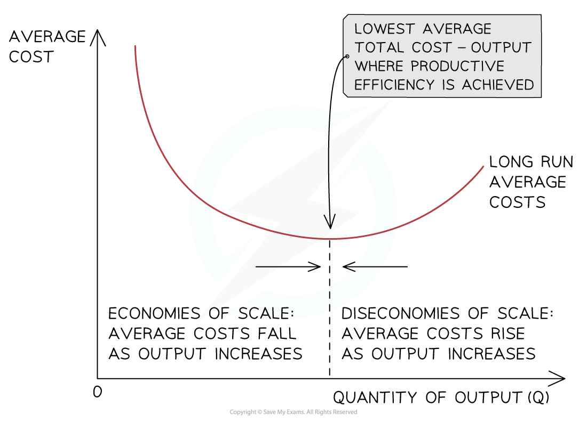

# Economies & Diseconomies of Scale

## An introduction to economies and diseconomies of scale

> **Spec point** — `spcpt_C4gDsj5s6DBxrC3C` · "how internal and external economies and diseconomies of scale can affect a firm/industry as the 
scale of production changes"

## An introduction to economies and diseconomies of scale

- **Economies of scale occur when an increase in the scale of output results in a lower cost per unit**
- As a firm grows, it is able to increases its **scale of output **generating efficiencies that lower its **average costs (AC)** of production

  - Economies of scale help large firms to **lower their costs of production** beyond what small firms are able to achieve
- **Diseconomies of scale occur when an increase in the scale of output results in a higher cost per unit**
- As a firm continues increasing its **scale of output**, it will reach a point where its **average costs (AC)** will start to **increase**

  - The reasons for the increase in the average costs are called **diseconomies of scale**

* Economies of scale occur when average costs decrease with increasing output and diseconomies of scale occur when average costs increase with increasing output*

### Diagram analysis

- With relatively low levels of output, the firm's average costs are high
- As the firm increases its output, it begins to benefit from **economies of scale** which lower the average cost per unit
- At some level of output, a firm will **not be able to reduce costs** any further

  - This point is called **productive efficiency**
- Beyond this level of output, the average cost will begin to rise as a result of **diseconomies of scale**

## Causes of internal economies of scale

> **Spec point** — `spcpt_fQCJwFZGcF8PPCSZ` · "drawing and interpretation of average total cost (ATC) diagrams to illustrate economies and diseconomies of scale
"

## Causes of internal economies of scale

- **Internal economies of scale** occur as a result of the growth in the scale of production **within** the firm

| **Type of economy** | **Explanation** |
|---|---|
| **Financial economies** | - Large firms can borrow money at lower interest rates, as they are seen as less risky by lenders - They also have access to a wider range of finance sources |
| **Managerial economies** | - As firms grow, they can hire specialist managers for different departments, leading to more efficient decision-making and improved productivity |
| **Marketing economies** | - Larger firms can spread the cost of marketing (e.g. advertising, promotion) over a greater output, reducing the cost per unit sold |
| **Purchasing economies** | - Bigger firms buy inputs (e.g. raw materials) in bulk, allowing them to negotiate lower prices and better terms with suppliers |
| **Technical economies** | - Large-scale production allows firms to invest in more advanced equipment or use production techniques that smaller firms cannot afford, improving efficiency |
| **Risk-bearing economies** | - Large firms can spread risk by operating in different markets or producing a range of products, so failure in one area has less impact overall |

## Causes of diseconomies of scale

> **Spec point** — `spcpt_FvW6ZRbkRP53hy32` · Causes of diseconomies of scale

## Causes of diseconomies of scale

- As a firm continues to increase its **scale of output in the long-run**, at some point its average costs will start to **increase**
- The reasons for the increase are called diseconomies of scale

#### Causes of diseconomies of scale

| **Type of diseconomy** | **Explanation** |
|---|---|
| **Management diseconomies** | - Occur when managers work more in their own interest than in the interest of the firm, e.g. managers become territorial and obstructive thus reducing efficiency and increasing the average costs |
| **Communication diseconomies** | - Occur when a firm with multiple layers of management and perhaps in multiple geographic locations struggles to communicate quickly and efficiently, leading to slow responses and increased average costs |
| **Geographical diseconomies** | - Occur when a firm has widespread bases of operations and this leads to logistical and communication challenges which can raise the average costs |
| **Cultural diseconomies** ** ** | - Occur when a firm expands into foreign markets in which workers have very different cultural work or productivity norms, which can raise the average costs |

## Causes of external economies of scale

> **Spec point** — `spcpt_PBz8wGnfxn34kF7Y` · Causes of external economies of scale

## Causes of external economies of scale

- **External economies of scale occur when there is an increase in the size of the industry in which the firm operates**

  - The firm is able to benefit from lower **average total costs **generated by factors **outside of the firm**

#### Sources of external economies of scale

| **Type of external economy** | **Explanation** |
|---|---|
| **Geographic cluster** | - As an industry grows, *ancillary firms* move closer to major manufacturers to cut costs and generate more business - This **lowers the average total cost**    - For example, car manufacturers in Sunderland rely on the service of over 2,500 ancillary firms |
| **Transport links** | - **Improved transport links** develop around growing industries in order to help get people to work and to improve the transport logistics - This **lowers the average total costs**    - For example,** **Bangalore is know as India's Silicon Valley and transportation projects have been successful in transforming the movement of people and goods |
| **Skilled labour** | - An increase in skilled labour can **lower the cost of skilled labour**, thereby **lowering the average total cost** - The larger the geographic cluster, the larger the pool of skilled labour |
| **Favourable legislation** ** ** | - Governments may pass laws that help to lower business costs - This often generates significant reductions in average total costs, as **governments support certain industries** in order to **achieve their wider objectives ** |

> **Case Study**
> **Discovery Channel in Mediapolis, Singapore**
> 
> Discovery Channel, a major global broadcaster, has established regional production and broadcasting facilities within **Mediapolis**, Singapore’s purpose-built media and tech hub. This location provides an excellent example of how **external economies of scale** benefit large firms as the **industry around them expands**.
> 
> 
> 
> **Geographic cluster**
> 
> - As Mediapolis has grown, **ancillary firms** offering services like animation, sound design, post-production, and media technology support have moved close to large media clients like Discovery
> - This **concentration of supporting firms** lowers Discovery’s average costs by **reducing travel time**, enabling faster collaboration, and giving access to multiple suppliers in one location
> 
> **Transport links**
> 
> - The development of **high-quality transport infrastructure** in and around Mediapolis helps Discovery staff and equipment move efficiently across the city and region
> - With easy access to metro stations, shuttle buses, and expressways, this reduces logistical costs and **improves the reliability of production schedules**
> 
> **Skilled labour**
> 
> - Singapore’s government has partnered with universities and polytechnics to ensure a **constant supply of skilled media professionals**, including editors, producers, and broadcast engineers
> - Discovery Channel benefits directly from this pool of talent, lowering its recruitment costs and ensuring access to workers with **industry-specific expertise**
> 
> **Favourable legislation**
> 
> - Singapore government **pro-media policies**, including grants, *tax relief*, and co-investment schemes, have made it more cost-effective for companies like Discovery to operate in the region
> - This **government support** helps reduce overheads and encourages long-term investment in innovation and digital production
> 
> **Summary**
> 
> Discovery Channel’s presence in Singapore’s Mediapolis illustrates how firms can benefit from **external economies of scale** driven by growth in the wider media industry
