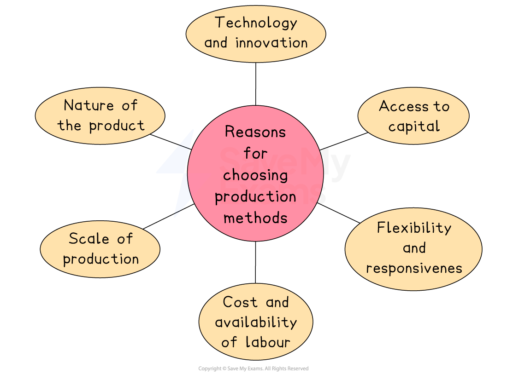

# Labour-Intensive & Capital-Intensive Production

## Defining capital-intensive and labour-intensive production

> **Spec point** — `spcpt_vyZCmJ9hb22Ttqxy` · "• reasons for adopting labour-intensive production 
• advantages and disadvantages of labour-intensive production "

## Defining capital-intensive and labour-intensive production

- **Capital-intensive **production occurs when **manufacturing relies more heavily on machinery, equipment and technology than human labour**

  - Capital-intensive means that the **proportion of machinery costs are higher** than any of the other factors of production, including labour
- **Labour-intensive production **occurs when** manufacturing relies more heavily on human workers than machines**

  - Labour-intensive means that the **proportion of labour costs are higher** than the other factors of production, including machinery

## Reasons for adopting the different forms of production

> **Spec point** — `spcpt_4r2DF9PM4bqXqK6H` · "• reasons for adopting capital-intensive production 
• advantages and disadvantages of capital-intensive production "

## Reasons for adopting the different forms of production

- Firms will consider several factors before they decide if their production should be capital-intensive or labour-intensive

### Determining factors

#### 1. Nature of the product

- **Labour-intensive** methods are suitable when products require ***personalisation *****or craftsmanship**
- **Capital-intensive** methods are preferred for ***standardised*****, mass-produced goods**

#### 2. Scale of production

- Large-scale production (e.g., car manufacturing) usually benefits from **capital intensity** due to economies of scale
- Small-scale or batch production (e.g. artisan goods) often relies on **labour intensity**

#### 3. Cost and availability of labour

- In countries with **low labour costs**, firms may choose labour-intensive production to save money
- In high-wage economies, firms often invest in **capital** to reduce reliance on expensive human labour

#### 4. Access to capital

- Firms with **greater financial resources** are more likely to afford expensive equipment, making capital-intensive production more viable
- Small firms may be limited to labour-intensive production due to *budget constraints*

#### 5. Technology and innovation

- In industries where **automation and AI** can replace manual tasks, capital intensity becomes more attractive
- Where technology cannot fully replace human judgement or creativity, labour intensity remains important

#### 6. Flexibility and responsiveness

- Labour-intensive systems can be more **flexible** when customisation or frequent changes are required
- Capital-intensive methods are efficient but less adaptable to variation in production needs

## The advantages and disadvantages of the different forms of production

> **Spec point** — `spcpt_v7q7KjxWwJ4KkBvX` · The advantages and disadvantages of the different forms of production

## The advantages and disadvantages of the different forms of production

- Constant improvements to **technology and process innovation** mean that firms are constantly evaluating the possibilities of **moving from labour to capital-intensive** production

#### Evaluating labour-intensive production

| **Advantages** | **Disadvantages** |
|---|---|
| - The firm can **adjust the number of workers** hired as demand for its goods/services fluctuate - Depending on the industry, workers can build **meaningful connections** with customers which helps to create customer loyalty e.g. restaurant waiters versus iPad ordering - Workers can **generate new ideas** and offer suggestions on how processes can be improved | - There may be periods where worker **productivity **is low - The firm may find it difficult to **recruit workers** when needed and letting go of staff when they are not required is unpopular - The more skilled the labour required, the higher the **wage bill** for the firm will be - Each worker requires both **wage and non-wage benefits**, which can prove expensive for the firm - Workers can get ill and then are **unavailable for work** |

- Many industries are gradually **replacing labour with capital** when it makes financial sense to do so

  - As wages rise in a country, more labour will be replaced by capital (machinery)

#### Evaluating capital-intensive production

| **Advantage** | **Disadvantages** |
|---|---|
| - **Production can continue 24/7** with only short breaks so as to allow for machinery maintenance - Machinery cuts down on human error and **product quality** remains consistent - *Absenteeism* or a shortage of skilled workers are non-issues with **capital-intensive production** - The firm can reduce average costs as it benefits from ***technical economies of scale *** | - The cost of purchasing and installing new machinery can be very high (but is often financed with a bank loan and paid off over a period of years) - Most **machinery cannot improve processes**, although *artificial intelligence* innovation is changing this - Switching **capital for labour** negatively impacts both the workers who lose their job and also the **morale** of the workers left behind - Once the machinery is installed, it can be difficult for the firm to respond to **changing customer tastes/fashions **which require product changes |

> **Case Study**
> ** Toyota Increases Capital-Intensive Production**
> 
> In 2025, Toyota, one of the world’s largest car manufacturers, announced it would expand the use of robotics and automation in its production plants in Japan and the United States. The company’s decision was driven by a combination of factors, including rising labour costs, a tight labour market, and advances in robotic efficiency and AI.
> 
> 
> 
> **Why Toyota Is Shifting Towards Capital-Intensive Production**
> 
> **Rising wages and labour shortages**
> 
> - Japan’s ageing population and the tight labour market have made it harder to recruit skilled factory workers.
> - This has increased wage pressure and prompted Toyota to seek alternatives through automation
> 
> **Improved robotics and AI**
> 
> - Toyota has developed more advanced robots that can now perform **more precise and complex tasks** that previously required human input
> - These machines operate 24/7 with minimal downtime, improving output and consistency
> 
> **Long-term cost efficiency**
> 
> - While installing advanced robotics is expensive, Toyota views it as a long-term investment that will reduce **labour costs, errors **and **downtime**, leading to **lower average costs per unit** over time
> 
> **Maintaining global competitiveness**
> 
> - As global rivals increasingly adopt automation, Toyota's shift helps ensure it remains efficient, competitive, and able to respond to global demand fluctuations
> 
> **Outcome**
> 
> Toyota’s investment in automation increases **fixed costs**, but helps reduce **variable labour costs**. By spreading costs over greater output, it improves efficiency and raises **profits** through lower average costs and consistent production
