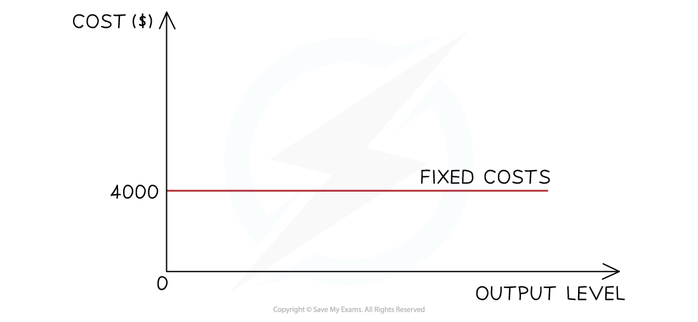

# Costs of Production

## What are costs of production?

> **Spec point** — `spcpt_8xX4NmNnfpcRzBcm` · What are costs of production?

## What are costs of production?

- In preparing goods and services for sale, **firms incur a range of costs**. These costs of production can be be broken into different categories:

### Fixed costs (FC)

- These are costs that do not change as the level of output changes
- They have to be paid whether output is zero or 5000

  - For example, building rent, management salaries, insurance and bank loan repayments

### Variable costs (VC)

- These are costs that vary directly with output
- These increase as output increases and vice versa

  - For example, raw material costs and wages of workers directly involved in production

### Total costs (TC)

- These are the sum of the fixed and the total variable costs

## Cost calculations

> **Spec point** — `spcpt_CMGD3v8JzwQ6PvZ9` · "• calculation of TC, ATC, FC, AFC, VC and AVC
• drawing and interpretation of diagrams that show how changes in output affect costs of 
production"

## Cost calculations

- Based on the above definitions, we can calculate several different types of costs

### 1. Total costs (TC)

$\mathrm{Total} \mathrm{costs}(\mathrm{TC})=\mathrm{Total} \mathrm{fixed} \mathrm{costs}(\mathrm{TFC})+\mathrm{Total} \mathrm{variable} \mathrm{costs}(\mathrm{TVC})$

### 2. Total variable costs (TVC)

$\mathrm{Total} \mathrm{variable} \mathrm{cost}(\mathrm{TVC})=\mathrm{Variable} \mathrm{cost}(\mathrm{VC})\times\mathrm{Quantity}(Q)$

### 3. Average total costs (ATC)

$\mathrm{Average} \mathrm{total} \mathrm{cost}(\mathrm{ATC})=\frac{\mathrm{Total} \mathrm{cost}(\mathrm{TC})}{\mathrm{Quantity}(Q)}$

### 4. Average fixed costs (AFC)

$\mathrm{Average} \mathrm{fixed} \mathrm{cost}(\mathrm{AFC})=\frac{\mathrm{Total} \mathrm{fixed} \mathrm{costs}(\mathrm{TFC})}{\mathrm{Quantity}(Q)}$

#### 5. Average variable costs (AVC)

$\mathrm{Average} \mathrm{variable} \mathrm{cost}(\mathrm{AVC})=\frac{\mathrm{Total} \mathrm{variable} \mathrm{costs}(\mathrm{TVC})}{\mathrm{Quantity}(Q)}$

> **Worked Example**
> ** Calculate **all relevant business costs using the following data:
> 
> - Variable cost is \$60
> - The fixed cost is \$200
> 
> | **Output (Q)** | **TFC** | **TVC = **`$ 60 straight x straight Q` | **TC = **$\mathrm{TFC}+\mathrm{TVC}$ | **AFC = **$\frac{\mathrm{TFC}}{Q}$ | **AVC = **$\frac{\mathrm{TVC}}{Q}$ | **ATC = **$\frac{\mathrm{TC}}{Q}$ |
> |---|---|---|---|---|---|---|
> | 0 | 200 | - | 200 | - | - | - |
> | 1 | 200 | 60 | 260 | 200 | 60 | 260 |
> | 2 | 200 | 120 | 320 | 100 | 60 | 160 |
> | 3 | 200 | 180 | 380 | 66.67 | 60 | 126.67 |
> | 4 | 200 | 240 | 440 | 50 | 60 | 110 |
> | 5 | 200 | 300 | 500 | 40 | 60 | 100 |
> | 6 | 200 | 360 | 560 | 33.34 | 60 | 93.33 |
> | 7 | 200 | 420 | 620 | 28.58 | 60 | 88.57 |
> | 8 | 200 | 480 | 680 | 25 | 60 | 85 |

## Drawing and interpreting cost diagrams

> **Spec point** — `spcpt_rScDRq6QvvDZkRYq` · "• calculation of TC, ATC, FC, AFC, VC and AVC
• drawing and interpretation of diagrams that show how changes in output affect costs of 
production"

## Drawing and interpreting cost diagrams

### Fixed costs (FC)

- The firm has to pay its ***fixed costs*** which do not change, irrespective if the output is 0 or 100,000 units
- The fixed costs for this firm are \$4,000

### Variable costs (VC)

- The variable costs initially **rise proportionally with output**, as shown in the diagram
- At some point the firm will benefit from a ***purchasing economy of scale*** and the rise will no longer be proportional

### Total cost (TC)

- The **total cost** is the sum of the variable and fixed costs
- The total costs **cannot be 0,** as all firms have some level of fixed costs

### Average fixed cost (AFC)

- If the **fixed costs** of a firm are \$1,000 and it produces 1 unit of output, then its **AFC is \$1,000** (\$1,000/1)
- If the firm increases its output to 1000 units, then the **AFC is \$1 per unit **(\$1000/1,000)
- The **more units** a firm produces, the **lower its AFC** will be
- This is one reasons why large levels of output help to increase the **profit per unit**

### Average total cost (ATC)

- As a firm grows, it is able to increases its **scale of output **generating efficiencies that lower its **average total costs (AC)** of production
- These efficiencies are called ***economies of scale***
- As a firm continues increasing its **scale of output**, it will reach a point where its **average total costs (AC)** start to **increase**
- The reasons for the increase in the average costs are called ***diseconomies of scale***

> **Exam Hint**
> MCQ frequently tests your knowledge of these curves by presenting you with 4 unlabelled diagrams and, for example, asking you to identify which sketch demonstrates the average fixed costs of the firm.
