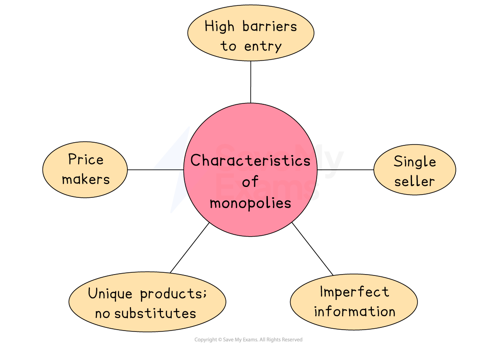

# Monopoly Markets

## Characteristics of monopoly markets

> **Spec point** — `spcpt_PcQZt9kC2yj9XGmr` · Advantages and disadvantages of monopoly markets; The effects of monopoly markets on price, quality, choice and profit

## Characteristics of monopoly markets

- A monopoly is a market structure in which there is a **single seller**

- There are no **substitute products**

  - The firms products are considered to be unique
- The firm has **complete market power**

  - They are able to set prices and control output
  
    - This allows the firm to **maximise profit**
    - There is no long-run erosion of profit levels as competitors are unable to enter the industry
- **High barriers to entry exist**

  - One of the main barriers is the ability of the monopoly to **prevent any competition** from entering the market
  
    - For example, by purchasing companies who are a potential threat

- Many governments** **define a monopoly as any firm having more than 25% ***market share***

  - Regulators act to **prevent** market share increasing beyond this level
  - It helps to maintain competition within the market

### Advantages and disadvantages of monopoly power

- When considering the pros and cons of monopoly power, it is useful to think about the pros and cons for different stakeholders

#### Evaluating monopoly power from the firm's point of view

| **Advantages** | **Disadvantages** |
|---|---|
| - **Large profits** generate money for continued investment in technology and **product innovation** - Market power enables the firm to increase its **global competitiveness** - ***Economies of scale***** **can increase, thereby lowering the average cost - **Price discrimination: **the firm can charge consumers different prices based on the different price elasticity of demand for the product, e.g., peak (inelastic) and off-peak (elastic) travel on trains | - Due to a lack of competition, there is a reduced incentive to be efficient - ***Cross-subsidisation*** can create inefficiencies - Monopolies lead to a **misallocation of resources **as they limit supply in order to increase price - Due to a lack of competition, **innovation sometimes lacks effectiveness.** |

#### Evaluating monopoly power from the employee's point of view

| **Advantages** | **Disadvantages** |
|---|---|
| - Large profits often result in **higher wages** | - Having only one supplier in the industry limits the opportunity to **change employers** |

#### Evaluating monopoly power from the consumer's point of view

| **Advantages** | **Disadvantages** |
|---|---|
| - Product innovation due to the firm's large profits may result in a **better-quality product** - ***Cross-subsidisation*** can lower prices on some products that the firm provides - **Prices may fall.** If firms pass on their cost savings to consumers (due to economies of scale) in the form of lower product prices | - A lack of competition is likely to result in **higher prices,** as **no substitute goods** are available - A lack of competition reduces the need for **product innovation** and worsens product quality over time - May experience **worse customer service** as the incentive to improve it is limited - Cross-subsidisation is likely to **increase prices on some products** offered by the firm |

#### Evaluating monopoly power from the supplier's point of view

| **Advantages** | **Disadvantages** |
|---|---|
| - **Increased sales volume** for some suppliers as they are able to supply products that are distributed nationally or internationally | - There is less competition for their products and a monopoly often has the power to **dictate what price** they will pay to suppliers |

### The effect of having only one firm

- **Price:** The monopoly can set prices above competitive levels
- **Quality:** Quality may fall if there is no competitive pressure, but it can also improve if profits fund innovation
- **Choice:** Very limited — consumers may have only one supplier
- **Profit:** Monopolies can earn **abnormal (supernormal) profits** in the long run due to lack of competition

> **Exam Hint**
> When **evaluating monopolies,** demonstrate critical thinking by acknowledging the positives as well as the negatives. For example, Amazon has partly become a monopoly by being very good at what they do and consumers benefit from lower prices and greater choice. However, this power means that they can also **abuse the suppliers** on their platform
