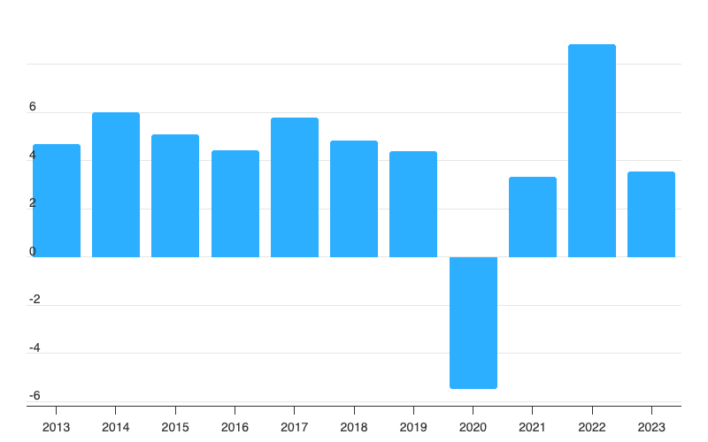
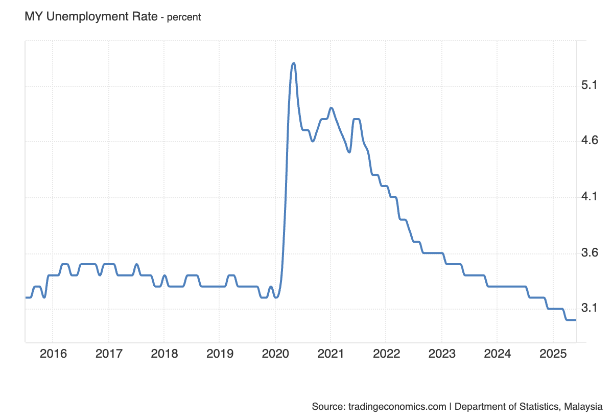
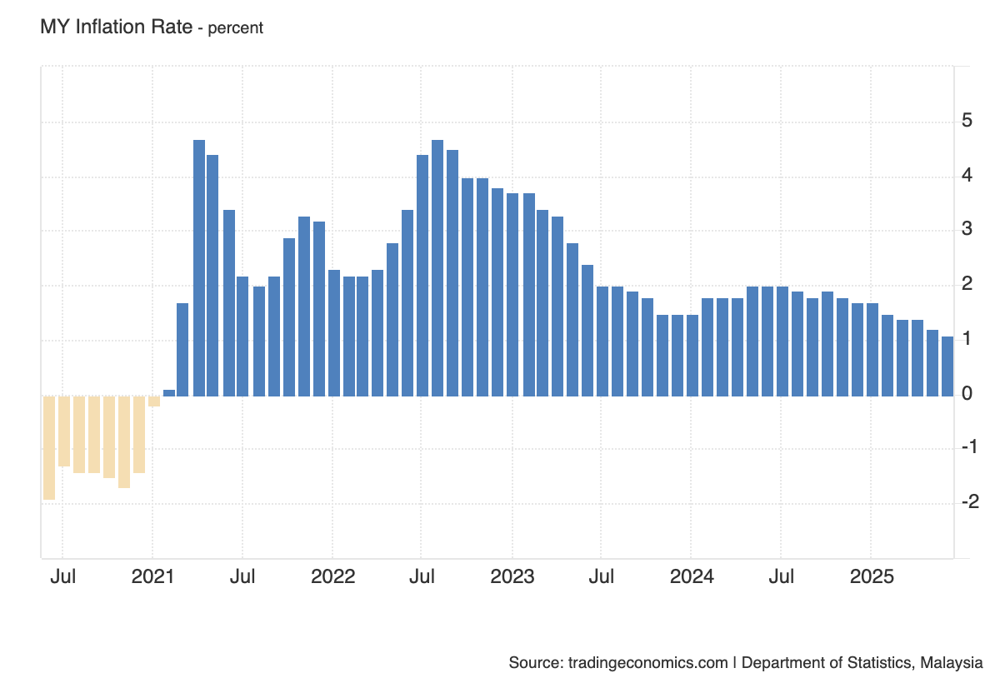
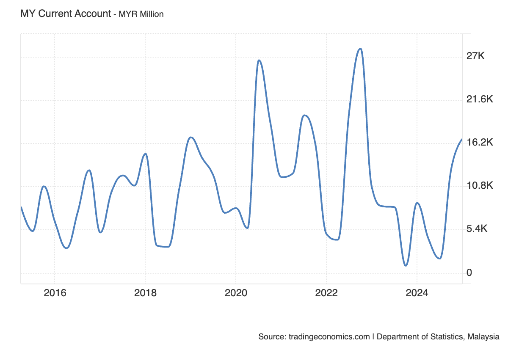

# Macroeconomic Aims

## An introduction to macroeconomic aims

> **Spec point** — `spcpt_FJYwSFwp2g446k7D` · An introduction to macroeconomic aims

## An introduction to macroeconomic aims

- **The macroeconomic aims of government are the main long-term objectives they strive to achieve to promote a healthy and sustainable economy**
- They include:

  - **Economic growth**
  
    - Increasing the total output of goods and services over time
  - **Full employment / low unemployment**
  
    - Ensuring that as many people as possible who are willing and able to work have jobs
  - **Stable prices / low inflation**
  
    - Keeping the general level of prices steady to protect purchasing power
  - **Balance of payments stability**
  
    - Maintaining a healthy trade and financial position with the rest of the world
  - **Redistribution of income**
  
    - Reducing excessive inequalities in income and wealth
  - **Environmental sustainability**
  
    - Supporting growth that preserves natural resources and protects the environment

## Economic growth

> **Spec point** — `spcpt_BMDg8MNSv2Sz7DFV` · reasons behind the choice of aims and the criteria that governments may set for meeting each aim

## Economic growth

- ***Economic growth*** is a central macroeconomic aim of most governments
- Many developed nations have an annual target **growth rate of 2-3%**

  - This is considered to be **sustainable growth**
  - Growth at this rate is **less likely** to cause excessive ***demand pull inflation***
- **Politicians** often use it as a metric of the effectiveness of their **policies** and leadership
- Economic growth has **positive impacts** on confidence, consumption, investment, employment, incomes, living standards and government budgets

*Malaysia's GDP growth rate 2013 - 2023*

Source: [Macrotrends](https://www.macrotrends.net/global-metrics/countries/mys/malaysia/gdp-growth-rate)

#### Explaining Malaysia's growth trends 2013 - 2023

| **2014 - 2016** | **2017 - 2019** | **2020** | **2022** |
|---|---|---|---|
| - Economic growth was increasing each year, but at a decreasing rate | - Growth increased significantly in 2017, but the following two years saw the rate of growth falling again | - As with all economies during the Covid-19 lockdowns, Malaysia experienced significant recession and a fall from +4.2% growth to - 5.8% growth | - As with most economies, Malaysia saw a significant rebound in economic growth (over 8%) during 2022 |

## Low unemployment

> **Spec point** — `spcpt_8FXHZ8s8yTKdKR3p` · Low unemployment

## Low unemployment

- Someone is considered to be unemployed if they do not have a job and are **actively seeking** one
- The **target unemployment rate** often depends on the size of the economy

  - E.g. India finds a rate of 6.5% good, whereas Singapore aims for it to be under 2%
- The closer an economy is to the **full employment level **of labour, the better (more efficiently) it is using its human resources
- Within the broader** unemployment rate**, there is an **increased emphasis** on the unemployment rate within different **sections of the population**

  - For example,** youth unemployment**, ethnic/racial unemployment by group
  
    - In 2021, black unemployment in the USA was 8.7% and white unemployment was 4.7%

- Unemployment tends to be **inversely proportional to real GDP** growth

  - When ***real GDP*** increases, unemployment falls
  - When real GDP decreases, unemployment rises

*Malaysia's unemployment rate from 2015 - 2025*

Source: [Trading Economics](https://tradingeconomics.com/malaysia/inflation-cpi)

### Chart analysis

- **2016–2019:**

  - The unemployment rate remained stable at around **3.3–3.5%**, indicating a steady labour market
- **Early 2020:**

  - Slight dip before a sharp **spike to over 5%** — most likely due to the economic disruption caused by the **Covid-19 pandemic** and lockdown measures
- **2021–2022:**

  - Gradual but uneven decline in unemployment, with small fluctuations suggesting partial recovery and intermittent economic disruptions
- **2022–2025:**

  - Continuous and steady decline, reaching around **3.1%** in 2025, indicating strong post-pandemic recovery and possible job creation from economic reopening
- **Overall trend:**

  - Long-term stability before pandemic → sharp short-term shock → gradual recovery → return to pre-pandemic unemployment levels

## Low and stable rate of inflation

> **Spec point** — `spcpt_SS34HRj5XbnvvhZ9` · Low and stable rate of inflation

## Low and stable rate of inflation

- Most economies have a **target** ***inflation*** rate of 2% using the ***Consumer Price Index (CPI)***
- A low rate of inflation is desirable, as it is a **symptom of economic growth**
- The different causes of inflation (***cost-push*** or ***demand-pull***) require different policy responses from the government

  - ***Demand-side policies*** ease demand-pull inflation
  - ***Supply-side policies*** ease cost-push inflation

*Malaysia's rate of inflation 2020 - 2025*

Source: [Trading Economics](https://tradingeconomics.com/malaysia/inflation-cpi)

- Malaysia experienced  a **continual deviation** from the target of 2% between July 2021 and July 2023

  - An inflation rate in July 2022 of 4-5% was considered to be unstable, eroding household ***purchasing power***
- A **low and stable rate of inflation** is important, as it

  - Allows firms to **confidently plan** for future investment
  - Offers **price stability** to consumers

## Balance of payments stability on the current account

> **Spec point** — `spcpt_87Y2Y4pWnBXzRn4k` · Balance of payments stability on the current account

## Balance of payments stability on the current account

- **The Balance of Payments (BoP) for a country is a record of all the financial transactions that occur between it and the rest of the world**

  - The current account focuses mainly on the financial transactions related to **exports and imports** of goods and services
- Governments aim for **Balance of Payments equilibrium on the Current Account**

  - If **exports > imports** it will create a **current account surplus**
  - If **imports > exports**, it will create a **current account deficit**
  
    - Each one of these conditions has advantages and disadvantages associated with it
    - However, a current account deficit is more problematic in the long-run than a surplus

#### Malaysia's current account position 2016 to 2024

*Malaysia has run a surplus on its current account between 2016 - 2024*

Source: [Trading Economics](https://tradingeconomics.com/malaysia/current-account)

### Chart analysis

- **General trend:**

  - The current account balance has shown **regular fluctuations**, reflecting seasonal trade patterns and changes in global demand for Malaysia’s exports
  - Overall, Malaysia has maintained a **surplus** for most of the period, meaning it exports more goods, services, and capital than it imports
- **2016–2019:**

  - Moderate surpluses with a repeating up-and-down cycle
- **2020:**

  - Strong increase in surplus early in the year, likely due to reduced imports during the COVID-19 pandemic and resilient export demand for certain products such as electronics and medical gloves
- **2021–2022:**

  - Sharp peaks, with one of the highest surpluses in the observed period, likely boosted by **high commodity prices (e.g. palm oil)** and strong electronics exports
  - Followed by significant drops, indicating volatility from global market shifts and possible import rebounds
- **2023–2024:**

  - Marked decline in the surplus, with some quarters approaching very low or near-zero balances, possibly due to falling commodity prices, weaker export demand or higher imports as domestic demand recovered
- **Late 2024:**

  - Strong rebound in the current account surplus, signalling a recovery in export performance or a reduction in imports

## The redistribution of income

> **Spec point** — `spcpt_2kHT649TJDt3dFKr` · Redistribution of income

## The redistribution of income

- The redistribution of income aims to reduce ***income inequality*** in an economy

  - High levels of income inequality **can create social unrest** which may ultimately lead to revolutions
  - **Perfect income equality** is not desirable, as it removes the** incentive to work** and study
- Governments aim to **redistribute income** by taxing the wealthy and providing welfare payments to the poor
- **Unchecked capitalism** has a natural outcome of **high income inequality**

  - The wealthy are able to keep buying **factors of production**
  - The **concentration of ownership** becomes more and more narrow, with fewer individuals owning the bulk of the world's wealth
- There is a need for governments to **intervene** to maintain acceptable levels of income inequality
- ***Absolute poverty*** is usually worse in developing countries. However, in a developed economy such as Germany, a 1% increase in income inequality can push a lot more households into ***relative poverty***

## Environmental sustainability

> **Spec point** — `spcpt_vRMCwFXmqt4RxBBb` · Environmental sustainability

## Environmental sustainability

- **Environmental sustainability aims to ensure that economic growth and development do not deplete natural resources or cause long-term damage to the environment**

  - Perfect environmental preservation is not possible, as some resource use is inevitable in any economy, but the aim is to **keep resource consumption within levels that the planet can naturally replenish**
- Unchecked industrial activity can lead to pollution, resource depletion and *climate change*, all of which can harm future generations

  - Environmental degradation often **disproportionately affects poorer countries**, which may lack the infrastructure or governance to mitigate the effects of, for example, rising sea levels or extreme weather events
- Governments aim to protect the environment through legislation, regulation and incentives

  - For example, setting emissions limits, taxing pollution or subsidising *renewable energy*
- **Unchecked capitalism** has a natural outcome of overusing common resources as firms and individuals pursue short-term profit without considering long-term environmental costs
- There is a clear need for **governments to intervene to protect** biodiversity, reduce greenhouse gas emissions and promote sustainable consumption and production patterns
