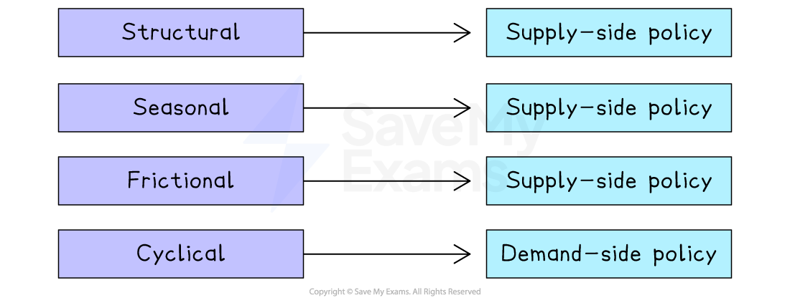

# Policies Used To Reduce Unemployment

## Demand and supply-side solutions

> **Spec point** — `spcpt_rPvyZ2JSTc9WnR67` · "the range of policies available to reduce unemployment and their effectiveness
"

## Demand and supply-side solutions

- **Demand-side** unemployment is caused by a **lack of total demand** in the economy and this is often related to a recession in the economic cycle
- **Frictional**, **seasonal **and **structural** unemployment emerge from factors affecting the **supply side** of the economy
- The appropriate** government interventions **to alleviate different types of unemployment depend on whether they stem from **demand-side or supply-side factors**

#### Type of policy to use for each cause of unemployment

> **Exam Hint**
> Always **link the policy to the type of unemployment** in the question. For example:
> 
> - **Cyclical unemployment** → demand-side policies work best
> - **Structural unemployment** → supply-side policies are more effective

## Demand-side policies

> **Spec point** — `spcpt_2hD58k6kjjn2mNxt` · "the range of policies available to reduce unemployment and their effectiveness
"

## Demand-side policies

- ***Expansionary fiscal policy*** and ***expansionary monetary policy*** aim to increase total (aggregate) demand in an economy

  - The demand for labour is **derived **from the demand for goods/services
  - If total demand for goods and service increases there will be a **higher demand for labour**, leading to lower unemployment
- **Total demand **can be increased through any policy which increases one of the components of ***real gross domestic product (rGDP)***

#### Examples of demand-side policies to reduce unemployment

| **Broad policy type** | **Specific policy** | **Explanation** |
|---|---|---|
| **Expansionary fiscal policy** | - The government **decreases** corporation tax | - Firms pay less tax → firms have more profit → firms hire **more workers **→ firms increase output → unemployment falls |
| **Expansionary fiscal policy** | - The government **increases** expenditure on national defence | - Defence firms receive more orders from the government → they hire **more workers** to produce the output → unemployment falls |
| **Expansionary fiscal policy** | - The government **decreases** personal income tax | - Households have more discretionary income → **consumption increases** → in order to produce the extra goods/services, firms hire more workers → unemployment falls |
| **Expansionary monetary policy** | - The Central Bank** lowers interest rates** | - Household repayments on existing loans fall → Households have more discretionary income → **consumption increases** → in order to produce the extra goods/services, firms hire more workers → unemployment falls |

### How effective are demand-side policies?

- **Demand-side policies** are very effective at dealing with unemployment caused by a fall in total (aggregate) demand
- They are not effective at dealing with **frictional and structural** unemployment
- One **conflict** caused by expansionary policy is that *demand-pull inflation* is likely to occur
- Expansionary monetary policy tends to **increase inequality** in the distribution of income, as the poor are usually unable to benefit from it (banks do not necessarily lend to the poorest households)

## Supply-side policies

> **Spec point** — `spcpt_FQ9yBNv2HMBgQFXc` · "the range of policies available to reduce unemployment and their effectiveness
"

## Supply-side policies

- Supply-side policies aim to improve the **quantity and/or the quality of the factors of production,** thereby raising potential output

  - If output increases then firms will require **more workers** to produce that output and **unemployment may fall**

#### Examples of supply-side policies used to reduce unemployment

| **Specific supply-side policy** | **Explanation** |
|---|---|
| **The government reduces *****trade union *****power** | - Trade union power weakens → firms lower wages → **costs of production decrease** → firms can produce more output with the same input → firms hire more workers as they are cheaper → unemployment falls |
| **The government reduces regulation on the oil and banking industries** | - Regulations removed → **costs of production decrease **as firms no longer need to spend money meeting requirements → firms can produce more output with the same input → firms hire more workers as they are cheaper → unemployment falls |
| **The government introduces new long term training subsidies for students of green technology** | - Cheaper to study green technology → more students develop their skills → **supply of skilled workers in the industry grows** → new firms launch → output increases and more workers are required → unemployment falls |

### Effectiveness of supply-side policies

- Supply-side policy tends to be **long-term**

  - E.g.** **reducing trade union power is a long-term process, as is training
- It is most effective in dealing with unemployment caused by **frictional and structural unemployment**
- It does not help deal with unemployment caused by **demand-side issues** e.g. a recession
