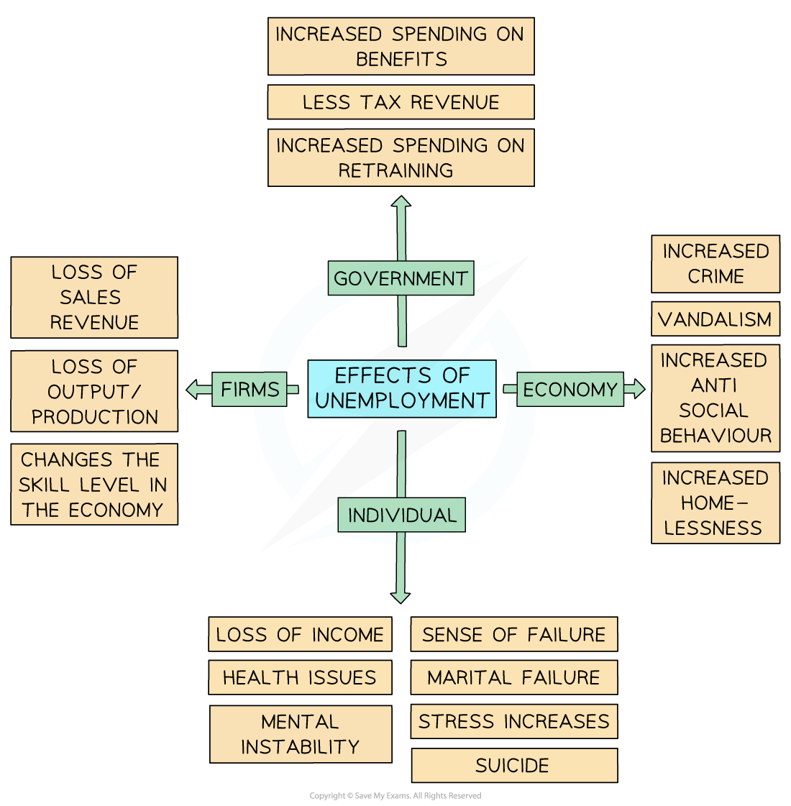

# The Types & Consequences of Unemployment

## Types of unemployment

> **Spec point** — `spcpt_msQKCn37Vzth4Fgj` · "• frictional unemployment
• structural unemployment
• cyclical unemployment
• seasonal unemployment"

## Types of unemployment

- There are specific causes of unemployment
- Understanding the cause is helpful as each cause **may require different solutions** to be implemented

#### Types of unemployment

| **Type** | **Explanation** |
|---|---|
| **Seasonal** | - Seasonal unemployment occurs as certain seasons come to an end and **labour is not required until the next season**    - E.g., fruit pickers, summer seaside resort workers, ski instructors |
| **Frictional** | - Frictional unemployment occurs when workers are **between jobs**    - This is usually short-term unemployment   - Workers have voluntarily left their previous job to search for another |
| **Structural** | - Structural unemployment occurs when there is a **mismatch between jobs and skills** in the economy    - It usually happens as the structure of an economy changes, e.g. the *secondary sector* is declining and the *tertiary sector* is growing   - There is **no longer a need for a specific type of worker**, e.g., shipbuilders in Glasgow   - Many Western industries have relocated production to China, causing structural unemployment in their economies   - Unless workers receive help to retrain, they are often left unemployed or underemployed |
| **Cyclical** | - Cyclical or demand-deficient unemployment is caused by a fall in total demand in an economy    - This typically happens during a **slowdown or *****recession***   - The demand for labour is a derived demand, as it stems from the demand for goods/services   - As output falls in the economy, firms lay off workers |

## The consequences of unemployment

> **Spec point** — `spcpt_7MnSqdFH7cySw3rn` · "consequences of unemployment for the individual, producers/firms, the government and the 
economy"

## The consequences of unemployment

- Unemployment can have serious impacts on individuals, producers/firms, the government, and the wider economy

  - The effects are often connected
  
    - For example, a loss of income for individuals reduces spending, which lowers firms’ sales, leading to lower tax revenue for the government
- The effects of unemployment, especially **long-term unemployment, **are extremely damaging

*The consequences of unemployment*

### Impact on individuals

- **Loss of income**

  - Unemployed people cannot earn wages, reducing their ability to buy goods and services
- **Sense of failure**

  - Being without work can harm self-esteem and confidence
- **Health issues**

  - Physical and mental health can suffer due to financial pressure and inactivity
- **Mental instability**

  - Anxiety and depression can increase during long periods of unemployment
- **Marital breakdown**

  - Financial stress can lead to relationship problems
- **Stress and suicide**

  - Extreme cases of unemployment-related stress may lead to suicide

### Impact on producers/firms

- **Loss of sales revenue**

  - Unemployed consumers spend less, reducing firms’ income
- **Loss of output**

  - Fewer workers mean lower production levels
- **Lower skill levels**

  - If unemployment lasts a long time, workers lose skills, reducing the quality of the labour force

### Impact on government

- **Increased spending on benefits**

  - More people claiming unemployment or welfare payments
- **Lower tax revenue**

  - Less income tax, corporation tax and sales tax is collected
- **Increased spending on retraining**

  - Governments may need to fund programmes to help people back into work

### Impact on the economy

- **Increased crime and vandalism**

  - Unemployment can lead to higher crime rates due to financial desperation or social unrest
- **Increased anti-social behaviour**

  - Frustration and exclusion from the labour market can cause social problems
- **Increased homelessness**

  - Without income, some people may lose their homes
