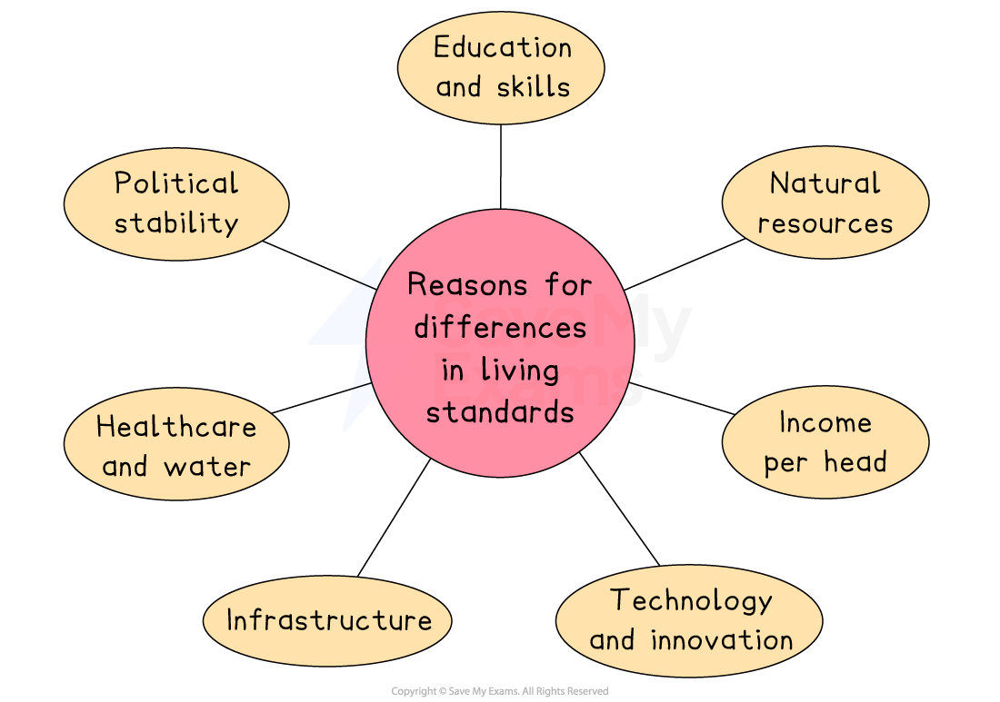

# Comparing Living Standards

## Reasons for differences in living standards

> **Spec point** — `spcpt_pPqnRvndppG9ynn2` · reasons for differences in living standards and income distribution within and between countries

## Reasons for differences in living standards

- **Living standards refer to the general well-being and quality of life experienced by individuals in a country or region**

  - This topic explores **why some countries and people enjoy higher living standards** than others, and why **income is not evenly distributed** (income inequality)

#### Explaining the reasons that affect living standards

| **Reason** | **Explanation** |
|---|---|
| **Income per head (GDP per capita)** | - Countries with higher GDP per capita can provide better healthcare, education and public services |
| **Natural resources** | - Countries rich in oil, minerals or fertile land can generate more income and improve living standards |
| **Level of education and skills** | - More skilled workers are more productive and can earn higher wages, boosting the economy and individual well-being |
| **Political stability and good governance** | - Stable governments tend to manage the economy better, invest in infrastructure and attract businesses |
| **Access to healthcare and clean water** | - These are basic needs for a healthy life and impact overall development and productivity |
| **Infrastructure** | - Good transport, energy and communication systems support business activity and quality of life |
| **Technology and innovation** | - Advanced economies often grow faster and create higher-paying jobs |

## Reasons for differences in income distribution

> **Spec point** — `spcpt_9nyXS2TdH5pHWqQn` · Reasons for differences in income distribution

## Reasons for differences in income distribution

- These are the key factors that explain why some individuals or groups earn more than others **within a country**, leading to **income inequality**.

### 1. Education and skills

- People with **higher levels of education and training** tend to get better-paying jobs
- Those with **specialist or in-demand skills** (e.g., coding, AI, medicine) often earn much more than unskilled workers

  - For example, in **India**, access to quality education is unequal, especially in rural areas, leading to wide income disparities between skilled and unskilled workers

### 2. Inheritance and wealth ownership

- Some people are born into wealthy families and **inherit land, property or business assets**, giving them an advantage
- Wealth ownership allows individuals to **earn income from rents, *****dividends ***or** investments**, even without working

  - For example, in South Africa, historical inequalities continue to impact who owns productive assets like land and businesses, whereas in Japan there was an equal distribution of land after World War 2, which helped reduce extreme wealth concentration across generations

### 3. Government policy (taxes and welfare)

- Progressive taxes (higher earners pay more) and generous welfare systems can **reduce income inequality**
- Weak tax systems or limited welfare can **widen the income gap**

  - For example, in **Sweden**, a strong *welfare state* and progressive tax system help reduce income inequality, **whereas in the United States**, weaker social safety nets and lower taxes on high incomes contribute to a larger income gap

### 4. Employment opportunities

- People in **urban areas** often have access to higher-paying jobs, while those in **rural areas** may rely on farming or *informal work*
- Job availability and wages can differ between **regions and industries**, depending on investment and development levels

  - For example, in **Brazil**, employment and wealth are heavily concentrated in urban coastal cities, **whereas in Germany**, regional investment and better infrastructure help spread employment opportunities more evenly across the country

### 5. Discrimination

- Some people may **face unequal treatment** in the labour market due to gender, ethnicity, age or disability
- This can limit job access, promotions or pay for certain groups

  - For example, in **Pakistan**, gender discrimination limits many women’s access to high-paying jobs and equal treatment in the labour market, **whereas in Iceland**, strong gender equality laws have significantly narrowed the gender pay gap

### 6. Rural vs urban divide

- People in **rural areas** often have poorer access to education, healthcare, and well-paid jobs
- This results in **lower incomes and fewer opportunities**, even within the same country

  - For example, in **Nigeria**, rural populations have much lower access to services and jobs compared to urban dwellers, **whereas in South Korea**, rural investment in infrastructure and education has helped close the rural–urban income gap
