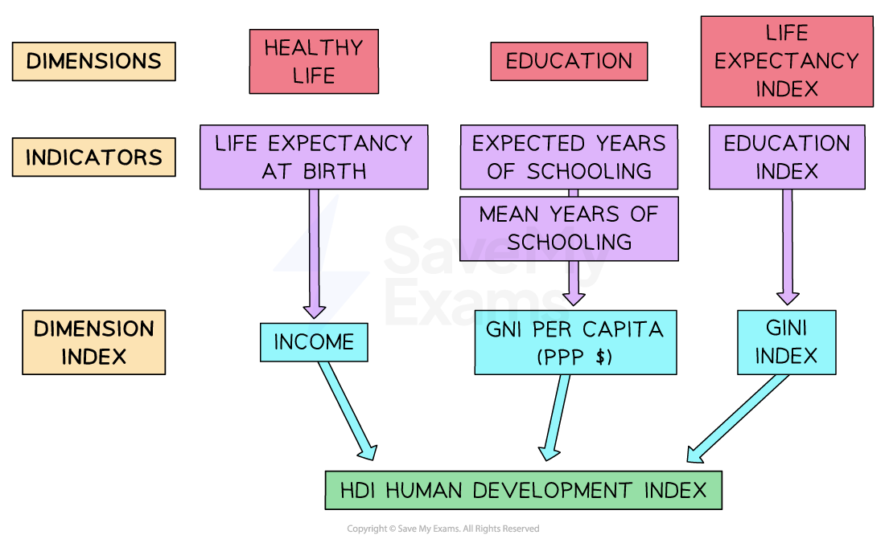
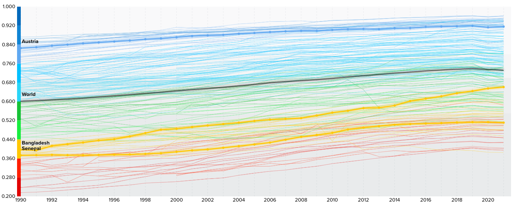

# Indicators of Living Standards

## Real GDP per head (capita)

> **Spec point** — `spcpt_Bq5Vfr3ZjfTvfbMp` · advantages and disadvantages of real GDP per head and HDI as indicators

## Real GDP per head (capita)

- **Economic development is the sustainable increase in living standards for a country, typically characterised by increases in life span, education levels, and income**
- There are many measures of **living standards**

  - **Single indicators**, e.g., **real gross domestic product per capita, **number of doctors/1000 people; infant mortality rate, and % of the population with access to clean drinking water
  - **Composite indicators** such as the ***Human Development Index (HDI)***

### The distinction between real, nominal and per head GDP

#### Nominal GDP

- In economics, the use of the word **'nominal'** refers to the fact that the **metric** has **not been adjusted for inflation**
- **Nominal GDP is the actual value of all goods and services produced in an economy in a one-year period**

  - There has been **no adjustment** to the amount based on the** increase in general price levels** (inflation)

#### Real GDP

- **Real GDP is the value of all goods and services produced in an economy in a one-year period - and adjusted for inflation**

  - For example, if **nominal GDP** is \$100bn and **inflation is 10%** then **real GDP** is \$90bn

#### Real GDP per head (capita)

- **This metric take the real GDP and divides it by the number of people in the population**

$\mathrm{Real} \mathrm{GDP} \mathrm{per} \mathrm{capita}=\frac{\mathrm{rGDP}}{\mathrm{Population}}$

- It shows the **mean wealth** of each citizen in a country
- This makes it easier to compare **standards of living** between countries

  - For example, Switzerland has a much higher GDP per capita than Burundi

### The advantages and disadvantages of real GDP per capita

| **Advantages** | **Disadvantages** |
|---|---|
| - **Allows comparisons** – helps compare living standards between countries or over time - **Adjusts for population size** – gives a better measure than total GDP alone - **Useful indicator of economic growth** – helps track whether an economy is growing or shrinking on a per-person basis - **Inflation adjusted** – when measured in real terms, it gives a clearer picture of changes in purchasing power | - **Ignores income distribution** – does not show how evenly income is shared among the population - **Non-market activities excluded** – ignores work like home care or *informal sector* jobs - **Doesn’t show quality of life** – doesn't measure health, education or environmental quality - **Currency value differences** – *exchange rates* can distort international comparisons |

> **Exam Hint**
> When an exam question uses the phrase **'at constant prices',** it is referring to **real GDP. **For example, a question may read, 'Explain what is meant by a **rise **in **GDP at constant prices.'** This requires you to define **real GDP** and then explain the rise.

## The human development index (HDI)

> **Spec point** — `spcpt_fphthP8xrWYz3snN` · advantages and disadvantages of real GDP per head and HDI as indicators

## The human development index (HDI)

- **The Human Development Index (HDI) is a measure used to compare the development levels of different countries, not just based on income, but also on health and education**
- Developed by the United Nations, the Human Development Index is a combination of 3 indicators

  1. **Health** – measured by *life expectancy* at birth
  2. **Education** – measured by average years of schooling and expected years of schooling
  3. **Income**, as measured by the real ***gross national income*** per capita at ***purchasing power parity (PPP)***
- Each indicator is given **equal weighting** in the index
- The index ranks countries on a score between 0  and 1

  - A score **closer to 1** means a **higher level of human development**
  - A score **closer to 0** means a **lower level of human development**

*The components of the HDI*

### Examples of HDI values

*The Human Development Index scores from 1990 to 2021*

***Source: ******[UNDP Data Centre](https://hdr.undp.org/data-center/human-development-index#/indicies/HDI)****** ***

- A value of less than 0.550 is considered **low development,** e.g. Senegal was at 0.514 in 2021
- A value of 0.550-0.699 is considered **medium development**, e.g., Bangladesh was at 0.667 in 2021
- A value of 0.700-0.799 is considered **high development**; e.g., Thailand was at 0.777 in 2021
- A value ≥ 0.800 is considered **very high development,** e.g. Austria was at 0.918 in 2021

### The advantages and disadvantages of using the HDI

- One of the main advantages is that the HDI is a composite indicator which provides a **more useful** comparison metric than single indicators do

| **Advantages** | **Disadvantages** |
|---|---|
| - It incorporates three of the **most important metrics** for households, i.e., health, education and income - It is widely used all over the world, which provides an opportunity for **meaningful comparisons** - It provides a goal for governments to use when developing their policies; e.g., it may help identify that the education levels are holding back improvements to the HDI, and **government policy** can target that - It provides citizens with an understanding of how their **quality of life** compares to other countries | - It does not measure the **inequality** that exists, as it uses the mean GNI per capita - It does not measure or compare the levels of *absolute* and *relative poverty *that exist - For many countries it does not provide useful **short-term information,** as gathering the data required for the calculation is difficult    - This means the **data often lags reality** by several years |
