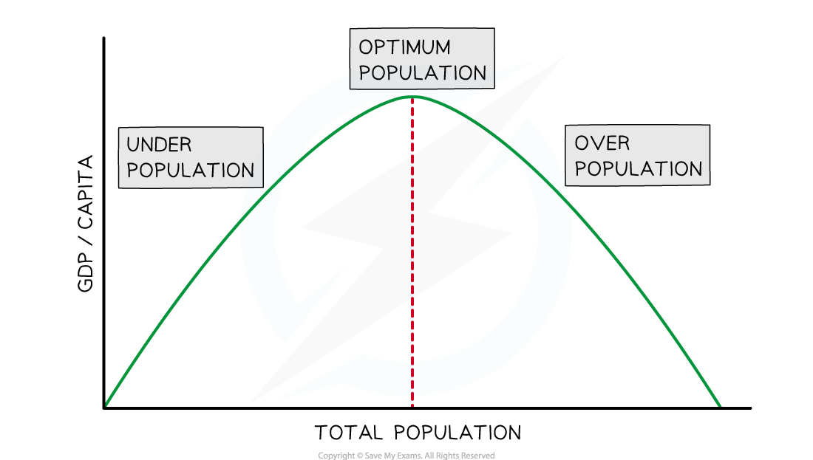
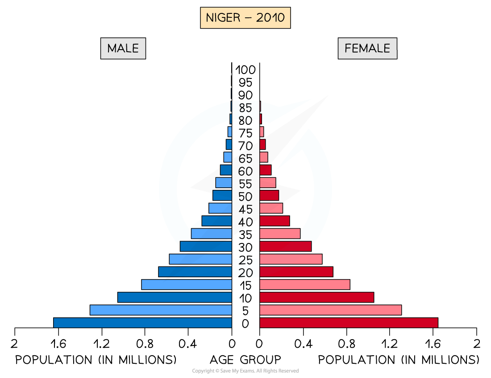
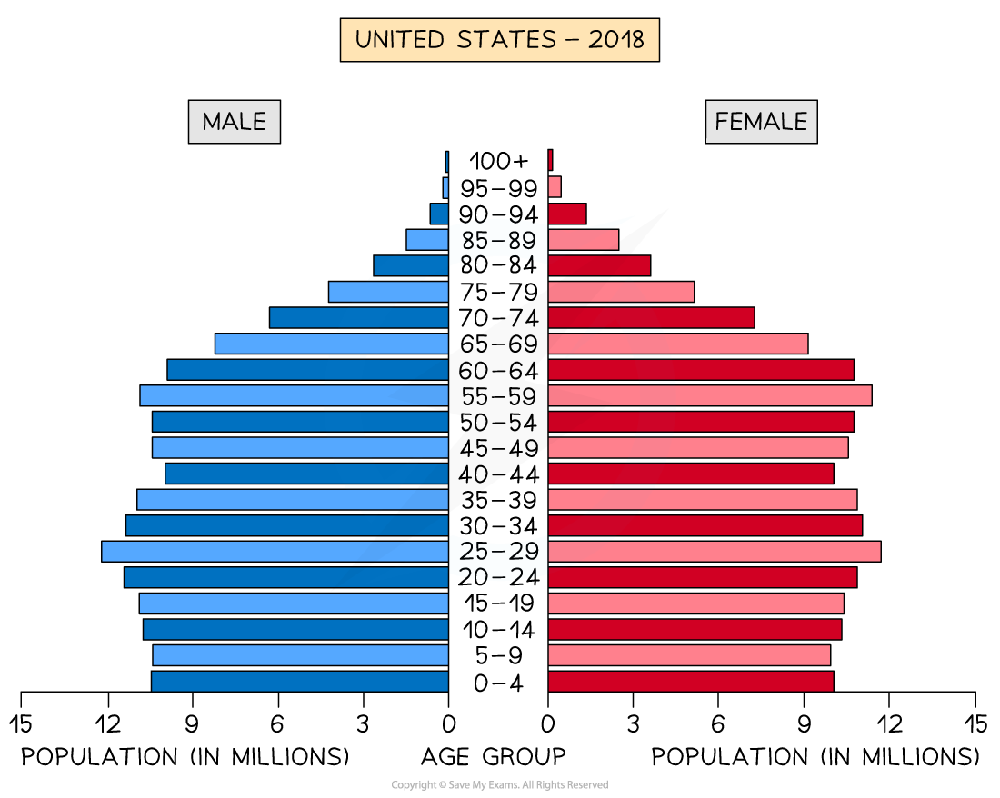

# Effects of Changing Population Sizes

## The optimum population

> **Spec point** — `spcpt_F9rzf6X5wrkdx3Jx` · The optimum population

## The optimum population

- **Overpopulation **occurs when there are more people in a country/region than can be supported by its resources and technology and leads to

  - Higher levels of pollution
  - Higher crime rates
  - Higher unemployment or ***underemployment***
  - Higher levels of **food and water shortages **
  - Higher pressure on services such as hospitals and schools
- **Underpopulation** occurs when there are more resources available than the population can use effectively and may lead to

  - Fewer people paying tax which can lead to higher taxes
  - **Underused resources**, which can lead to wastage
  - A shortage of workers
  - Lower levels of *exports *and production, which affects the wealth of an area
  - Fewer customers for goods and services
- **Optimum population** occurs when there is a balance between the number of people and available resources/technology
** **

*Optimum theory of population*

- **The optimum population** results in the highest standard of living

  - There are not so many people or so few resources that the standard of living falls
  - There are enough people to develop the resources of the country

> **Exam Hint**
> It is important to remember that overpopulation does not just mean there are a lot of people, and underpopulation means there are few people. The terms refer to the balance between **population and resources**. There may be many people in a country, but it is only overpopulated when there are too few resources to support that population.

## Population distribution

> **Spec point** — `spcpt_kc9pWBqKvsqQwQWW` · Population distribution

## Population distribution

- The **characteristics of a population (**the distribution of age, sex, ethnicity, religion etc), is known as the **population structure **
- **The population structure** is the result of changes in:

  - the birth rate
  - the death rate
  - net migration
- The two main characteristics of age and sex can be shown on a **population pyramid**

### Population pyramids

- **Population pyramids** are used to display the gender and age structure of a given population

  - They illustrate the **distribution of population** across age groups and between male/female
- **Population pyramids** can be used to identify the following groups:

  - Young dependents
  - Old dependants, e.g. number of retired people
  - Economically active (working population or** labour force**)
  - ***Dependency ratio***

#### Example 1: Niger as a less economically developed country (LEDC)

*Population Pyramid - Niger*

- LEDCs like Niger have a concave pyramid shape which indicates

  - **High birth rate**
  - **Low life expectancy**
  - **High death rate** but starting to decrease (people dying through every age group)
  - **High infant mortality rate** (significant decrease between 0-5)
  - **Young dependent population** dominates the distribution

#### Example 2: USA as a more economically developed country (MEDC)

*Population Pyramid - USA *

- This population pyramid indicates:

  - **Decreasing birth rate**  - there is a smaller population reading down from age 29
  - **Increasing life expectancy **– indicated by the relatively straight sides reaching the age of 70, followed by a good proportion of people living much longer
  - **Decreasing death rate **– indicated by the relatively straight sides reaching the age of 70
  - Low infant mortality - hardly any change between 0-9 years
  - **Larger working age population** - 15 to 69 represents a large proportion of the population

> **Exam Hint**
> Population pyramids are not included in your examination. We have left them in here, as they are a useful tool for understanding the term 'population distribution'. The visual pyramid quickly helps us to understand differences in population distribution.

## Effects of population changes

> **Spec point** — `spcpt_JpKqRTBk2yHrHjWb` · Effects of population changes

## Effects of population changes

- **Population changes** can have major impacts within the economy, resulting in changes to consumption, production, lifestyle, standards of living and government policies (fiscal, monetary and supply-side)
- Typical changes that occur are

  - Progressively **ageing populations** as economies develop
  - **Falling birth rates** as economies develop
  - **Swings in *****net migration*** as influenced by war, famine, natural disasters and government policy

### Ageing populations

- Many **developed economies **are experiencing ageing populations and an increase in the older dependent population
- The implications of this include

  - Increased pension payments by **governments**
  - Increased need for care homes **(public and private)**
  - Increased pressure on the healthcare service and social care results in higher **government spending**
  - It also results in a **smaller labour force** and often Governments collect less tax
  - Firms suffer worker shortages
  - Labour shortages result in **increased wage costs** for firms

### Falling birth rates

- Falling birth rates have the following impact on an economy

  - **School closures** due to fewer children
  - Future **labour shortages**
  - Governments typically put in place incentives that **encourage families to have more children**
  - Governments may **change the migration laws** to encourage immigration so that labour shortages are prevented
  
    - Excessive immigration can **change the nature and culture** of different regions within a country

### Migration

- In some countries migration can lead to an **imbalance in the population structure** e.g. the UAE has significantly more males than females
- Rapid population growth caused by **migration** can lead to

  - Increased **pressure on services **such as healthcare and schools resulting in increased costs for government
  - A **shortage of housing** which generates social issues in society
  - **Increased traffic congestion,** which is a negative externality
  - Increased water and air pollution, which are **negative externalities**
  - Food shortages
