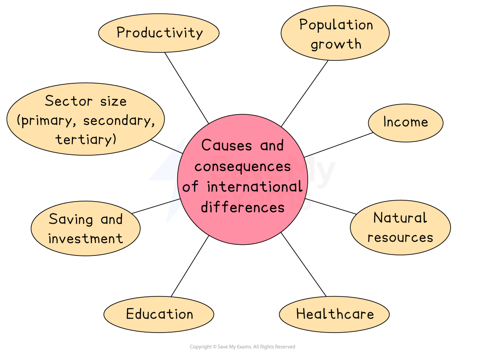

# Causes and Consequences of International Differences

## Key international differences

> **Spec point** — `spcpt_YRjW4h5KSKcd2zTh` · "differences in:
– income
– productivity
– population growth
– size of primary, secondary and tertiary sectors
– saving and investment
– education
– healthcare
– natural resources
"

## Key international differences

- **Economic development** is the sustainable **increase in living standards** for a country, typically characterised by increases in life span, education levels, and income

  - Two indicators used to compare development are the ***real GDP*** and the Human Development Index (see [Indicators of Living Standards](https://www.savemyexams.com/igcse/economics/cie/25/revision-notes/5-economic-development/5-1-living-standards/indicators-of-living-standards/))
- **Countries are all at different points of development** and economists distinguish between them using different criteria

  - E.g., **HDI has five categories** of development based on the HDI score
  
    - Low human development (<0.550)
    - Medium human development (0.550–0.699)
    - High human development (0.700–0.799)
    - Very high human development (>0.800)

### Causes of differences in development

- There are **numerous reasons for these differences**

| **Factor** | **Explanation** |
|---|---|
| **Differences in income** | - Countries with a **higher GDP per head **tend to be more developed - Even with high GDP per head, there may be significant** inequality in the distribution of income,** resulting in poor living standards for many |
| **Differences in productivity** | - Differences in **skills** result in difference in productivity - Higher levels of productivity are rewarded with **higher wages**, which leads to a better standard of living |
| **Differences in population growth** | - More densely populated countries or cities face more challenges - A larger population can mean **higher tax revenues** for the government but at the same time, government expenditure on services is spread across more people - Poorer economies are characterised by **less government spending per head** |
| **Differences in economic sector sizes** | - Economies with a **larger proportion** of secondary and tertiary activity tend to be more developed due to the **wages** associated with each sector - ***Primary sector*** workers are usually paid low wages due to the unskilled nature of the job and the fact that raw materials often generate the lowest profits in the production chain - ***Secondary sector*** workers ***add value*** to the raw materials and these products sell for higher profits. Therefore wages tend to be higher than primary sector wages - ***Tertiary sector*** workers are paid the highest. Their jobs often require highly valued skills that take years to acquire and the products they sell or services they provide can be complex and expensive e.g. artificial intelligence coders |
| **Differences in saving and investment** | - Higher savings result in **higher investment and economic growth**. It is believed that as economies develop, savings increase - Increased savings → increased investment → higher *capital stock* → higher economic growth → increased savings - If the ***dependency ratio*** is high it means there is less money available for savings and investment |
| **Differences in education** | - These directly influence the **level of skill** in an economy - Improved skills results in **higher productivity and wages** |
| **Differences in healthcare** | - The level of health directly impacts **productivity of labour** - Productivity influences output and income - **Developed economies** tend to have healthy workforces - The less developed the economy, the **more sickness and disease** there are |
| Natural resources | - Countries with abundant natural resources (such as oil, minerals, fertile land, or water) can use them to produce goods for export, earn income and support economic growth - Natural resources can create jobs in **primary industries **and provide raw materials for the **secondary sector** |

> **Case Study**
> ** Comparing India and South Korea**
> 
> **Overview**
> 
> South Korea and India provide an interesting contrast in development.
> 
> South Korea has rapidly transformed from an industrialising nation into a high-income economy within a few decades. In contrast, India remains a developing country with a lower GDP per head but faster growth rates.
> 
> | **Factor** | **South Korea** | **India** |
> |---|---|---|
> | **Income (GDP per head)** | - Approx. \$31,000 GDP per head (high-income economy) | - Approx. \$2,700 GDP per head (lower-income level) |
> | **Productivity** | - High and efficient due to strong institutions and policies | - Lower productivity, improving more slowly due to policy limitations |
> | **Population growth** | - Slower growth, ageing population | - Rapid growth, younger population |
> | **Sector size** | - Large secondary (manufacturing) and tertiary sectors | - Larger primary sector, growing service (tertiary) sector |
> | **Saving & Investment** | - Higher gross savings (~35% of GDP), strong capital formation | - Gross savings (~31% of GDP), lower capital formation than Korea |
> | **Education** | - High tertiary education rates, strong human capital | - Growing education, but still lower skills and access |
> | **Healthcare & life expectancy** | - Life expectancy ~82.6 years | - Life expectancy ~69.2 years |
> | **Natural resources** | - Few natural resources; economy relies on manufactured exports | - Rich in agricultural land and minerals but lower value-added exports |
