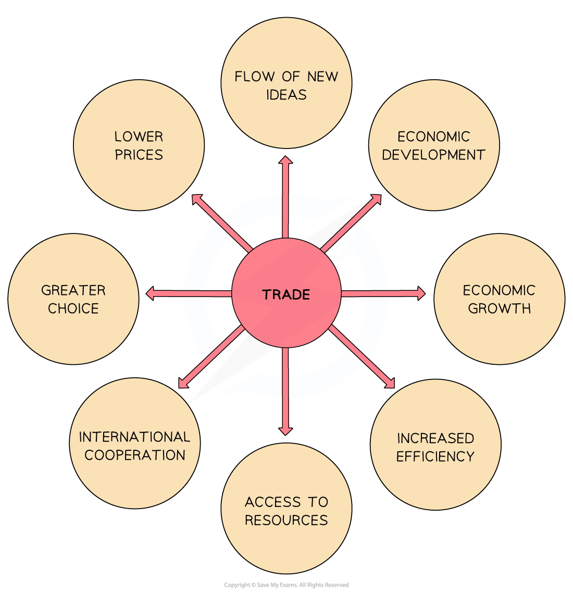

# Free Trade

## The advantages of free trade

> **Spec point** — `spcpt_g7tY52YYyKQ6rnxy` · The advantages of free trade

## The advantages of free trade

- Free trade is the exchange of goods and services between countries **without any trade barriers**, such as *tariffs*, *quotas* or import bans
- This means countries can **buy and sell freely** with each other, allowing for more open access to foreign markets

*The benefits of free trade*

- **Greater choice**

  - With access to a wider variety of goods/services, the standard of living improves
- **Lower prices**

  - With international competition prices fall, giving households the ability to buy more
- **International cooperation**

  - Required for trade, it helps countries to build better relationships, which leads to lower levels of hostilities
- **Flow of new ideas**

  - Innovative ideas and technology can be shared between countries
- **Access to resources**

  - Output can increase and costs of production can fall with increased access to raw materials
- **Increased efficiency**

  - International competition allows the most efficient firms to emerge and this improves the use of global resources
- **Economic growth**

  - Exports are a key component of the *gross domestic product* of many countries and an increase in exports can lead to economic growth
- **Economic development**

  - Increased output leads to lower levels of unemployment, which leads to higher incomes and a higher standard of living

## The disadvantages of free trade

> **Spec point** — `spcpt_5f59Sfjvb9SJkwwq` · The disadvantages of free trade

## The disadvantages of free trade

- **Harm to domestic industries**

  - Without protection from foreign competition, local firms may struggle to survive
  - This can lead to business closures and job losses in certain sectors
- **Over-dependence on imports**

  - Countries may rely too heavily on other nations for essential goods, such as food, fuel or medicine
  - This can be risky if global supply chains are disrupted
- **Job losses**

  - Free trade can lead to *structural unemployment* as less competitive industries shrink or shut down in the face of cheaper imports
- **Worsening trade balance**

  - Some countries may import more than they export, leading to *trade deficits* which can create long-term economic problems
- **Unequal gains**

  - While some countries and firms benefit, others may be left behind
  - Smaller or less developed economies can find it hard to compete fairly
- **Environmental damage**

  - Transporting goods across the world increases carbon emissions
  - Also, some countries may ignore environmental standards to stay competitive
- **Exploitation risks**

  - Firms may shift production to countries with lower wages and weaker labour laws, leading to poor working conditions and inequality
